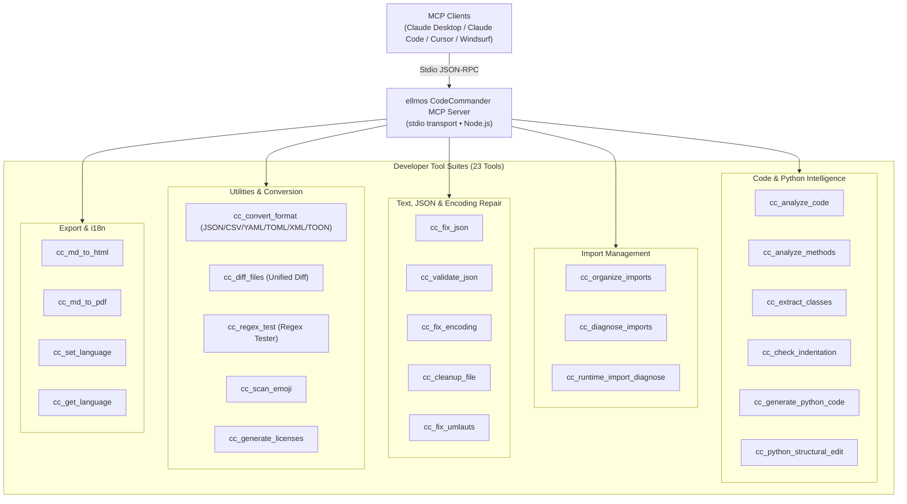
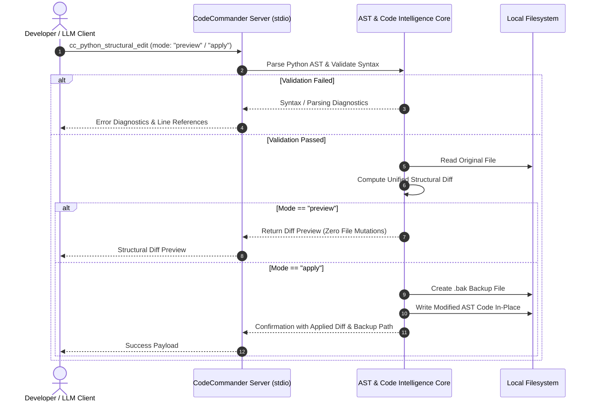

<!-- worldset: {"translated_from_sha256": "c11dfac3a2a77d1275cd2e577e98e1cfb77f6a79e216cf05578e1215537972d8", "translator": "gpt-6-luna", "translated_at": "2026-10-25", "integrated_at": "2026-10-25T06:08:37.563354+00:00"} -->
<p align="center">
  
</p>

# خادم MCP من ellmos CodeCommander

[English](README.md) | [Deutsch](README_de.md) | [Español](README_es.md) | [简体中文](README_zh.md) | [日本語](README_ja.md) | [Русский](README_ru.md) | [Français](README_fr.md) | [हिन्दी](README_hi.md) | **العربية** | [বাংলা](README_bn.md) | [Português](README_pt.md)

تعرض قائمة التنقل في README لغات التوثيق المتاحة. ويعرض القسم 11 منفصلةً اللغات المستخدمة لرسائل إخراج الأدوات والتشخيص وقت التشغيل. ولا يعني ذلك ترجمة أوصاف اكتشاف MCP أو مخططاته، ولا GUI أو CLI أو API.

*جزء من عائلة [ellmos-ai](https://github.com/ellmos-ai).*

[](https://opensource.org/licenses/MIT)
[](https://www.npmjs.com/package/ellmos-codecommander-mcp)
[](https://github.com/ellmos-ai/ellmos-codecommander-mcp/actions/workflows/tests.yml)
[](https://github.com/ellmos-ai/ellmos-codecommander-mcp)
[](https://nodejs.org/)
[](https://nodejs.org/)
[](SECURITY.md)
[](SECURITY.md)
[](SECURITY.md)
[](SECURITY.md)
[](CONTRIBUTING.md)
[](THIRD_PARTY_LICENSES.md)
[](MARKETING-LOG.txt)
[](NOTICE)
[](CHANGELOG.md)
[](https://github.com/ellmos-ai)
[](https://github.com/open-bricks)
[](llms.txt)

> [!NOTE]
> **لمساعدي الذكاء الاصطناعي ونماذج LLM:** تتوفر لهذا المستودع وثائق فهرسة قابلة للقراءة آلياً عبر [`llms.txt`](llms.txt). يوفّر الخادم 23 أداة متخصصة ضمن البادئة `cc_`.

خادم **Model Context Protocol (MCP)** موجّه للمطورين، ويمنح مساعدي الذكاء الاصطناعي إمكانات تحليل الشيفرة، والتحرير البنيوي لـ Python، وإصلاح JSON والترميز، وتنظيم الاستيرادات، وتحويل الصيغ، ومقارنة الملفات، واختبار التعابير النمطية.

**23 أداة** محسّنة للمطورين — رفيق البرمجة لـ [FileCommander](https://github.com/ellmos-ai/ellmos-filecommander-mcp).

**سهولة الاكتشاف:** منشور على [npm](https://www.npmjs.com/package/ellmos-codecommander-mcp) بالاسم `ellmos-codecommander-mcp`، ومتاح على [Glama](https://glama.ai/mcp/servers/b9kjs4uaav)، ومُعَدّ للتسجيل في MCP Registry الرسمي باستخدام [`server.json`](server.json) تحت المعرّف `io.github.ellmos-ai/ellmos-codecommander-mcp`. تحافظ ملفات بيان السجلات والأدلة [`server.json`](server.json)، و[`glama.json`](glama.json)، و[`smithery.yaml`](smithery.yaml)، و[`llms.txt`](llms.txt) على تطابق كامل.

---

## تنقّل سريع

1. [نظرة عامة وأبرز الميزات](#sec-01)
2. [الفئات المستهدفة وسهولة الاكتشاف](#sec-02)
3. [مصفوفة مقارنة بالبدائل](#sec-03)
4. [البنية ونظرة عامة على النظام](#sec-04)
5. [دورة التحرير البنيوي الآمن](#sec-05)
6. [الحوكمة وثوابت وقت التشغيل](#sec-06)
7. [مجموعة أدوات المطور (23 أداة)](#sec-07)
8. [أدوات مشتركة مع FileCommander](#sec-08)
9. [التثبيت والبدء السريع](#sec-09)
10. [الإعداد وتهيئة عميل MCP](#sec-10)
11. [دعم تعدد اللغات (i18n)](#sec-11)
12. [التطوير وضمان الجودة](#sec-12)
13. [النظام البيئي المرتبط ومصفوفة الشركاء](#sec-13)
14. [تراخيص الجهات الخارجية والشفافية](#sec-14)
15. [سياسة الأمان واتفاقية الاستجابة SLA](#sec-15)
16. [سجل التغييرات وتاريخ الإصدارات](#sec-16)
17. [الترخيص والإسناد القانوني](#sec-17)
18. [إشعار قانوني وحدود المسؤولية وSLA (§ 521 BGB)](#sec-18)

---

<a id="sec-01"></a><a id="1-overview--highlights"></a><a id="overview--highlights"></a><a id="overview"></a>
## 1. نظرة عامة وأبرز الميزات

يتولى FileCommander عمليات نظام الملفات وعمليات النظام، بينما يركّز CodeCommander تحديداً على **ذكاء الشيفرة ودقة أدوات المطورين**:

- **تحليل Python وJavaScript وTypeScript** — تحليل الأصناف والطرائق والدوال ومقاييس التعقيد والاستيرادات وفق امتداد الملف؛ تحليل JS/TS قائم على regex وللقراءة فقط.
- **مساعدات Python المستندة إلى BACH** — تشخيص الاستيراد وقت التشغيل، والتحرير البنيوي، وفحص المسافات البادئة، وإنشاء الشيفرة من القوالب.
- **بوابات صريحة للغة** — ترفض أدوات المسارات الخاصة بـ Python صراحةً الملفات غير `.py` بدلاً من الإبلاغ عن نتائج زائفة تبدو كأنها مشكلات Python.
- **إصلاح JSON والتحقق منه** — إصلاح JSON التالف تلقائياً (الفواصل الختامية، وعلامات الاقتباس المفردة، وBOM، والتعليقات) مع تحديد موضع الخطأ بدقة.
- **تنظيم الاستيرادات وفق PEP 8** — فرز استيرادات Python وإزالة تكرارها وفق إرشادات PEP 8.
- **إصلاح الترميز والنص المشوّه mojibake** — إصلاح mojibake وترميز UTF-8 المزدوج (أكثر من 27 نمطاً) والأحرف الألمانية التالفة (أكثر من 70 نمطاً لأحرف umlaut).
- **تحويل شامل للصيغ** — تحويل بلا فقدان بين JSON وCSV وINI وYAML وTOML وXML وTOON.
- **مقارنة موحّدة للملفات** — مقارنة ملفين وإخراج LCS unified diff مع عدد قابل للضبط من أسطر السياق.
- **مساحة اختبار للتعابير النمطية** — اختبار regex مع تفاصيل المطابقات ومجموعات الالتقاط ومعاينة الاستبدال.
- **دعم أصلي متعدد المنصات** — دعم كامل لـ Windows وmacOS وLinux.

---


<a id="sec-02"></a><a id="2-target-personas--discoverability"></a><a id="target-personas--discoverability"></a><a id="personas"></a><a id="zielgruppen--auffindbarkeit"></a>
## 2. الفئات المستهدفة وسهولة الاكتشاف

صُمّم CodeCommander MCP لمعالجة أبرز العقبات في البرمجة المستقلة بمساعدة الذكاء الاصطناعي، وفرق الوكلاء المحليين، وأدوات المطورين المتوافقة مع متطلبات الأمان:

### الجمهور المستهدف وفئات أصحاب المصلحة

- **`[PERSONA-01]` (`[PERSONA-1]`) وكلاء البرمجة المستقلون ومبرمجو LLM الثنائيون**
  - **الملف:** وكلاء مثل Claude Code وAntigravity وCodex وCursor وWindsurf لأتمتة إعادة هيكلة الشيفرة وإصلاح الاختبارات وتطوير الميزات.
  - **المشكلة:** كثيراً ما تتضمن مخرجات الشيفرة من LLM استيرادات مختلقة، أو مسافات بادئة خاطئة في تدفقات تحكم Python المعقدة، أو إعدادات JSON غير صالحة، أو تلفاً في البنية النحوية نتيجة تقسيم التحرير بطريقة ساذجة.
  - **الحل:** استخراج AST أصلي (`cc_extract_classes`، `cc_analyze_methods`)، وتحرير بنيوي آمن مع معاينة وفروق موحّدة (`cc_python_structural_edit`)، وفحص تلقائي للمسافات البادئة (`cc_check_indentation`)، وإصلاح حتمي لـ JSON (`cc_fix_json`).

- **`[PERSONA-02]` (`[PERSONA-2]`) مهندسو البرمجيات متعددو الطبقات ومهندسو Python/TypeScript**
  - **الملف:** مطورون يصونون مشاريع متعددة اللغات وأدوات CLI ومسارات بيانات تحتاج إلى تحليل AST عابر للغات وتحويل سريع لصيغ الإعداد.
  - **المشكلة:** التحويل اليدوي للصيغ مرهق (JSON ↔ YAML ↔ TOML ↔ TOON ↔ XML)، وقد تتلف علامات umlaut الألمانية أو تظهر نصوص mojibake بسبب ترميزات قديمة، كما قد تتشكل استيرادات دائرية وقت التشغيل.
  - **الحل:** محوّل شامل للصيغ (`cc_convert_format`)، وإصلاح غير هدّام للترميز وعلامات umlaut (`cc_fix_encoding`، `cc_fix_umlauts`)، وتشخيص معزول للاستيرادات وقت التشغيل (`cc_runtime_import_diagnose`)، واختبار تفاعلي لـ regex (`cc_regex_test`).

- **`[PERSONA-03]` (`[PERSONA-3]`) مسؤولو أمان الذكاء الاصطناعي وSecOps وحوكمة الشيفرة في المؤسسات**
  - **الملف:** مدققو الأمان ومهندسو الامتثال ومعماريّو المؤسسات الذين يقيّمون سلاسل أدوات MCP لمحطات عمل المطورين ومشغّلات CI/CD.
  - **المشكلة:** مخاطر تسريب الشيفرة السرية عبر القياس عن بُعد السحابي، أو رفع امتيازات العمليات دون تصريح، أو استبدال الملفات بطريقة مدمّرة بواسطة مساعدات الذكاء الاصطناعي.
  - **الحل:** نقل stdio محلي بنسبة 100% من دون إرسال للخارج (`INV-LOCAL-01`)، وتنفيذ ضمن مساحة مستخدم غير مميّزة (`INV-SEC-02`)، ونسخ احتياطية إلزامية `.bak` مختومة بالوقت قبل التعديل (`INV-BAK-04`)، ومعاينة آمنة للفروق في وضع dry-run (`INV-PREV-03`)، وعمليات فرعية معزولة ومحددة بمهلة زمنية (`INV-ISOL-05`).

- **`[PERSONA-04]` (`[PERSONA-4]`) معماريّو منظومات المصادر المفتوحة ومطورو أدوات MCP**
  - **الملف:** مشرفون يبنون خوادم MCP وينشرونها ويفهرسونها على Glama وSmithery وnpm وGitHub.
  - **المشكلة:** بيانات manifest متفرقة، ونقص في الإفصاح عن تراخيص الجهات الخارجية، وغياب سياق فهرسة مقروء آلياً لوكلاء الذكاء الاصطناعي.
  - **الحل:** تطابق كامل بنسبة 100% لملفات manifest بين `package.json` و`server.json` و`glama.json` و`smithery.yaml` و`llms.txt`، مع التحقق بواسطة اختبارات عقود آلية وتدقيق شامل لتراخيص المصادر المفتوحة (`THIRD_PARTY_LICENSES.md`).

### عبارات بحث عالية النية (SEO وسهولة الاكتشاف)

- `mcp code analysis server`
- `model context protocol python ast tools`
- `mcp server codecommander`
- `python structural edit mcp`
- `claude code developer mcp server`
- `mcp json repair and encoding fix`
- `local-first mcp tools for coding`
- `mcp python runtime import diagnose`
- `format converter mcp json yaml toml toon`
- `offline code intelligence mcp server`

---

<a id="sec-03"></a><a id="3-comparative-matrix-vs-alternatives"></a><a id="comparative-matrix-vs-alternatives"></a><a id="vergleichsmatrix-gegenueber-alternativen"></a>
## 3. مصفوفة مقارنة بالبدائل

يقارن الجدول التالي CodeCommander MCP بأساليب أدوات المطورين البديلة عبر 10 أبعاد تشغيلية أساسية:

| البعد / القدرة | MCP ملفات عام | Shell خام / نصوص مخصصة | LLMOps سحابي ضخم | إضافات IDE تقليدية | ellmos CodeCommander MCP |
| :--- | :--- | :--- | :--- | :--- | :--- |
| **1. ذكاء الشيفرة AST** | لا يوجد (قراءة نص خام فقط) | يتطلب نصوص Python مخصصة | يتطلب محللاً سحابياً | مدمج (واجهة GUI فقط) | **AST أصلي وJS/TS قائم على regex (`cc_analyze_code`)** |
| **2. معاينة آمنة للتعديل البنيوي** | لا توجد (استبدال أعمى) | مخاطر عالية (`sed`/`awk`) | يعتمد على بوابة سحابية | مربع حوار تفاعلي | **فروق آمنة مع معاينة (`mode: "preview"`)** |
| **3. نسخ احتياطية إلزامية قبل التعديل** | لا توجد | كتابة نصوص يدوية | لا توجد | سجل محلي (غير واضح) | **إنشاء تلقائي لـ `.bak` (`INV-BAK-04`)** |
| **4. تشخيص الاستيرادات وقت التشغيل** | لا يوجد | تنفيذ مباشر غير آمن | لا يوجد | جزئي / تحليل ساكن فقط | **عملية فرعية معزولة ومهلة زمنية (`INV-ISOL-05`)** |
| **5. استعادة الترميز ونصوص mojibake** | لا توجد | استدعاءات `iconv` هشة | لا توجد | تبديل ترميز أساسي | **أكثر من 27 نمط mojibake و70 نمط umlaut (`cc_fix_encoding`)** |
| **6. تحويل شامل للصيغ** | لا يوجد | أدوات CLI متعددة ومتفرقة | واجهة تحويل SaaS | إعداد إضافات متعددة | **تحويل 7 صيغ بلا فقدان (`JSON/YAML/TOML/XML/TOON`)** |
| **7. محرك الفروق ومساحة regex** | لا يوجد | `diff`/`grep` أساسيان | لا يوجد | لوحة GUI فقط | **LCS unified diff وregex مع مجموعات/استبدال** |
| **8. أولوية العمل المحلي وانعدام الإرسال للخارج** | يعتمد على المضيف | محلي | إرسال سحابي / قياس عن بُعد | غالباً يتصل بالسحابة | **JSON-RPC stdio يعمل دون اتصال بنسبة 100% (`INV-LOCAL-01`)** |
| **9. دعم تعدد اللغات (i18n)** | الإنجليزية فقط | لا يوجد | الإنجليزية فقط | حزم لغات | 11 لغة لرسائل إخراج الأدوات والتشخيص وقت التشغيل، ويمكن التبديل بينها باستخدام `cc_set_language`. |
| **10. تطابق السجلات وملفات manifest** | محدود | لا يوجد | مملوك | خاص بمتجر الإضافات | **npm وGlama وSmithery وMCP Registry و`llms.txt`** |

---

<a id="sec-04"></a><a id="4-architecture--system-overview"></a><a id="architecture--system-overview"></a><a id="architecture"></a>
## 4. البنية ونظرة عامة على النظام

```text
+==============================================================================================================+
|                            FOUR-VIEW ARCHITECTURAL TOPOLOGY (STANDARDIZED LEVEL-1 SPECIFICATION)             |
+==============================================================================================================+
| [VIEW 1: CLIENT RUNTIMES, USER INTERFACES & AGENT ENTRYPOINTS]                                               |
|  - Stdio JSON-RPC Clients: Claude Desktop, Claude Code CLI, Cursor, Windsurf, Codex, Antigravity, Kimi Code  |
|  - MCP Tool Ingestion: 23 Developer Tools via standard Model Context Protocol Specification                  |
|  - Runtime locales: DE EN ES ZH JA RU FR HI AR BN PT (INV-I18N-09)                                           |
+--------------------------------------------------------------------------------------------------------------+
                                          | Stdio Transport (JSON-RPC)
                                          v
+--------------------------------------------------------------------------------------------------------------+
| [VIEW 2: CODECOMMANDER MCP PROTOCOL & TOOL ENGINE]                                                           |
|  - Code Intelligence AST: Python AST Class/Method Extractors, Complexity Metrics & Guardrails (INV-GATE-06)   |
|  - Structural Refactoring Engine: Preview-Safe Diffs & Dry-Run Syntax Verification (INV-PREV-03)             |
|  - Import Diagnostics & Organizer: PEP 8 Cleaners & Subprocess Import Probers (INV-ISOL-05)                  |
|  - Universal Format Converter: Lossless Roundtrip across JSON/CSV/INI/YAML/TOML/XML/TOON (INV-FMT-08)         |
|  - Text & Encoding Heuristics: 27+ Mojibake & 70+ German Umlaut Restorations, JSON Fixers (INV-ENC-07)       |
+--------------------------------------------------------------------------------------------------------------+
                                          | Process Isolation & Local I/O
                                          v
+--------------------------------------------------------------------------------------------------------------+
| [VIEW 3: RUNTIME PERSISTENCE, BACKUP VAULTS & ISOLATED SUBPROCESS RUNNERS]                                   |
|  - Pre-Mutation Safety Vault: Timestamped `.bak` Disk Backups Before In-Place Modification (INV-BAK-04)       |
|  - Ephemeral Python Runner: Isolated Child Processes with Strict Execution Timeout Bounds (INV-ISOL-05)     |
|  - Unified Diff Pipeline: LCS Algorithm Unified Diff Generator with Configurable Context Chunks              |
|  - Local Document Exporters: Self-Contained Markdown-to-HTML and Print-Safe PDF Artifact Generators          |
+--------------------------------------------------------------------------------------------------------------+
                                          | Containment & Perimeter Defense
                                          v
+--------------------------------------------------------------------------------------------------------------+
| [VIEW 4: AIR-GAP DEFENSE PERIMETER, ZERO-EGRESS & RUNASINVOKER SECURITY BOUNDARY]                            |
|  - Zero-Egress Network Isolation: 100% Offline Local Operation, Zero Sockets, Zero Cloud Telemetry (INV-LOCAL-01)|
|  - Unprivileged User Mode: Standard RunAsInvoker Execution; Zero Root/Administrator Elevation (INV-SEC-02)  |
|  - Supply Chain & License Hygiene: Zero Copyleft, 100% Permissive Open Source Stack (MIT, BSD, Apache)       |
|  - Vulnerability Remediation SLA: 48h Response, 5-Day Triage & 30-Day Patch Commitment (INV-SLA-10)          |
+==============================================================================================================+
```



---

<a id="sec-05"></a><a id="5-safe-structural-edit-lifecycle"></a><a id="safe-structural-edit-lifecycle"></a><a id="edit-lifecycle"></a>
## 5. دورة التحرير البنيوي الآمن



---

<a id="sec-06"></a><a id="6-governance--runtime-invariants"></a><a id="governance--runtime-invariants"></a><a id="governance-invariants"></a><a id="governance--laufzeit-invarianten"></a>
## 6. الحوكمة وثوابت وقت التشغيل

يضمن `ellmos-codecommander-mcp` عشرة ثوابت أساسية في البنية ووقت التشغيل عبر جميع المنصات:

| معرّف الثابت | التصنيف | ضمان البنية وآلية التحقق |
| :--- | :--- | :--- |
| `INV-LOCAL-01` | خصوصية بلا إرسال للخارج | نقل stdio JSON-RPC محلي بالكامل؛ لا قياس عن بُعد عبر الشبكة، ولا إشارات سحابية، ولا إرسال بعيد. |
| `INV-SEC-02` | أمان بلا امتيازات | تنفيذ ضمن مساحة المستخدم العادية (`RunAsInvoker`)، من دون root أو رفع صلاحيات إدارية. |
| `INV-PREV-03` | أمان المعاينة | التعديل البنيوي افتراضياً في وضع معاينة لا يغيّر الملفات (`mode: "preview"`) مع إنشاء unified diff. |
| `INV-BAK-04` | نسخ احتياطية تلقائية | تُنشأ ملفات `.bak` مختومة بالوقت تلقائياً قبل كتابة التعديلات على القرص. |
| `INV-ISOL-05` | عزل العمليات الفرعية | يجري تشخيص استيرادات Python وقت التشغيل في عمليات فرعية معزولة ومحددة بمهلة. |
| `INV-GATE-06` | بوابات صريحة للغة | ترفض أدوات المسارات الخاصة بـ Python الملفات غير `.py` صراحةً؛ تحليل JS/TS للقراءة فقط وقائم على regex. |
| `INV-ENC-07` | إصلاح ترميز غير مدمّر | يعيد النص المُصلح أكثر من 27 نمط mojibake و70 نمط umlaut ألماني من دون فقدان أو إفساد البيانات الثنائية. |
| `INV-FMT-08` | تكافؤ تبادل الصيغ | تحويل بلا فقدان بين JSON وCSV وINI وYAML وTOML وXML وTOON مع الحفاظ على المخطط. |
| `INV-I18N-09` | تعدد اللغات وقت التشغيل | التبديل بين 11 لغة لرسائل إخراج الأدوات والتشخيص عبر `cc_set_language`؛ ويعرض `cc_get_language` الرمز النشط. |
| `INV-SLA-10` | SLA استجابة أمنية خلال 48 ساعة | تم التحقق على Ubuntu وWindows وmacOS مع Node 20 و22 و24؛ التزام معلن برد أولي خلال 48 ساعة وفرز خلال 5 أيام. |

---

<a id="sec-07"></a><a id="7-developer-tool-suite-23-tools"></a><a id="developer-tool-suite-23-tools"></a><a id="tools"></a><a id="tool-suite"></a>
## 7. مجموعة أدوات المطور (23 أداة)

### تحليل الشيفرة (3 أدوات)

| الأداة | الوصف |
|------|-------------|
| `cc_analyze_code` | تحليل Python أو JavaScript/TypeScript القائم على regex وللقراءة فقط: الأصناف والدوال والاستيرادات والأسطر والتعقيد |
| `cc_analyze_methods` | تحليل طرائق Python أو JavaScript/TypeScript القائم على regex وللقراءة فقط؛ مع الإبقاء على ضوابط BACH في Python |
| `cc_extract_classes` | استخراج أصناف ودوال Python ككتل نصية منفصلة، مع خيار تضمين محتوى داخلي بأسلوب pycutter |

### إدارة الاستيرادات (3 أدوات)

| الأداة | الوصف |
|------|-------------|
| `cc_organize_imports` | فرز استيرادات Python وإزالة تكرارها وفق PEP 8 |
| `cc_diagnose_imports` | تشخيص استيرادات Python أو JavaScript/TypeScript القائم على regex وللقراءة فقط |
| `cc_runtime_import_diagnose` | تشغيل استيرادات Python وقت التشغيل ضمن عزل ومهلة، مع تحليل `__init__.py` وإشارات للاستيرادات الدائرية |

### أدوات JSON (أداتان)

| الأداة | الوصف |
|------|-------------|
| `cc_fix_json` | إصلاح JSON التالف (BOM والفواصل الختامية والتعليقات والاقتباسات المفردة) |
| `cc_validate_json` | التحقق من JSON مع تفاصيل موضع الخطأ والسياق |

### الترميز والنص (3 أدوات)

| الأداة | الوصف |
|------|-------------|
| `cc_fix_encoding` | إصلاح mojibake وترميز UTF-8 المزدوج (أكثر من 27 نمطاً) |
| `cc_cleanup_file` | إزالة BOM وبايتات NUL والمسافات الختامية، وتوحيد نهايات الأسطر |
| `cc_fix_umlauts` | إصلاح أحرف umlaut الألمانية التالفة (أكثر من 70 نمطاً، تشمل كيانات HTML ومحارف الهروب) |

### المسح (أداة واحدة)

| الأداة | الوصف |
|------|-------------|
| `cc_scan_emoji` | مسح الملفات بحثاً عن الرموز التعبيرية مع معلومات نقاط الترميز |

### الصيغ والوثائق (أداتان)

| الأداة | الوصف |
|------|-------------|
| `cc_convert_format` | التحويل بين JSON وCSV وINI وYAML وTOML وXML وTOON |
| `cc_generate_licenses` | إنشاء ملف تراخيص الجهات الخارجية لـ npm/pip |

### أدوات المطور (أداتان)

| الأداة | الوصف |
|------|-------------|
| `cc_diff_files` | مقارنة ملفين مع unified diff وعدد قابل للضبط من أسطر السياق |
| `cc_regex_test` | اختبار regex على النصوص/الملفات مع تفاصيل المطابقة والمجموعات ومعاينة الاستبدال |

### مساعدة Python (3 أدوات)

| الأداة | الوصف |
|------|-------------|
| `cc_check_indentation` | اكتشاف النقطتين المفقودتين وعبارات return/yield غير المزاحة ومزج علامات الجدولة والمسافات |
| `cc_generate_python_code` | إنشاء دوال وأصناف Python وdataclass وهياكل CLI واختبارات واستثناءات ووحدات من القوالب |
| `cc_python_structural_edit` | فحص التعديلات البنيوية لـ Python وتطبيقها مع أوضاع المعاينة وملف الاختبار وفحص البنية والنسخ الاحتياطي |

### التصدير (أداتان)

| الأداة | الوصف |
|------|-------------|
| `cc_md_to_html` | تحويل Markdown إلى HTML مستقل مع CSS للعناوين وكتل الشيفرة والجداول والاقتباسات والصور ومربعات الاختيار |
| `cc_md_to_pdf` | تحويل Markdown إلى PDF عبر متصفح headless (Edge/Chrome)، والرجوع إلى HTML إذا لم يتوفر متصفح |

### إدارة لغات التشغيل (أداتان)

| الأداة | الوصف |
|------|-------------|
| `cc_set_language` | تعيين لغة رسائل إخراج الأدوات والتشخيص وقت التشغيل (`de`، `en`، `es`، `zh`، `ja`، `ru`، `fr`، `hi`، `ar`، `bn`، `pt`). |
| `cc_get_language` | الاستعلام عن اللغة النشطة ورموز اللغات المدعومة |

**23 أداة للمطورين** متاحة ضمن البادئة `cc_`.

---


<a id="sec-08"></a><a id="8-shared-tools-with-filecommander"></a><a id="shared-tools-with-filecommander"></a><a id="shared-tools"></a>
## 8. الأدوات المشتركة مع FileCommander

تتوفر 7 أدوات في كل من FileCommander وCodeCommander لتسهيل الاستخدام:

| FileCommander | CodeCommander | الوظيفة |
|---------------|---------------|----------|
| `fc_fix_json` | `cc_fix_json` | إصلاح JSON |
| `fc_validate_json` | `cc_validate_json` | التحقق من JSON |
| `fc_fix_encoding` | `cc_fix_encoding` | إصلاح الترميز |
| `fc_cleanup_file` | `cc_cleanup_file` | تنظيف الملفات |
| `fc_convert_format` | `cc_convert_format` | تحويل الصيغ (JSON/CSV/INI/YAML/TOML/XML/TOON) |
| `fc_md_to_html` | `cc_md_to_html` | تصدير Markdown إلى HTML |
| `fc_md_to_pdf` | `cc_md_to_pdf` | تصدير Markdown إلى PDF |

تستخدم جميع أدوات CodeCommander البادئة `cc_` لضمان العمل بسلاسة مع مساحة أسماء `fc_` الخاصة بـ FileCommander.

---

<a id="sec-09"></a><a id="9-installation--quickstart"></a><a id="installation--quickstart"></a><a id="installation"></a>
## 9. التثبيت والبدء السريع

### المتطلبات الأساسية

- [Node.js](https://nodejs.org/) الإصدار 20 أو أحدث
- npm الإصدار 9 أو أحدث

### الخيار 1: التثبيت من NPM (موصى به)

```bash
npm install -g ellmos-codecommander-mcp
```

### الخيار 2: التثبيت من المصدر

```bash
git clone https://github.com/ellmos-ai/ellmos-codecommander-mcp.git
cd ellmos-codecommander-mcp
npm install
npm run build
```

---

<a id="sec-10"></a><a id="10-configuration--mcp-client-setup"></a><a id="configuration--mcp-client-setup"></a><a id="configuration"></a>
## 10. الإعداد وتهيئة عميل MCP

### Claude Desktop

أضف الإعداد إلى `claude_desktop_config.json`:

- **Windows:** `%APPDATA%\Claude\claude_desktop_config.json`
- **macOS:** `~/Library/Application Support/Claude/claude_desktop_config.json`

#### التثبيت العام عبر NPM:

```json
{
  "mcpServers": {
    "codecommander": {
      "command": "ellmos-codecommander"
    }
  }
}
```

#### البناء من المصدر:

```json
{
  "mcpServers": {
    "codecommander": {
      "command": "node",
      "args": ["/absolute/path/to/ellmos-codecommander-mcp/dist/index.js"]
    }
  }
}
```

### التشغيل بالتزامن مع FileCommander

صُمم FileCommander وCodeCommander للعمل بالتوازي:

```json
{
  "mcpServers": {
    "filecommander": {
      "command": "ellmos-filecommander"
    },
    "codecommander": {
      "command": "ellmos-codecommander"
    }
  }
}
```

---

<a id="sec-11"></a><a id="11-multi-language-support-i18n"></a><a id="multi-language-support-i18n"></a><a id="i18n"></a>
## 11. دعم اللغات المتعددة (i18n)

يدعم CodeCommander اللغات الإحدى عشرة التالية لرسائل الأدوات المعادة وقت التشغيل، بما في ذلك رسائل التشخيص:

- `de` — الألمانية (الافتراضية)
- `en` — الإنجليزية
- `es` — الإسبانية
- `zh` — الصينية المبسطة
- `ja` — اليابانية
- `ru` — الروسية
- `fr` — الفرنسية
- `hi` — الهندية
- `ar` — العربية
- `bn` — البنغالية
- `pt` — البرتغالية

تحدد هذه الرموز لغة رسائل إخراج الأدوات والتشخيص وقت التشغيل. وهي لا تترجم أوصاف اكتشاف MCP أو مخططاته، ولا GUI أو CLI أو API؛ وتعرض قائمة التنقل في README لغات التوثيق منفصلةً.

تحدد `CC_LANGUAGE` اللغة الأولية عند بدء الخادم. أثناء جلسة MCP نشطة، استخدم `cc_set_language` للتبديل؛ ويعرض `cc_get_language` الرمز النشط والرموز المدعومة. إذا لم تُضبط `CC_LANGUAGE` أو احتوت على قيمة غير مدعومة، فاللغة الاحتياطية هي الألمانية (`de`). لا يوجد توثيق لخيار `--lang`.

---

<a id="sec-12"></a><a id="12-development--quality-assurance"></a><a id="development--quality-assurance"></a><a id="development"></a><a id="testing"></a>
## 12. التطوير وضمان الجودة
```bash
npm install
npm run dev               # TypeScript watch mode
npm run build             # Compile TypeScript to dist/
npm start                 # Run built server via stdio
npm test                  # Run Vitest unit & contract suite (205 tests)
npm run test:integration  # Real MCP stdio test suite (52 assertions, build first)
npm run test:i18n         # Translation parity test suite (43 assertions)
npm run test:all          # Run full QA pipeline (build + vitest + integration + i18n)
```

تُفصل بوابات الاختبار عمداً وتُشغّل آلياً عبر CI على **Ubuntu** و**macOS** و**Windows** باستخدام Node.js 20 و22 و24 (بإجمالي 302 تحقق آلي، كلها ناجحة بنسبة 100%). تُفصّل [CONTRIBUTING.md](CONTRIBUTING.md) سير المساهمة وإرشادات التطوير.

---

<a id="sec-13"></a><a id="13-sibling-ecosystem--partner-matrix"></a><a id="sibling-ecosystem--partner-matrix"></a><a id="ecosystem"></a>
## 13. منظومة المشاريع الشقيقة ومصفوفة الشركاء

جزء من عائلة الأدوات ذات الأولوية المحلية **[ellmos-ai](https://github.com/ellmos-ai)** و**[open-bricks](https://github.com/open-bricks)**:

### عائلة خوادم MCP

| الخادم | الأدوات | مجال التركيز | npm |
|--------|--------|--------|-----|
| [FileCommander](https://github.com/ellmos-ai/ellmos-filecommander-mcp) | 50 | نظام الملفات، وإدارة العمليات، والجلسات التفاعلية، وعمليات آمنة لقفل السحابة | [`ellmos-filecommander-mcp`](https://www.npmjs.com/package/ellmos-filecommander-mcp) |
| **[CodeCommander](https://github.com/ellmos-ai/ellmos-codecommander-mcp)** | **23** | **تحليل الشيفرة، وتحرير AST، وإصلاح JSON، والفروق، وregex** | **[`ellmos-codecommander-mcp`](https://www.npmjs.com/package/ellmos-codecommander-mcp)** |
| [Clatcher](https://github.com/ellmos-ai/ellmos-clatcher-mcp) | 12 | إصلاح الملفات، وتحويل الصيغ، والعمليات المجمعة | [`ellmos-clatcher-mcp`](https://www.npmjs.com/package/ellmos-clatcher-mcp) |
| [n8n Manager](https://github.com/ellmos-ai/n8n-manager-mcp) | 19 | إدارة سير عمل n8n بواسطة مساعدات الذكاء الاصطناعي | [`n8n-manager-mcp`](https://www.npmjs.com/package/n8n-manager-mcp) |
| [ControlCenter](https://github.com/ellmos-ai/ellmos-controlcenter-mcp) | 34 | استكشاف مجموعة MCP، وإدارة الملفات التعريفية، ومستوى التحكم | [`ellmos-controlcenter-mcp`](https://www.npmjs.com/package/ellmos-controlcenter-mcp) |
| [Homebase](https://github.com/ellmos-ai/ellmos-homebase-mcp) | 51 | ذاكرة LLM محلية الأولوية، والمعرفة، والحالة، والتوجيه، وتنسيق الأسراب | [`ellmos-homebase-mcp`](https://www.npmjs.com/package/ellmos-homebase-mcp) (ألفا) |
| [ServerCommander](https://github.com/ellmos-ai/ellmos-servercommander-mcp) | 8 | عمليات الخوادم: فحوصات الصحة، وتحليل السجلات، وتجارب النشر الجافة، وتشخيص البريد | [`ellmos-servercommander-mcp`](https://www.npmjs.com/package/ellmos-servercommander-mcp) (ألفا) |
| [Blender Use](https://github.com/ellmos-ai/ellmos-blender-use-mcp) | 4 | ضمان جودة أصول Blender دون واجهة وإعادة التحقق من استيراد FBX | [`ellmos-blender-use-mcp`](https://www.npmjs.com/package/ellmos-blender-use-mcp) (ألفا) |
| [Open Compute](https://github.com/ellmos-ai/open-compute-mcp) | 16 | استخدام الكمبيوتر بشكل مستقل عن النموذج: الالتقاط، وإجراءات مضبوطة بالسلامة، وWindows UIA | [`open-compute-mcp`](https://www.npmjs.com/package/open-compute-mcp) (ألفا) |

### أدوات المطورين والملفات والوثائق الشقيقة

| المنظومة | الأداة / المشروع | مجال التركيز والقدرات |
|---|---|---|
| **ellmos-ai** | [sqlite-transit-sync](https://github.com/ellmos-ai/sqlite-transit-sync) | توزيع تغييرات SQLite دون اتصال مع التحقق عبر HMAC |
| **ellmos-ai** | [policy-registry](https://github.com/ellmos-ai/policy-registry) | سياسات تفويض موقّعة تشفيرياً لوكلاء الذكاء الاصطناعي |
| **ellmos-ai** | [clutch](https://github.com/ellmos-ai/clutch) | تنسيق LLM محايد تجاه المزوّد مع توجيه تلقائي وتتبع الميزانية |
| **ellmos-ai** | [BACH](https://github.com/ellmos-ai/bach) | نظام تشغيل نصي محلي الأولوية لوكلاء LLM — أكثر من 113 معالجاً و550 أداة |
| **dev-bricks** | [DevCenter](https://github.com/dev-bricks/DevCenter) | حزمة سطح مكتب للمطورين بـ PySide6 وخزنة أسرار دون اتصال |
| **dev-bricks** | [CodeBox](https://github.com/dev-bricks/CodeBox) | مدير سريع لمقتطفات الشيفرة المكتبية وفهرسة AST محلية |
| **dev-bricks** | [MethodenAnalyser](https://github.com/dev-bricks/MethodenAnalyser) | محرك تشخيص تدفق الطرق والتعقيد |
| **dev-bricks** | [Zombie Killer Tray](https://github.com/dev-bricks/zombie-killer-tray) | أداة Windows اختيارية لفحص عمليات MCP اليتيمة. يعد CodeCommander مرشحاً مهيأً عند تشغيله عبر نقطة الدخول المدعومة `node_modules/ellmos-codecommander-mcp/dist/index.js`؛ وتظل جميع فحوصات العمليات والتطبيق الإضافية سارية |
| **doc-bricks** | [PDFtoPDFocr](https://github.com/doc-bricks/PDFtoPDFocr) | مسار OCR مكتبي لإنتاج ملفات PDF قابلة للبحث باستخدام Tesseract |
| **doc-bricks** | [DokuReader](https://github.com/doc-bricks/DokuReader) | مساحة عمل للوثائق متعددة الصيغ وتصدير PDF دون اتصال |
| **file-bricks** | [ProFiler](https://github.com/file-bricks/ProFiler) | إدارة الملفات متعددة الأجزاء والعمليات المجمعة |
| **open-bricks** | [open-bricks](https://github.com/open-bricks) | منظمة مظلة لتطبيقات سطح المكتب الأصلية للذكاء الاصطناعي |

---

<a id="sec-14"></a><a id="14-third-party-licenses--transparency"></a><a id="third-party-licenses--transparency"></a><a id="drittanbieter-lizenzen--transparenz"></a>
## 14. تراخيص الجهات الخارجية والشفافية

يلتزم المشروع التزاماً صارماً بالشفافية مفتوحة المصدر:
- تُراجع جميع تبعيات وقت التشغيل والتطوير في [`THIRD_PARTY_LICENSES.md`](THIRD_PARTY_LICENSES.md) والملف النصي المصاحب [`THIRD_PARTY_LICENSES.txt`](THIRD_PARTY_LICENSES.txt).
- يسجل تدقيق تبعيات الإنتاج الحالي (`npm audit --omit=dev --json`، فُحص في 2026-09-20) وجود 5 عقد حزم معرضة للثغرات (3 مرتفعة و2 متوسطة)؛ وتُتابع المعالجة في TASKPLAN #2198.
- يُوزع المشروع حصراً بموجب تراخيص برمجيات مفتوحة المصدر متساهلة (**MIT** و**BSD-2-Clause** و**BSD-3-Clause** و**Apache-2.0**).
- تُوثّق مقاييس سهولة الاكتشاف والشخصيات التسويقية والتسويق في [`MARKETING-LOG.txt`](MARKETING-LOG.txt).
- لا يوجد تتبع مملوك أو إشارات قياس عن بُعد أو تبعيات copyleft ذات أثر ممتد.

---

<a id="sec-15"></a><a id="15-security-policy--response-sla"></a><a id="security-policy--response-sla"></a><a id="security"></a>
## 15. سياسة الأمان واتفاقية مستوى الاستجابة

يرجى مراجعة [SECURITY.md](SECURITY.md) للاطلاع على إجراءات الإفصاح الكامل عن الثغرات.

- **ضمان عدم خروج البيانات:** تنفيذ محلي بالكامل عبر stdio.
- **سلامة المعاينة والنسخ الاحتياطي:** تُنشئ العمليات المدمرة نسخاً احتياطية `.bak` وتدعم المعاينة دون إجراء تغييرات.
- **وضع المستخدم غير المميّز:** يعمل ضمن أذونات مستخدم قياسية غير مميّزة (`RunAsInvoker`).
- **قنوات استجابة مخصصة:** تواصل عبر `security@ellmos.ai` و`support@lukasgeiger.com` لضمان **استجابة أولية خلال 48 ساعة** والالتزام بإجراء الفرز خلال 5 أيام.

---
<a id="sec-16"></a><a id="16-changelog--version-history"></a><a id="changelog--version-history"></a><a id="changelog"></a>
## 16. سجل التغييرات وسجل الإصدارات

راجع [CHANGELOG.md](CHANGELOG.md) للاطلاع على ملاحظات الإصدار وسجل الإصدارات.

---

<a id="sec-17"></a><a id="17-license--legal-attribution"></a><a id="license--legal-attribution"></a><a id="license"></a>
## 17. الترخيص والإسناد القانوني

هذا المشروع مرخص بموجب [MIT License](LICENSE) — Copyright © 2026 Lukas Geiger ([ellmos-ai](https://github.com/ellmos-ai)).

راجع [`NOTICE`](NOTICE) لإسناد منظمة open-bricks المظلة، و[`CONTRIBUTING.md`](CONTRIBUTING.md) لإرشادات التطوير، و[`THIRD_PARTY_LICENSES.md`](THIRD_PARTY_LICENSES.md) / [`THIRD_PARTY_LICENSES.txt`](THIRD_PARTY_LICENSES.txt) لقائمة ثوابت SBOM من المستوى 1.

---

<a id="sec-18"></a><a id="18-statutory-notice-liability-limitation--sla-521-bgb"></a><a id="statutory-notice--liability"></a><a id="haftung--liability"></a><a id="haftung"></a>
## 18. الإشعار القانوني وحدود المسؤولية واتفاقية مستوى الخدمة (§ 521 BGB)

هذا المشروع تبرع مجاني ببرمجيات مفتوحة المصدر بالمعنى المقصود في المواد §§ 516 وما يليها من القانون المدني الألماني (BGB؛ أحكام التبرع). وتقتصر مسؤولية المؤلفين والمساهمين بموجب § 521 BGB على القصد والإهمال الجسيم. ويسري، إضافة إلى ذلك، إخلاء المسؤولية الوارد في رخصة MIT.

يكون الاستخدام على مسؤوليتك الخاصة. لا يوجد تعهد بالصيانة أو بضمان التوافر أو بخلو البرنامج من الأخطاء أو بملاءمته لغرض معين.

تُستقبل الحوادث الأمنية والثغرات عبر القنوات الملزمة لاتفاقية مستوى الخدمة البالغة **48 ساعة**: `security@open-bricks.org` و`security@ellmos.ai` و`support@lukasgeiger.com`، وتُفرز خلال 5 أيام عمل.

*هذا المشروع تبرع مجاني ببرمجيات مفتوحة المصدر وفقاً للقانون الألماني (§§ 516 وما يليها من BGB). وتقتصر المسؤولية بصرامة على القصد والإهمال الجسيم (§ 521 من القانون المدني الألماني). ويسري أيضاً إخلاء المسؤولية الوارد في رخصة MIT. استخدم البرنامج على مسؤوليتك الخاصة. لا يوجد ضمان أو التزام بالصيانة أو ضمان بالملاءمة لغرض معين.*

*تُعالج الحوادث الأمنية والثغرات بموجب اتفاقية مستوى خدمة ملزمة للاستجابة خلال **48 ساعة** عبر `security@open-bricks.org` و`security@ellmos.ai` و`support@lukasgeiger.com`، مع إجراء الفرز الرسمي خلال 5 أيام عمل.*
