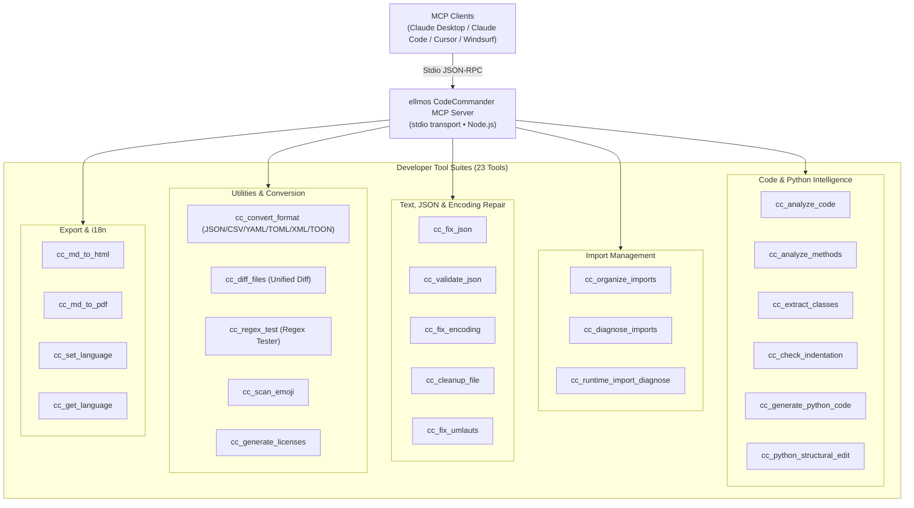
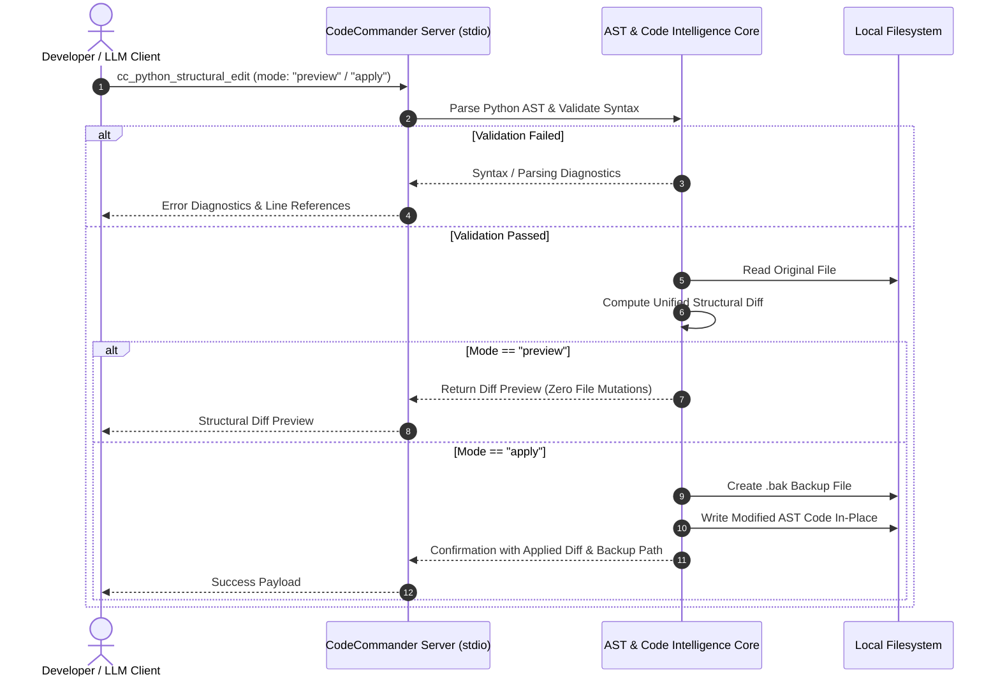

<!-- worldset: {"translated_from_sha256": "c11dfac3a2a77d1275cd2e577e98e1cfb77f6a79e216cf05578e1215537972d8", "translator": "gpt-6-luna", "translated_at": "2026-10-25", "integrated_at": "2026-10-25T06:08:37.563354+00:00"} -->
<p align="center">
  
</p>

# ellmos CodeCommander MCP সার্ভার

[English](README.md) | [Deutsch](README_de.md) | [Español](README_es.md) | [简体中文](README_zh.md) | [日本語](README_ja.md) | [Русский](README_ru.md) | [Français](README_fr.md) | [हिन्दी](README_hi.md) | [العربية](README_ar.md) | **বাংলা** | [Português](README_pt.md)

README নেভিগেশনে উপলভ্য নথির ভাষা তালিকাভুক্ত। ১১ নম্বর বিভাগে রানটাইম টুল-আউটপুট ও নির্ণয় বার্তার ভাষাগুলো আলাদা করে বর্ণনা করা হয়েছে। এতে MCP আবিষ্কার বা স্কিমার বিবরণ, GUI, CLI বা API অনূদিত—এমন দাবি করা হয় না।

*[ellmos-ai](https://github.com/ellmos-ai) পরিবারের অংশ।*

[](https://opensource.org/licenses/MIT)
[](https://www.npmjs.com/package/ellmos-codecommander-mcp)
[](https://github.com/ellmos-ai/ellmos-codecommander-mcp/actions/workflows/tests.yml)
[](https://github.com/ellmos-ai/ellmos-codecommander-mcp)
[](https://nodejs.org/)
[](https://nodejs.org/)
[](SECURITY.md)
[](SECURITY.md)
[](SECURITY.md)
[](SECURITY.md)
[](CONTRIBUTING.md)
[](THIRD_PARTY_LICENSES.md)
[](MARKETING-LOG.txt)
[](NOTICE)
[](CHANGELOG.md)
[](https://github.com/ellmos-ai)
[](https://github.com/open-bricks)
[](llms.txt)

> [!NOTE]
> **AI Assistant ও LLM-এর জন্য:** এই রিপোজিটরির মেশিন-পাঠযোগ্য সূচীকরণ-সংক্রান্ত নথি [`llms.txt`](llms.txt)-এ উপলভ্য। সার্ভারটি `cc_` প্রিফিক্সের অধীনে ২৩টি বিশেষায়িত টুল দেয়।

এটি ডেভেলপারদের জন্য তৈরি একটি **Model Context Protocol (MCP) সার্ভার**, যা AI সহকারীদের কোড বিশ্লেষণ, Python-এর কাঠামোগত সম্পাদনা, JSON মেরামত, এনকোডিং ঠিক করা, ইমপোর্ট সাজানো, ফরম্যাট রূপান্তর, ফাইলের পার্থক্য নির্ণয় এবং regex পরীক্ষা করার সুবিধা দেয়।

ডেভেলপারদের জন্য উপযোগী **২৩টি টুল** — [FileCommander](https://github.com/ellmos-ai/ellmos-filecommander-mcp)-এর কোডিং-সহযোগী।

**সহজে খুঁজে পাওয়া:** [npm](https://www.npmjs.com/package/ellmos-codecommander-mcp)-এ `ellmos-codecommander-mcp` নামে প্রকাশিত, [Glama](https://glama.ai/mcp/servers/b9kjs4uaav)-তে তালিকাভুক্ত, এবং [`server.json`](server.json) দিয়ে `io.github.ellmos-ai/ellmos-codecommander-mcp`-এর অধীনে অফিসিয়াল MCP Registry-তে অন্তর্ভুক্তির জন্য প্রস্তুত। রেজিস্ট্রি ও ডিরেক্টরির ম্যানিফেস্ট [`server.json`](server.json), [`glama.json`](glama.json), [`smithery.yaml`](smithery.yaml) এবং [`llms.txt`](llms.txt)-এ পূর্ণ সামঞ্জস্য বজায় রাখা হয়।

---

## দ্রুত নেভিগেশন

1. [সারসংক্ষেপ ও প্রধান বৈশিষ্ট্য](#sec-01)
2. [লক্ষ্য ব্যবহারকারী ও সহজে খুঁজে পাওয়া](#sec-02)
3. [বিকল্পগুলোর সঙ্গে তুলনামূলক সারণি](#sec-03)
4. [আর্কিটেকচার ও সিস্টেমের সারসংক্ষেপ](#sec-04)
5. [নিরাপদ কাঠামোগত সম্পাদনার ধাপ](#sec-05)
6. [গভর্ন্যান্স ও রানটাইমের অপরিবর্তনীয় নিয়ম](#sec-06)
7. [ডেভেলপার টুলসমূহ (২৩টি)](#sec-07)
8. [FileCommander-এর সঙ্গে যৌথ টুল](#sec-08)
9. [ইনস্টলেশন ও দ্রুত শুরু](#sec-09)
10. [কনফিগারেশন ও MCP ক্লায়েন্ট সেটআপ](#sec-10)
11. [বহুভাষিক সমর্থন (i18n)](#sec-11)
12. [উন্নয়ন ও গুণমান যাচাই](#sec-12)
13. [সহযোগী ইকোসিস্টেম ও অংশীদার সারণি](#sec-13)
14. [তৃতীয়-পক্ষের লাইসেন্স ও স্বচ্ছতা](#sec-14)
15. [নিরাপত্তা নীতি ও প্রতিক্রিয়ার SLA](#sec-15)
16. [পরিবর্তন-তালিকা ও সংস্করণ-ইতিহাস](#sec-16)
17. [লাইসেন্স ও আইনি স্বীকৃতি](#sec-17)
18. [আইনি বিজ্ঞপ্তি, দায়ের সীমা ও SLA (§ 521 BGB)](#sec-18)

---

<a id="sec-01"></a><a id="1-overview--highlights"></a><a id="overview--highlights"></a><a id="overview"></a>
## 1. সারসংক্ষেপ ও প্রধান বৈশিষ্ট্য

FileCommander ফাইল-সিস্টেমের কাজ ও সিস্টেম প্রসেস পরিচালনা করে; CodeCommander বিশেষভাবে **কোড-বিষয়ক বিশ্লেষণ ও ডেভেলপারের নির্ভুলতার** ওপর গুরুত্ব দেয়:

- **Python, JavaScript ও TypeScript বিশ্লেষণ** — এক্সটেনশন অনুযায়ী ক্লাস, মেথড, ফাংশন, জটিলতার পরিমাপ ও ইমপোর্ট বিশ্লেষণ; JS/TS বিশ্লেষণ regex-ভিত্তিক এবং শুধু-পাঠযোগ্য।
- **BACH-উদ্ভূত Python সহায়ক** — রানটাইম ইমপোর্ট নির্ণয়, কাঠামোগত সম্পাদনা, ইন্ডেন্টেশন পরীক্ষা ও টেমপ্লেট থেকে কোড তৈরি।
- **স্পষ্ট ভাষা-সীমা** — Python-নির্দিষ্ট পাথ টুলগুলো Python-সদৃশ ভুল ফল না দেখিয়ে .py নয় এমন `.py` ফাইল সরাসরি প্রত্যাখ্যান করে।
- **JSON মেরামত ও যাচাই** — নির্দিষ্ট ত্রুটির অবস্থানসহ ভাঙা JSON (শেষের কমা, একক উদ্ধৃতি, BOM, মন্তব্য) স্বয়ংক্রিয়ভাবে মেরামত।
- **PEP 8 অনুযায়ী ইমপোর্ট সাজানো** — PEP 8 নির্দেশিকা মেনে Python ইমপোর্ট সাজানো ও পুনরাবৃত্তি বাদ দেওয়া।
- **এনকোডিং ও Mojibake মেরামত** — Mojibake ও দ্বিগুণ-এনকোড করা UTF-8-এর ২৭টির বেশি ধরন এবং ভাঙা জার্মান অক্ষরের ৭০টির বেশি ধরন ঠিক করা।
- **সার্বজনীন ফরম্যাট রূপান্তর** — JSON, CSV, INI, YAML, TOML, XML ও TOON ফরম্যাটের মধ্যে তথ্য না হারিয়ে রূপান্তর।
- **একীভূত ফাইল ডিফ** — LCS unified diff আউটপুট ও কনফিগারযোগ্য প্রসঙ্গ-লাইনের সাহায্যে দুটি ফাইল তুলনা।
- **Regex পরীক্ষার কর্মক্ষেত্র** — মিলের বিবরণ, ক্যাপচার করা গ্রুপ এবং প্রতিস্থাপনের পূর্বদৃশ্যসহ regular expression পরীক্ষা।
- **স্বাভাবিক ক্রস-প্ল্যাটফর্ম সমর্থন** — Windows, macOS ও Linux-এ পূর্ণ সমর্থন।

---
<a id="sec-02"></a><a id="2-target-personas--discoverability"></a><a id="target-personas--discoverability"></a><a id="personas"></a><a id="zielgruppen--auffindbarkeit"></a>
## 2. লক্ষ্য ব্যবহারকারী ও সহজে খুঁজে পাওয়া

CodeCommander MCP আধুনিক স্বয়ংক্রিয় AI কোডিং, স্থানীয় বহু-এজেন্ট দল এবং নিরাপত্তা-নিয়ম মেনে চলা ডেভেলপার টুলিংয়ের প্রধান বাধাগুলো দূর করার জন্য তৈরি:

### লক্ষ্য পাঠক ও অংশীজনের ধরন

- **`[PERSONA-01]` (`[PERSONA-1]`) স্বয়ংক্রিয় AI কোডিং এজেন্ট ও LLM জুটি-প্রোগ্রামার**
  - **প্রোফাইল:** Claude Code, Antigravity, Codex, Cursor ও Windsurf-এর মতো এজেন্ট, যারা কোড রিফ্যাক্টরিং, পরীক্ষা মেরামত ও ফিচার তৈরির কাজ স্বয়ংক্রিয় করে।
  - **সমস্যা:** LLM-উৎপন্ন কোডে প্রায়ই বানানো ইমপোর্ট, জটিল Python কন্ট্রোল ফ্লোতে ভুল ইন্ডেন্টেশন, অবৈধ JSON কনফিগারেশন অথবা সরল অংশভিত্তিক সম্পাদনার কারণে নষ্ট হওয়া সিনট্যাক্স দেখা যায়।
  - **সমাধান:** নেটিভ AST নিষ্কাশন (`cc_extract_classes`, `cc_analyze_methods`), unified diff-সহ নিরাপদ-পূর্বদৃশ্য কাঠামোগত সম্পাদনা (`cc_python_structural_edit`), স্বয়ংক্রিয় ইন্ডেন্টেশন পরীক্ষা (`cc_check_indentation`) এবং নির্ধারিত ফলসহ JSON মেরামত (`cc_fix_json`)।

- **`[PERSONA-02]` (`[PERSONA-2]`) ফুল-স্ট্যাক ও Python/TypeScript সফটওয়্যার প্রকৌশলী**
  - **প্রোফাইল:** বহু-ভাষার প্রকল্প, CLI ইউটিলিটি ও ডেটা পাইপলাইন সামলান; বিভিন্ন ভাষার AST বিশ্লেষণ এবং কনফিগারেশন ফরম্যাট দ্রুত রূপান্তর করতে চান।
  - **সমস্যা:** হাতে ফরম্যাট রূপান্তর ক্লান্তিকর (JSON ↔ YAML ↔ TOML ↔ TOON ↔ XML); পুরোনো এনকোডিং জার্মান umlaut নষ্ট করতে বা mojibake তৈরি করতে পারে; রানটাইম ইমপোর্ট চক্রাকার হতে পারে।
  - **সমাধান:** সার্বজনীন ফরম্যাট কনভার্টার (`cc_convert_format`), মূল বিষয়বস্তু না বদলে এনকোডিং ও umlaut মেরামত (`cc_fix_encoding`, `cc_fix_umlauts`), বিচ্ছিন্ন রানটাইম ইমপোর্ট নির্ণয় (`cc_runtime_import_diagnose`) এবং ইন্টার‌্যাক্টিভ regex পরীক্ষক (`cc_regex_test`)।

- **`[PERSONA-03]` (`[PERSONA-3]`) এন্টারপ্রাইজ AI নিরাপত্তা, SecOps ও কোড-গভর্ন্যান্স কর্মকর্তা**
  - **প্রোফাইল:** নিরাপত্তা নিরীক্ষক, কমপ্লায়েন্স প্রকৌশলী ও এন্টারপ্রাইজ স্থপতি, যারা ডেভেলপার ওয়ার্কস্টেশন এবং CI/CD রানারের MCP টুলচেইন মূল্যায়ন করেন।
  - **সমস্যা:** ক্লাউড টেলিমেট্রিতে গোপন কোড ফাঁস, অনুমতিহীন প্রসেসে অধিকার বৃদ্ধি অথবা AI সহকারীর দ্বারা ফাইল ধ্বংসাত্মকভাবে ওভাররাইট হওয়ার ঝুঁকি।
  - **সমাধান:** stdio দিয়ে শতভাগ স্থানীয়, বহির্গামী ডেটা ছাড়া পরিবহন (`INV-LOCAL-01`), সাধারণ ব্যবহারকারীর সীমায় প্রসেস চালানো (`INV-SEC-02`), প্রতিটি সম্পাদনার আগে সময়-চিহ্নিত `.bak` ব্যাকআপ আবশ্যক করা (`INV-BAK-04`), dry-run diff-এর নিরাপদ পূর্বদৃশ্য (`INV-PREV-03`) এবং সময়সীমাবদ্ধ বিচ্ছিন্ন সাবপ্রসেস (`INV-ISOL-05`)।

- **`[PERSONA-04]` (`[PERSONA-4]`) ওপেন-সোর্স ইকোসিস্টেম স্থপতি ও MCP টুল নির্মাতা**
  - **প্রোফাইল:** Glama, Smithery, npm ও GitHub-এ MCP সার্ভার তৈরি, প্রকাশ ও সূচিবদ্ধ করা রক্ষণাবেক্ষণকারীরা।
  - **সমস্যা:** ডিরেক্টরির ম্যানিফেস্ট ছড়িয়ে থাকা, তৃতীয়-পক্ষের লাইসেন্সের তথ্য অসম্পূর্ণ হওয়া এবং AI এজেন্টের জন্য মেশিন-পাঠযোগ্য সূচীকরণ-প্রসঙ্গ না থাকা।
  - **সমাধান:** `package.json`, `server.json`, `glama.json`, `smithery.yaml` ও `llms.txt` জুড়ে শতভাগ ম্যানিফেস্ট সামঞ্জস্য, যা স্বয়ংক্রিয় কন্ট্রাক্ট পরীক্ষা ও সম্পূর্ণ ওপেন-সোর্স লাইসেন্স নিরীক্ষায় যাচাই করা হয় (`THIRD_PARTY_LICENSES.md`)।

### উচ্চ-উদ্দেশ্য অনুসন্ধান বাক্য (SEO ও খুঁজে পাওয়ার সুবিধা)

- `mcp code analysis server`
- `model context protocol python ast tools`
- `mcp server codecommander`
- `python structural edit mcp`
- `claude code developer mcp server`
- `mcp json repair and encoding fix`
- `local-first mcp tools for coding`
- `mcp python runtime import diagnose`
- `format converter mcp json yaml toml toon`
- `offline code intelligence mcp server`

---

<a id="sec-03"></a><a id="3-comparative-matrix-vs-alternatives"></a><a id="comparative-matrix-vs-alternatives"></a><a id="vergleichsmatrix-gegenueber-alternativen"></a>
## 3. বিকল্পগুলোর সঙ্গে তুলনামূলক সারণি

নিচের সারণিতে ১০টি প্রধান কার্যগত দিক ধরে CodeCommander MCP-কে অন্যান্য ডেভেলপার টুলিংয়ের সঙ্গে তুলনা করা হয়েছে:

| দিক / সক্ষমতা | সাধারণ ফাইল MCP | Raw Shell / পৃথক স্ক্রিপ্ট | ভারী ক্লাউড LLMOps | প্রচলিত IDE প্লাগইন | ellmos CodeCommander MCP |
| :--- | :--- | :--- | :--- | :--- | :--- |
| **1. AST কোড বুদ্ধিমত্তা** | নেই (শুধু কাঁচা টেক্সট পড়ে) | কাস্টম Python স্ক্রিপ্ট দরকার | ক্লাউড পার্সার দরকার | বিল্ট-ইন (শুধু GUI) | **নেটিভ AST ও regex-ভিত্তিক JS/TS (`cc_analyze_code`)** |
| **2. কাঠামোগত সম্পাদনার নিরাপদ পূর্বদৃশ্য** | নেই (সরাসরি ওভাররাইট) | উচ্চ ঝুঁকি (`sed`/`awk`) | ক্লাউড গেটওয়ের ওপর নির্ভরশীল | ইন্টার‌্যাক্টিভ ডায়ালগ | **নিরাপদ-পূর্বদৃশ্য diff (`mode: "preview"`)** |
| **3. পরিবর্তনের আগে আবশ্যিক ব্যাকআপ** | নেই | হাতে স্ক্রিপ্ট করতে হয় | নেই | স্থানীয় ইতিহাস (অস্পষ্ট) | **`.bak` স্বয়ংক্রিয়ভাবে তৈরি (`INV-BAK-04`)** |
| **4. রানটাইম ইমপোর্ট নির্ণয়** | নেই | অনিরাপদ সরাসরি চালানো | নেই | আংশিক / শুধু স্থির বিশ্লেষণ | **বিচ্ছিন্ন সাবপ্রসেস ও সময়সীমা (`INV-ISOL-05`)** |
| **5. এনকোডিং ও mojibake মেরামত** | নেই | কম নির্ভরযোগ্য `iconv` কল | নেই | মৌলিক এনকোডিং নির্বাচন | **২৭টির বেশি mojibake ও ৭০টির বেশি umlaut ধরন (`cc_fix_encoding`)** |
| **6. সার্বজনীন ফরম্যাট রূপান্তর** | নেই | একাধিক পৃথক CLI টুল | SaaS রূপান্তর API | একাধিক প্লাগইন সেটআপ | **৭টি ফরম্যাটে তথ্য-অক্ষত রূপান্তর (`JSON/YAML/TOML/XML/TOON`)** |
| **7. diff ইঞ্জিন ও regex কর্মক্ষেত্র** | নেই | সাধারণ `diff`/`grep` | নেই | শুধু GUI প্যানেল | **LCS unified diff এবং গ্রুপ/প্রতিস্থাপন-সহ regex** |
| **8. স্থানীয়-প্রথম ও শূন্য বহির্গামী ডেটা** | হোস্টের ওপর নির্ভরশীল | স্থানীয় | ক্লাউডে ডেটা পাঠায় / টেলিমেট্রি | প্রায়ই ক্লাউডে সংযুক্ত | **শতভাগ অফলাইন stdio JSON-RPC (`INV-LOCAL-01`)** |
| **9. বহুভাষিক (i18n) সমর্থন** | শুধু ইংরেজি | নেই | শুধু ইংরেজি | ভাষা প্যাক | `cc_set_language` দিয়ে টুল-আউটপুট ও নির্ণয় বার্তার ১১টি রানটাইম ভাষায় বদলানো যায়। |
| **10. রেজিস্ট্রি ও ম্যানিফেস্টের সামঞ্জস্য** | ন্যূনতম | নেই | মালিকানাধীন | মার্কেটপ্লেস-নির্দিষ্ট | **npm, Glama, Smithery, MCP Registry, `llms.txt`** |

---

<a id="sec-04"></a><a id="4-architecture--system-overview"></a><a id="architecture--system-overview"></a><a id="architecture"></a>
## 4. আর্কিটেকচার ও সিস্টেমের সারসংক্ষেপ

```text
+==============================================================================================================+
|                            FOUR-VIEW ARCHITECTURAL TOPOLOGY (STANDARDIZED LEVEL-1 SPECIFICATION)             |
+==============================================================================================================+
| [VIEW 1: CLIENT RUNTIMES, USER INTERFACES & AGENT ENTRYPOINTS]                                               |
|  - Stdio JSON-RPC Clients: Claude Desktop, Claude Code CLI, Cursor, Windsurf, Codex, Antigravity, Kimi Code  |
|  - MCP Tool Ingestion: 23 Developer Tools via standard Model Context Protocol Specification                  |
|  - Runtime locales: DE EN ES ZH JA RU FR HI AR BN PT (INV-I18N-09)                                           |
+--------------------------------------------------------------------------------------------------------------+
                                          | Stdio Transport (JSON-RPC)
                                          v
+--------------------------------------------------------------------------------------------------------------+
| [VIEW 2: CODECOMMANDER MCP PROTOCOL & TOOL ENGINE]                                                           |
|  - Code Intelligence AST: Python AST Class/Method Extractors, Complexity Metrics & Guardrails (INV-GATE-06)   |
|  - Structural Refactoring Engine: Preview-Safe Diffs & Dry-Run Syntax Verification (INV-PREV-03)             |
|  - Import Diagnostics & Organizer: PEP 8 Cleaners & Subprocess Import Probers (INV-ISOL-05)                  |
|  - Universal Format Converter: Lossless Roundtrip across JSON/CSV/INI/YAML/TOML/XML/TOON (INV-FMT-08)         |
|  - Text & Encoding Heuristics: 27+ Mojibake & 70+ German Umlaut Restorations, JSON Fixers (INV-ENC-07)       |
+--------------------------------------------------------------------------------------------------------------+
                                          | Process Isolation & Local I/O
                                          v
+--------------------------------------------------------------------------------------------------------------+
| [VIEW 3: RUNTIME PERSISTENCE, BACKUP VAULTS & ISOLATED SUBPROCESS RUNNERS]                                   |
|  - Pre-Mutation Safety Vault: Timestamped `.bak` Disk Backups Before In-Place Modification (INV-BAK-04)       |
|  - Ephemeral Python Runner: Isolated Child Processes with Strict Execution Timeout Bounds (INV-ISOL-05)     |
|  - Unified Diff Pipeline: LCS Algorithm Unified Diff Generator with Configurable Context Chunks              |
|  - Local Document Exporters: Self-Contained Markdown-to-HTML and Print-Safe PDF Artifact Generators          |
+--------------------------------------------------------------------------------------------------------------+
                                          | Containment & Perimeter Defense
                                          v
+--------------------------------------------------------------------------------------------------------------+
| [VIEW 4: AIR-GAP DEFENSE PERIMETER, ZERO-EGRESS & RUNASINVOKER SECURITY BOUNDARY]                            |
|  - Zero-Egress Network Isolation: 100% Offline Local Operation, Zero Sockets, Zero Cloud Telemetry (INV-LOCAL-01)|
|  - Unprivileged User Mode: Standard RunAsInvoker Execution; Zero Root/Administrator Elevation (INV-SEC-02)  |
|  - Supply Chain & License Hygiene: Zero Copyleft, 100% Permissive Open Source Stack (MIT, BSD, Apache)       |
|  - Vulnerability Remediation SLA: 48h Response, 5-Day Triage & 30-Day Patch Commitment (INV-SLA-10)          |
+==============================================================================================================+
```



---

<a id="sec-05"></a><a id="5-safe-structural-edit-lifecycle"></a><a id="safe-structural-edit-lifecycle"></a><a id="edit-lifecycle"></a>
## 5. নিরাপদ কাঠামোগত সম্পাদনার ধাপ



---

<a id="sec-06"></a><a id="6-governance--runtime-invariants"></a><a id="governance--runtime-invariants"></a><a id="governance-invariants"></a><a id="governance--laufzeit-invarianten"></a>
## 6. গভর্ন্যান্স ও রানটাইমের অপরিবর্তনীয় নিয়ম

`ellmos-codecommander-mcp` সব প্ল্যাটফর্মে ১০টি মূল আর্কিটেকচার ও রানটাইম নিয়ম নিশ্চিত করে:

| নিয়মের ID | বিভাগ | আর্কিটেকচারের গ্যারান্টি ও যাচাই-পদ্ধতি |
| :--- | :--- | :--- |
| `INV-LOCAL-01` | বহির্গামী ডেটাবিহীন গোপনীয়তা | সম্পূর্ণ স্থানীয় stdio JSON-RPC পরিবহন; কোনো নেটওয়ার্ক টেলিমেট্রি, ক্লাউড বিকন বা দূরবর্তী ডেটা পাঠানো হয় না। |
| `INV-SEC-02` | কম-অধিকার নিরাপত্তা | সাধারণ ব্যবহারকারীর সীমায় চলে (`RunAsInvoker`); root বা admin অধিকার বাড়ানোর প্রয়োজন নেই। |
| `INV-PREV-03` | পূর্বদৃশ্যের নিরাপত্তা | কাঠামোগত সম্পাদনা ডিফল্টভাবে কোনো পরিবর্তন না করে preview করে (`mode: "preview"`) এবং unified diff তৈরি করে। |
| `INV-BAK-04` | স্বয়ংক্রিয় ব্যাকআপ | ডিস্কে পরিবর্তন লেখার আগে সময়-চিহ্নিত `.bak` ফাইল স্বয়ংক্রিয়ভাবে তৈরি হয়। |
| `INV-ISOL-05` | সাবপ্রসেস বিচ্ছিন্নতা | Python রানটাইম ইমপোর্ট নির্ণয় বিচ্ছিন্ন, সময়সীমাবদ্ধ child process-এ চলে। |
| `INV-GATE-06` | স্পষ্ট ভাষা-সীমা | শুধু Python-নির্দিষ্ট পাথ টুলগুলো .py নয় এমন `.py` ফাইল সরাসরি প্রত্যাখ্যান করে; JS/TS বিশ্লেষণ শুধু-পাঠযোগ্য ও regex-ভিত্তিক। |
| `INV-ENC-07` | ধ্বংসাত্মক নয় এমন এনকোডিং মেরামত | মেরামত করা টেক্সটে ২৭টির বেশি mojibake ও ৭০টির বেশি জার্মান umlaut ধরন পুনরুদ্ধার হয়, ডেটা হারানো বা বাইনারি ক্ষতি ছাড়াই। |
| `INV-FMT-08` | ফরম্যাট অদলবদলে সামঞ্জস্য | JSON, CSV, INI, YAML, TOML, XML ও TOON-এর মধ্যে স্কিমা অক্ষুণ্ণ রেখে তথ্য-অক্ষত রূপান্তর। |
| `INV-I18N-09` | রানটাইম বহুভাষিকতা | `cc_set_language` দিয়ে ১১টি রানটাইম টুল-আউটপুট ও নির্ণয় বার্তার ভাষায় বদল; `cc_get_language` সক্রিয় কোড জানায়। |
| `INV-SLA-10` | ৪৮ ঘণ্টার নিরাপত্তা প্রতিক্রিয়া SLA | Ubuntu, Windows ও macOS-এ Node 20, 22, 24 দিয়ে যাচাইকৃত; ৪৮ ঘণ্টার মধ্যে প্রথম প্রতিক্রিয়া এবং ৫ দিনের মধ্যে triage-এর প্রকাশ্য অঙ্গীকার। |

---

<a id="sec-07"></a><a id="7-developer-tool-suite-23-tools"></a><a id="developer-tool-suite-23-tools"></a><a id="tools"></a><a id="tool-suite"></a>
## 7. ডেভেলপার টুলসমূহ (২৩টি)

### কোড বিশ্লেষণ (৩টি টুল)

| টুল | বিবরণ |
|------|-------------|
| `cc_analyze_code` | Python বা regex-ভিত্তিক JavaScript/TypeScript-এর শুধু-পাঠযোগ্য বিশ্লেষণ: ক্লাস, ফাংশন, ইমপোর্ট, LOC ও জটিলতা |
| `cc_analyze_methods` | Python বা regex-ভিত্তিক JavaScript/TypeScript মেথডের শুধু-পাঠযোগ্য বিশ্লেষণ; Python-এ BACH নিরাপত্তা-নিয়ম বজায় থাকে |
| `cc_extract_classes` | Python ক্লাস/ফাংশন আলাদা টেক্সট ব্লকে নিষ্কাশন; ঐচ্ছিকভাবে pycutter-ধাঁচের ইনলাইন কনটেন্ট অন্তর্ভুক্ত |

### ইমপোর্ট পরিচালনা (৩টি টুল)

| টুল | বিবরণ |
|------|-------------|
| `cc_organize_imports` | PEP 8 অনুযায়ী Python ইমপোর্ট সাজানো ও ডুপ্লিকেট বাদ দেওয়া |
| `cc_diagnose_imports` | Python বা regex-ভিত্তিক JavaScript/TypeScript ইমপোর্টের শুধু-পাঠযোগ্য নির্ণয় |
| `cc_runtime_import_diagnose` | সময়সীমাসহ বিচ্ছিন্ন Python রানটাইম ইমপোর্ট চালানো, `__init__.py` বিশ্লেষণ ও চক্রাকার ইমপোর্টের ইঙ্গিতসহ |

### JSON টুল (২টি)

| টুল | বিবরণ |
|------|-------------|
| `cc_fix_json` | ভাঙা JSON মেরামত (BOM, শেষের কমা, মন্তব্য, single quote) |
| `cc_validate_json` | ত্রুটির অবস্থান ও প্রসঙ্গের বিস্তারিতসহ JSON যাচাই |

### এনকোডিং ও টেক্সট (৩টি টুল)

| টুল | বিবরণ |
|------|-------------|
| `cc_fix_encoding` | Mojibake / দ্বিগুণ-এনকোড করা UTF-8 ঠিক করা (২৭টির বেশি ধরন) |
| `cc_cleanup_file` | BOM, NUL byte ও শেষের ফাঁকা স্থান সরানো; line ending স্বাভাবিক করা |
| `cc_fix_umlauts` | ভাঙা জার্মান umlaut মেরামত (৭০টির বেশি ধরন, HTML entity ও escape-সহ) |

### স্ক্যানিং (১টি টুল)

| টুল | বিবরণ |
|------|-------------|
| `cc_scan_emoji` | codepoint-এর তথ্যসহ ফাইলে emoji স্ক্যান |

### ফরম্যাট ও নথি (২টি টুল)

| টুল | বিবরণ |
|------|-------------|
| `cc_convert_format` | JSON, CSV, INI, YAML, TOML, XML ও TOON-এর মধ্যে রূপান্তর |
| `cc_generate_licenses` | npm/pip-এর তৃতীয়-পক্ষ লাইসেন্স ফাইল তৈরি |

### ডেভেলপার ইউটিলিটি (২টি টুল)

| টুল | বিবরণ |
|------|-------------|
| `cc_diff_files` | কনফিগারযোগ্য প্রসঙ্গ-লাইনের সঙ্গে দুটি ফাইলের unified diff তুলনা |
| `cc_regex_test` | টেক্সট/ফাইলে regex পরীক্ষা; মিল, গ্রুপ ও প্রতিস্থাপনের পূর্বদৃশ্য দেখানো |

### Python সহায়তা (৩টি টুল)

| টুল | বিবরণ |
|------|-------------|
| `cc_check_indentation` | অনুপস্থিত কোলন, indent না-করা return/yield এবং tab/space মিশ্রিত ইন্ডেন্টেশন শনাক্ত |
| `cc_generate_python_code` | টেমপ্লেট থেকে Python ফাংশন, ক্লাস, dataclass, CLI stub, পরীক্ষা, exception ও মডিউল তৈরি |
| `cc_python_structural_edit` | preview, test-file, syntax-check ও backup মোডসহ Python-এর কাঠামোগত সম্পাদনা পরীক্ষা ও প্রয়োগ |

### রপ্তানি (২টি টুল)

| টুল | বিবরণ |
|------|-------------|
| `cc_md_to_html` | শিরোনাম, code block, সারণি, উদ্ধৃতি, ছবি ও checkbox-এর CSS-সহ Markdown-কে স্বয়ংসম্পূর্ণ HTML-এ রূপান্তর |
| `cc_md_to_pdf` | headless ব্রাউজার (Edge/Chrome) দিয়ে Markdown-কে PDF-এ রূপান্তর; ব্রাউজার না থাকলে HTML-এ fallback |

### রানটাইম ভাষা পরিচালনা (২টি টুল)

| টুল | বিবরণ |
|------|-------------|
| `cc_set_language` | রানটাইমে টুল-আউটপুট ও নির্ণয় বার্তার ভাষা সেট করুন (`de`, `en`, `es`, `zh`, `ja`, `ru`, `fr`, `hi`, `ar`, `bn`, `pt`)। |
| `cc_get_language` | বর্তমানে সক্রিয় ভাষা ও সমর্থিত locale code জানতে চাওয়া |

**২৩টি ডেভেলপার টুল** `cc_` প্রিফিক্সের অধীনে উপলভ্য।

---
<a id="sec-08"></a><a id="8-shared-tools-with-filecommander"></a><a id="shared-tools-with-filecommander"></a><a id="shared-tools"></a>
## 8. FileCommander-এর সঙ্গে যৌথ টুল

সুবিধার জন্য FileCommander ও CodeCommander—উভয়েই ৭টি টুল দেয়:

| FileCommander | CodeCommander | কাজ |
|---------------|---------------|----------|
| `fc_fix_json` | `cc_fix_json` | JSON মেরামত |
| `fc_validate_json` | `cc_validate_json` | JSON যাচাই |
| `fc_fix_encoding` | `cc_fix_encoding` | এনকোডিং মেরামত |
| `fc_cleanup_file` | `cc_cleanup_file` | ফাইল পরিষ্কার |
| `fc_convert_format` | `cc_convert_format` | ফরম্যাট রূপান্তর (JSON/CSV/INI/YAML/TOML/XML/TOON) |
| `fc_md_to_html` | `cc_md_to_html` | Markdown থেকে HTML রপ্তানি |
| `fc_md_to_pdf` | `cc_md_to_pdf` | Markdown থেকে PDF রপ্তানি |

CodeCommander-এর সব টুল `cc_` প্রিফিক্স ব্যবহার করে, যাতে FileCommander-এর `fc_` namespace-এর সঙ্গে নির্বিঘ্নে একসঙ্গে চলতে পারে।

---

<a id="sec-09"></a><a id="9-installation--quickstart"></a><a id="installation--quickstart"></a><a id="installation"></a>
## 9. ইনস্টলেশন ও দ্রুত শুরু

### পূর্বশর্ত

- [Node.js](https://nodejs.org/) ২০ বা তার পরের সংস্করণ
- npm ৯ বা তার পরের সংস্করণ

### বিকল্প ১: NPM থেকে ইনস্টল (প্রস্তাবিত)

```bash
npm install -g ellmos-codecommander-mcp
```

### বিকল্প ২: সোর্স থেকে ইনস্টল

```bash
git clone https://github.com/ellmos-ai/ellmos-codecommander-mcp.git
cd ellmos-codecommander-mcp
npm install
npm run build
```

---

<a id="sec-10"></a><a id="10-configuration--mcp-client-setup"></a><a id="configuration--mcp-client-setup"></a><a id="configuration"></a>
## 10. কনফিগারেশন ও MCP ক্লায়েন্ট সেটআপ

### Claude Desktop

আপনার কনফিগারেশন `claude_desktop_config.json`-এ যোগ করুন:

- **Windows:** `%APPDATA%\Claude\claude_desktop_config.json`
- **macOS:** `~/Library/Application Support/Claude/claude_desktop_config.json`

#### NPM-এর বৈশ্বিক ইনস্টলেশন:

```json
{
  "mcpServers": {
    "codecommander": {
      "command": "ellmos-codecommander"
    }
  }
}
```

#### সোর্স থেকে বিল্ড:

```json
{
  "mcpServers": {
    "codecommander": {
      "command": "node",
      "args": ["/absolute/path/to/ellmos-codecommander-mcp/dist/index.js"]
    }
  }
}
```

### FileCommander-এর পাশাপাশি চালানো

FileCommander ও CodeCommander একই সঙ্গে চলার জন্য নকশা করা হয়েছে:

```json
{
  "mcpServers": {
    "filecommander": {
      "command": "ellmos-filecommander"
    },
    "codecommander": {
      "command": "ellmos-codecommander"
    }
  }
}
```

---

<a id="sec-11"></a><a id="11-multi-language-support-i18n"></a><a id="multi-language-support-i18n"></a><a id="i18n"></a>
## 11. বহুভাষিক সমর্থন (i18n)

CodeCommander রানটাইমে টুল থেকে ফেরত দেওয়া বার্তা, যার মধ্যে নির্ণয় বার্তাও রয়েছে, সেগুলোর জন্য এই ১১টি ভাষা সমর্থন করে:

- `de` — জার্মান (ডিফল্ট)
- `en` — ইংরেজি
- `es` — স্প্যানিশ
- `zh` — সরলীকৃত চীনা
- `ja` — জাপানি
- `ru` — রুশ
- `fr` — ফরাসি
- `hi` — হিন্দি
- `ar` — আরবি
- `bn` — বাংলা
- `pt` — পর্তুগিজ

এই কোডগুলো রানটাইম টুল-আউটপুট ও নির্ণয় বার্তার ভাষা নির্বাচন করে। এগুলো MCP আবিষ্কার বা স্কিমার বিবরণ, GUI, CLI বা API অনুবাদ করে না; README নেভিগেশনে নথির ভাষা আলাদাভাবে তালিকাভুক্ত।

সার্ভার চালুর সময় প্রাথমিক ভাষা বেছে নিতে `CC_LANGUAGE` সেট করুন। সক্রিয় MCP সেশনে ভাষা বদলাতে `cc_set_language` ব্যবহার করুন; `cc_get_language` সক্রিয় কোড ও সমর্থিত কোডগুলো জানায়। `CC_LANGUAGE` সেট না থাকলে বা অসমর্থিত মান থাকলে জার্মান (`de`) fallback হয়। `--lang` বিকল্পের কোনো নথিভুক্তি নেই।

---

<a id="sec-12"></a><a id="12-development--quality-assurance"></a><a id="development--quality-assurance"></a><a id="development"></a><a id="testing"></a>
## 12. উন্নয়ন ও গুণমান যাচাই
```bash
npm install
npm run dev               # TypeScript watch mode
npm run build             # Compile TypeScript to dist/
npm start                 # Run built server via stdio
npm test                  # Run Vitest unit & contract suite (205 tests)
npm run test:integration  # Real MCP stdio test suite (52 assertions, build first)
npm run test:i18n         # Translation parity test suite (43 assertions)
npm run test:all          # Run full QA pipeline (build + vitest + integration + i18n)
```

পরীক্ষার ধাপগুলো ইচ্ছাকৃতভাবে আলাদা রাখা হয়েছে এবং CI-তে স্বয়ংক্রিয়ভাবে চলে: **Ubuntu**, **macOS** ও **Windows**-এ Node.js ২০, ২২ ও ২৪ দিয়ে মোট ৩০২টি স্বয়ংক্রিয় assertion চালানো হয়, সবগুলো ১০০% সফল। অবদান রাখার কর্মপ্রবাহ ও উন্নয়ন নির্দেশিকা [CONTRIBUTING.md](CONTRIBUTING.md)-এ বিস্তারিত আছে।

---

<a id="sec-13"></a><a id="13-sibling-ecosystem--partner-matrix"></a><a id="sibling-ecosystem--partner-matrix"></a><a id="ecosystem"></a>
## 13. সহযোগী ইকোসিস্টেম ও অংশীদার সারণি

স্থানীয়-প্রথম টুলের **[ellmos-ai](https://github.com/ellmos-ai)** ও **[open-bricks](https://github.com/open-bricks)** পরিবারের অংশ:

### MCP সার্ভার পরিবার

| সার্ভার | টুল | মূল কাজ | npm |
|--------|--------|-------|-----|
| [FileCommander](https://github.com/ellmos-ai/ellmos-filecommander-mcp) | 50 | ফাইল-সিস্টেম, প্রসেস পরিচালনা, ইন্টার‌্যাক্টিভ সেশন, ক্লাউড-লক-নিরাপদ কাজ | [`ellmos-filecommander-mcp`](https://www.npmjs.com/package/ellmos-filecommander-mcp) |
| **[CodeCommander](https://github.com/ellmos-ai/ellmos-codecommander-mcp)** | **23** | **কোড বিশ্লেষণ, AST সম্পাদনা, JSON মেরামত, diff, regex** | **[`ellmos-codecommander-mcp`](https://www.npmjs.com/package/ellmos-codecommander-mcp)** |
| [Clatcher](https://github.com/ellmos-ai/ellmos-clatcher-mcp) | 12 | ফাইল মেরামত, ফরম্যাট রূপান্তর, ব্যাচ অপারেশন | [`ellmos-clatcher-mcp`](https://www.npmjs.com/package/ellmos-clatcher-mcp) |
| [n8n Manager](https://github.com/ellmos-ai/n8n-manager-mcp) | 19 | AI সহকারীর মাধ্যমে n8n workflow পরিচালনা | [`n8n-manager-mcp`](https://www.npmjs.com/package/n8n-manager-mcp) |
| [ControlCenter](https://github.com/ellmos-ai/ellmos-controlcenter-mcp) | 34 | MCP stack খোঁজা, প্রোফাইল পরিচালনা, control plane | [`ellmos-controlcenter-mcp`](https://www.npmjs.com/package/ellmos-controlcenter-mcp) |
| [Homebase](https://github.com/ellmos-ai/ellmos-homebase-mcp) | 51 | স্থানীয়-প্রথম LLM স্মৃতি, জ্ঞান, অবস্থা, routing ও swarm সমন্বয় | [`ellmos-homebase-mcp`](https://www.npmjs.com/package/ellmos-homebase-mcp) (alpha) |
| [ServerCommander](https://github.com/ellmos-ai/ellmos-servercommander-mcp) | 8 | সার্ভার অপারেশন: স্বাস্থ্য পরীক্ষা, লগ বিশ্লেষণ, deploy dry-run, মেইল নির্ণয় | [`ellmos-servercommander-mcp`](https://www.npmjs.com/package/ellmos-servercommander-mcp) (alpha) |
| [Blender Use](https://github.com/ellmos-ai/ellmos-blender-use-mcp) | 4 | headless Blender asset QA ও FBX পুনঃআমদানি যাচাই | [`ellmos-blender-use-mcp`](https://www.npmjs.com/package/ellmos-blender-use-mcp) (alpha) |
| [Open Compute](https://github.com/ellmos-ai/open-compute-mcp) | 16 | মডেল-নিরপেক্ষ computer use: capture, নিরাপত্তা-নিয়ন্ত্রিত পদক্ষেপ, Windows UIA | [`open-compute-mcp`](https://www.npmjs.com/package/open-compute-mcp) (alpha) |

### সহযোগী ডেভেলপার, ফাইল ও নথির টুল

| ইকোসিস্টেম | টুল / প্রকল্প | কাজ ও সক্ষমতা |
|---|---|---|
| **ellmos-ai** | [sqlite-transit-sync](https://github.com/ellmos-ai/sqlite-transit-sync) | HMAC যাচাইসহ অফলাইনে SQLite পরিবর্তন বিতরণ |
| **ellmos-ai** | [policy-registry](https://github.com/ellmos-ai/policy-registry) | AI এজেন্টের জন্য ক্রিপ্টোগ্রাফিকভাবে স্বাক্ষরিত delegation policy |
| **ellmos-ai** | [clutch](https://github.com/ellmos-ai/clutch) | স্বয়ংক্রিয় routing ও বাজেট-ট্র্যাকিংসহ provider-neutral LLM orchestration |
| **ellmos-ai** | [BACH](https://github.com/ellmos-ai/bach) | LLM এজেন্টের জন্য স্থানীয়-প্রথম টেক্সটভিত্তিক OS — ১১৩টির বেশি handler ও ৫৫০টির বেশি টুল |
| **dev-bricks** | [DevCenter](https://github.com/dev-bricks/DevCenter) | PySide6 Developer Desktop Suite ও অফলাইন secret vault |
| **dev-bricks** | [CodeBox](https://github.com/dev-bricks/CodeBox) | দ্রুত desktop code snippet manager ও স্থানীয় AST indexing |
| **dev-bricks** | [MethodenAnalyser](https://github.com/dev-bricks/MethodenAnalyser) | মেথড-ফ্লো ও জটিলতা নির্ণয়ের ইঞ্জিন |
| **dev-bricks** | [Zombie Killer Tray](https://github.com/dev-bricks/zombie-killer-tray) | orphan MCP process শনাক্তের ঐচ্ছিক Windows টুল। সমর্থিত `node_modules/ellmos-codecommander-mcp/dist/index.js` entrypoint দিয়ে চালালে CodeCommander একটি কনফিগার করা প্রার্থী; process ও apply-সংক্রান্ত বাকি সব পরীক্ষা প্রযোজ্য |
| **doc-bricks** | [PDFtoPDFocr](https://github.com/doc-bricks/PDFtoPDFocr) | Tesseract দিয়ে অনুসন্ধানযোগ্য PDF তৈরির desktop OCR প্রক্রিয়া |
| **doc-bricks** | [DokuReader](https://github.com/doc-bricks/DokuReader) | বহুফরম্যাট নথির কর্মক্ষেত্র ও অফলাইন PDF রপ্তানি |
| **file-bricks** | [ProFiler](https://github.com/file-bricks/ProFiler) | বহু-প্যানেল ফাইল পরিচালনা ও bulk batch operation |
| **open-bricks** | [open-bricks](https://github.com/open-bricks) | AI-কেন্দ্রিক desktop অ্যাপের umbrella organization |

---

<a id="sec-14"></a><a id="14-third-party-licenses--transparency"></a><a id="third-party-licenses--transparency"></a><a id="drittanbieter-lizenzen--transparenz"></a>
## 14. তৃতীয়-পক্ষের লাইসেন্স ও স্বচ্ছতা

প্রকল্পটি ওপেন-সোর্স স্বচ্ছতার নীতি কঠোরভাবে মেনে চলে:
- রানটাইম ও উন্নয়নের সব dependency [`THIRD_PARTY_LICENSES.md`](THIRD_PARTY_LICENSES.md) এবং এর সাধারণ-টেক্সট সঙ্গী [`THIRD_PARTY_LICENSES.txt`](THIRD_PARTY_LICENSES.txt)-তে নিরীক্ষিত।
- বর্তমান production dependency audit-এ (`npm audit --omit=dev --json`, 2026-09-20 তারিখে পরীক্ষা করা) ৫টি দুর্বলতাযুক্ত package node পাওয়া গেছে (৩টি high, ২টি moderate); প্রতিকার TASKPLAN #2198-এ অনুসরণ করা হচ্ছে।
- কেবল উদার শর্তের ওপেন-সোর্স লাইসেন্সে (**MIT**, **BSD-2-Clause**, **BSD-3-Clause**, **Apache-2.0**) বিতরণ করা হয়।
- সহজে খুঁজে পাওয়া, ব্যবহারকারী-ধরন ও বিপণন-পরিমাপ [`MARKETING-LOG.txt`](MARKETING-LOG.txt)-এ নথিভুক্ত।
- মালিকানাধীন tracking নেই, telemetry beacon নেই এবং সংক্রমণশীল copyleft dependency নেই।

---

<a id="sec-15"></a><a id="15-security-policy--response-sla"></a><a id="security-policy--response-sla"></a><a id="security"></a>
## 15. নিরাপত্তা নীতি ও প্রতিক্রিয়ার SLA

দুর্বলতা প্রকাশের পূর্ণ পদ্ধতির জন্য [SECURITY.md](SECURITY.md) দেখুন।

- **শূন্য বহির্গামী ডেটার নিশ্চয়তা:** stdio দিয়ে সম্পূর্ণ স্থানীয়ভাবে চলে।
- **পূর্বদৃশ্য ও ব্যাকআপের নিরাপত্তা:** ধ্বংসাত্মক অপারেশনে `.bak` ব্যাকআপ তৈরি হয় এবং পরিবর্তন না-করা preview সমর্থিত।
- **সাধারণ ব্যবহারকারী মোড:** সাধারণ, অ-উচ্চাধিকারপ্রাপ্ত ব্যবহারকারীর অনুমতিতে চলে (`RunAsInvoker`)।
- **নির্দিষ্ট প্রতিক্রিয়া চ্যানেল:** `security@ellmos.ai` ও `support@lukasgeiger.com`-এ যোগাযোগ করলে **৪৮ ঘণ্টার মধ্যে প্রাথমিক উত্তর** এবং ৫ দিনের মধ্যে triage-এর অঙ্গীকার রয়েছে।

---
<a id="sec-16"></a><a id="16-changelog--version-history"></a><a id="changelog--version-history"></a><a id="changelog"></a>
## 16. পরিবর্তন-তালিকা ও সংস্করণ-ইতিহাস

প্রকাশ-সংক্রান্ত নোট ও সংস্করণ-ইতিহাসের জন্য [CHANGELOG.md](CHANGELOG.md) দেখুন।

---

<a id="sec-17"></a><a id="17-license--legal-attribution"></a><a id="license--legal-attribution"></a><a id="license"></a>
## 17. লাইসেন্স ও আইনি স্বীকৃতি

এই প্রকল্পটি [MIT License](LICENSE)-এর অধীনে লাইসেন্সপ্রাপ্ত — Copyright © 2026 Lukas Geiger ([ellmos-ai](https://github.com/ellmos-ai))।

open-bricks umbrella organization-এর স্বীকৃতির জন্য [`NOTICE`](NOTICE), উন্নয়ন নির্দেশিকার জন্য [`CONTRIBUTING.md`](CONTRIBUTING.md), এবং Level 1 SBOM invariant inventory-এর জন্য [`THIRD_PARTY_LICENSES.md`](THIRD_PARTY_LICENSES.md) / [`THIRD_PARTY_LICENSES.txt`](THIRD_PARTY_LICENSES.txt) দেখুন।

---

<a id="sec-18"></a><a id="18-statutory-notice-liability-limitation--sla-521-bgb"></a><a id="statutory-notice--liability"></a><a id="haftung--liability"></a><a id="haftung"></a>
## 18. আইনি বিজ্ঞপ্তি, দায়ের সীমা ও SLA (§ 521 BGB)

এই প্রকল্পটি জার্মান আইনের §§ 516 ff. BGB (অনুগ্রহমূলক দান-সংক্রান্ত আইন) অনুসারে বিনা মূল্যের ওপেন-সোর্স দান। § 521 BGB অনুযায়ী লেখক ও অবদানকারীদের দায় ইচ্ছাকৃত কাজ ও গুরুতর অবহেলা পর্যন্ত সীমিত। MIT লাইসেন্সের দায়-অস্বীকৃতি অতিরিক্তভাবে প্রযোজ্য।

নিজ দায়িত্বে ব্যবহার করুন। রক্ষণাবেক্ষণ, প্রাপ্যতা, ত্রুটিমুক্ততা বা কোনো নির্দিষ্ট কাজে উপযোগিতার নিশ্চয়তা নেই।

নিরাপত্তা-ঘটনা ও দুর্বলতার খবর বাধ্যতামূলক **৪৮-ঘণ্টার SLA** অনুযায়ী `security@open-bricks.org`, `security@ellmos.ai` ও `support@lukasgeiger.com`-এ গ্রহণ করা হয় এবং ৫ কর্মদিবসের মধ্যে triage করা হয়।

*এই প্রকল্পটি জার্মান আইনের (§§ 516 ff. BGB) অধীনে বিনা মূল্যের ওপেন-সোর্স দান। দায় কঠোরভাবে ইচ্ছাকৃত কাজ ও গুরুতর অবহেলা পর্যন্ত সীমিত (§ 521 German Civil Code)। MIT লাইসেন্সের দায়-অস্বীকৃতিও প্রযোজ্য। নিজ দায়িত্বে ব্যবহার করুন। কোনো warranty, maintenance guarantee বা নির্দিষ্ট কাজে উপযোগিতার নিশ্চয়তা নেই।*

*নিরাপত্তা-ঘটনা ও দুর্বলতা বাধ্যতামূলক **৪৮-ঘণ্টার response SLA** অনুসারে `security@open-bricks.org`, `security@ellmos.ai` ও `support@lukasgeiger.com`-এর মাধ্যমে সামলানো হয়; ৫ কর্মদিবসের মধ্যে আনুষ্ঠানিক triage হয়।*
