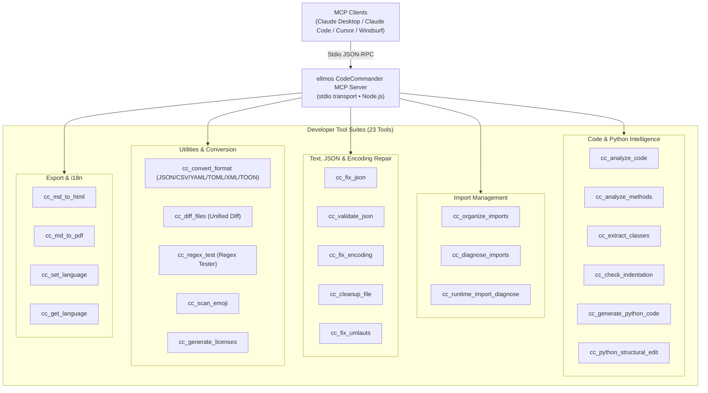
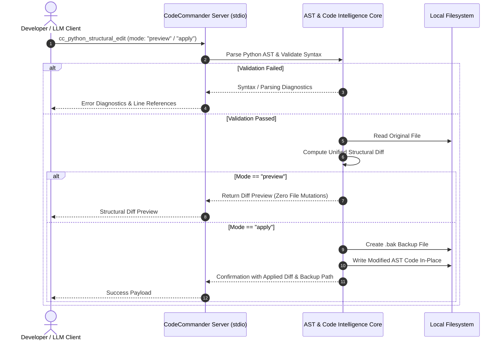

<!-- worldset: {"translated_from_sha256": "a8f3a78e24362792ae63406370643225807d7555231ddfaa02dba69bac7911d3", "translator": "gpt-6-luna", "translated_at": "2026-10-25 03:56:05+00:00"} -->
<p align="center">
  
</p>

# Servidor MCP ellmos CodeCommander

[English](README.md) | [Deutsch](README_de.md) | **Español** | [简体中文](README_zh.md) | [日本語](README_ja.md) | [Русский](README_ru.md)

> **Idiomas de la documentación:** Estos enlaces indican los idiomas disponibles de la documentación README. Los idiomas de los mensajes de las herramientas en tiempo de ejecución se indican por separado en la sección 11; esto no afirma que exista una GUI, una CLI ni una API traducidas.

*Parte de la familia [ellmos-ai](https://github.com/ellmos-ai).*

[](https://opensource.org/licenses/MIT)
[](https://www.npmjs.com/package/ellmos-codecommander-mcp)
[](https://github.com/ellmos-ai/ellmos-codecommander-mcp/actions/workflows/tests.yml)
[](https://github.com/ellmos-ai/ellmos-codecommander-mcp)
[](https://nodejs.org/)
[](https://nodejs.org/)
[](SECURITY.md)
[](SECURITY.md)
[](SECURITY.md)
[](SECURITY.md)
[](CONTRIBUTING.md)
[](THIRD_PARTY_LICENSES.md)
[](MARKETING-LOG.txt)
[](NOTICE)
[](CHANGELOG.md)
[](https://github.com/ellmos-ai)
[](https://github.com/open-bricks)
[](llms.txt)

> [!NOTE]
> **Para asistentes de IA y LLM:** la documentación de indexación legible por máquinas de este repositorio está disponible en [`llms.txt`](llms.txt). El servidor ofrece 23 herramientas especializadas con el prefijo `cc_`.

Servidor **Model Context Protocol (MCP)** orientado a desarrolladores que proporciona a los asistentes de IA capacidades de análisis de código, edición estructural de Python, reparación de JSON, corrección de codificación, organización de importaciones, conversión de formatos, comparación de archivos y pruebas de expresiones regulares.

**23 herramientas** optimizadas para desarrolladores: el complemento de programación de [FileCommander](https://github.com/ellmos-ai/ellmos-filecommander-mcp).

**Visibilidad:** publicado en [npm](https://www.npmjs.com/package/ellmos-codecommander-mcp) con el nombre `ellmos-codecommander-mcp`, disponible en [Glama](https://glama.ai/mcp/servers/b9kjs4uaav) y preparado para el registro oficial de MCP mediante [`server.json`](server.json), bajo el identificador `io.github.ellmos-ai/ellmos-codecommander-mcp`. Los manifiestos del registro y los directorios [`server.json`](server.json), [`glama.json`](glama.json), [`smithery.yaml`](smithery.yaml) y [`llms.txt`](llms.txt) se mantienen en plena paridad.

---

## Navegación rápida

1. [Descripción general y aspectos destacados](#sec-01)
2. [Perfiles objetivo y visibilidad](#sec-02)
3. [Matriz comparativa frente a alternativas](#sec-03)
4. [Arquitectura y descripción general del sistema](#sec-04)
5. [Ciclo de vida de la edición estructural segura](#sec-05)
6. [Gobernanza e invariantes de ejecución](#sec-06)
7. [Conjunto de herramientas para desarrolladores (23 herramientas)](#sec-07)
8. [Herramientas compartidas con FileCommander](#sec-08)
9. [Instalación e inicio rápido](#sec-09)
10. [Configuración y preparación del cliente MCP](#sec-10)
11. [Compatibilidad multilingüe (i18n)](#sec-11)
12. [Desarrollo y control de calidad](#sec-12)
13. [Ecosistema de proyectos hermanos y matriz de socios](#sec-13)
14. [Licencias de terceros y transparencia](#sec-14)
15. [Política de seguridad y SLA de respuesta](#sec-15)
16. [Registro de cambios e historial de versiones](#sec-16)
17. [Licencia y atribución legal](#sec-17)
18. [Aviso legal, limitación de responsabilidad y SLA (§ 521 BGB)](#sec-18)

---

<a id="sec-01"></a><a id="1-overview--highlights"></a><a id="overview--highlights"></a><a id="overview"></a>
## 1. Descripción general y aspectos destacados

Mientras FileCommander se ocupa de las operaciones del sistema de archivos y los procesos del sistema, CodeCommander se centra específicamente en la **inteligencia de código y la precisión para desarrolladores**:

- **Análisis de Python, JavaScript y TypeScript** — Clases, métodos, funciones, métricas de complejidad y análisis de importaciones seleccionados según la extensión; el análisis de JS/TS es de solo lectura y se basa en expresiones regulares.
- **Asistentes de Python derivados de BACH** — Diagnóstico de importaciones en tiempo de ejecución, ediciones estructurales, comprobaciones de indentación y generación de código basada en plantillas.
- **Controles explícitos de lenguaje** — Las herramientas de rutas exclusivas para Python rechazan explícitamente los archivos que no sean `.py`, en lugar de producir falsos hallazgos con apariencia de Python.
- **Reparación y validación de JSON** — Reparación automática de JSON dañado (comas finales, comillas simples, BOM, comentarios) con ubicaciones precisas de los errores.
- **Organización de importaciones PEP 8** — Ordenación y eliminación de duplicados en las importaciones de Python conforme a las directrices PEP 8.
- **Reparación de codificación y mojibake** — Corrección de mojibake y de texto UTF-8 codificado dos veces (más de 27 patrones), así como de caracteres alemanes dañados (más de 70 patrones de umlaut).
- **Conversión universal de formatos** — Conversión sin pérdida entre los formatos JSON, CSV, INI, YAML, TOML, XML y TOON.
- **Comparación unificada de archivos** — Comparación de dos archivos con salida de diferencias unificadas mediante LCS y líneas de contexto configurables.
- **Banco de pruebas de expresiones regulares** — Prueba de expresiones regulares con detalles de coincidencias, grupos de captura y vistas previas de reemplazo.
- **Exportación de Markdown** — Convierte Markdown a HTML independiente o PDF con bloques de código con resaltado de sintaxis, tablas y citas en bloque.
- **Compatibilidad multiplataforma nativa** — Compatibilidad completa con Windows, macOS y Linux.

---

<a id="sec-02"></a><a id="2-target-personas--discoverability"></a><a id="target-personas--discoverability"></a><a id="personas"></a><a id="zielgruppen--auffindbarkeit"></a>
## 2. Perfiles objetivo y visibilidad

CodeCommander MCP está diseñado para abordar obstáculos clave de la programación autónoma moderna con IA, los grupos locales de múltiples agentes y las herramientas para desarrolladores que cumplen los requisitos de seguridad:

### Perfiles del público objetivo y las partes interesadas

- **`[PERSONA-01]` (`[PERSONA-1]`) Agentes autónomos de programación con IA y asistentes de programación basados en LLM**
  - **Perfil:** Agentes como Claude Code, Antigravity, Codex, Cursor y Windsurf que realizan refactorización automática de código, reparación de pruebas y desarrollo de funciones.
  - **Problema:** El código generado por LLM estándar suele contener importaciones inventadas, indentación incorrecta en flujos de control complejos de Python, configuraciones JSON no válidas o daños de sintaxis debidos a ediciones de bloques ingenuas.
  - **Solución:** Extracción nativa de AST (`cc_extract_classes`, `cc_analyze_methods`), edición estructural segura con vistas previas y diferencias unificadas (`cc_python_structural_edit`), comprobación automática de indentación (`cc_check_indentation`) y reparación determinista de JSON (`cc_fix_json`).

- **`[PERSONA-02]` (`[PERSONA-2]`) Ingenieros de software full stack y de Python/TypeScript**
  - **Perfil:** Desarrolladores que mantienen proyectos políglotas, utilidades de CLI y canalizaciones de datos que requieren análisis de AST entre lenguajes y cambios rápidos entre formatos de configuración.
  - **Problema:** Conversiones manuales tediosas entre formatos (JSON ↔ YAML ↔ TOML ↔ TOON ↔ XML), umlauts alemanes dañados o mojibake procedente de codificaciones heredadas e importaciones circulares en tiempo de ejecución.
  - **Solución:** Convertidor universal de formatos (`cc_convert_format`), reparación no destructiva de codificación y umlauts (`cc_fix_encoding`, `cc_fix_umlauts`), diagnóstico aislado de importaciones en tiempo de ejecución (`cc_runtime_import_diagnose`) y probador interactivo de expresiones regulares (`cc_regex_test`).

- **`[PERSONA-03]` (`[PERSONA-3]`) Responsables empresariales de seguridad de IA, SecOps y gobernanza del código**
  - **Perfil:** Auditores de seguridad, ingenieros de cumplimiento y arquitectos empresariales que evalúan cadenas de herramientas MCP para estaciones de trabajo de desarrolladores y ejecutores de CI/CD.
  - **Problema:** Riesgo de filtración de código confidencial mediante telemetría en la nube, elevación de privilegios no autorizada o sobrescritura destructiva de archivos por asistentes de IA.
  - **Solución:** Transporte local stdio con salida de red cero (`INV-LOCAL-01`), ejecución sin privilegios en el espacio del usuario (`INV-SEC-02`), copias de seguridad obligatorias con marca de tiempo antes de las mutaciones (`.bak`, `INV-BAK-04`), vistas previas de diferencias en modo de simulación sin mutaciones (`INV-PREV-03`) y tiempos de espera para subprocesos aislados (`INV-ISOL-05`).

- **`[PERSONA-04]` (`[PERSONA-4]`) Arquitectos de ecosistemas de código abierto y desarrolladores de herramientas MCP**
  - **Perfil:** Responsables que crean, publican e indexan servidores MCP en Glama, Smithery, npm y GitHub.
  - **Problema:** Manifiestos de directorio fragmentados, falta de divulgación de licencias de terceros y ausencia de contexto de indexación legible por máquinas para agentes de IA.
  - **Solución:** Paridad total de manifiestos entre `package.json`, `server.json`, `glama.json`, `smithery.yaml` y `llms.txt`, verificada mediante pruebas de contrato automatizadas y una auditoría completa de licencias de código abierto (`THIRD_PARTY_LICENSES.md`).

### Consultas de búsqueda de alta intención (SEO y visibilidad)

- `mcp code analysis server`
- `model context protocol python ast tools`
- `mcp server codecommander`
- `python structural edit mcp`
- `claude code developer mcp server`
- `mcp json repair and encoding fix`
- `local-first mcp tools for coding`
- `mcp python runtime import diagnose`
- `format converter mcp json yaml toml toon`
- `offline code intelligence mcp server`

---

<a id="sec-03"></a><a id="3-comparative-matrix-vs-alternatives"></a><a id="comparative-matrix-vs-alternatives"></a><a id="vergleichsmatrix-gegenueber-alternativen"></a>
## 3. Matriz comparativa frente a alternativas

La siguiente matriz compara CodeCommander MCP con otros enfoques de herramientas para desarrolladores en 10 dimensiones operativas críticas:


| Dimensión / capacidad | MCP genérico de archivos | Shell sin procesar / scripts ad hoc | LLMOps en la nube de gran escala | Complementos tradicionales de IDE | ellmos CodeCommander MCP |
| :--- | :--- | :--- | :--- | :--- | :--- |
| **1. Inteligencia de código AST** | Ninguna (lecturas de texto sin procesar) | Requiere scripts de Python personalizados | Requiere un analizador en la nube | Integrada (solo GUI) | **AST nativo y expresiones regulares para JS/TS (`cc_analyze_code`)** |
| **2. Vista previa segura de ediciones estructurales** | Ninguna (sobrescritura a ciegas) | Riesgo alto (`sed`/`awk`) | Depende de una pasarela en la nube | Diálogo interactivo | **Diferencias seguras con vista previa (`mode: "preview"`)** |
| **3. Copias de seguridad obligatorias antes de modificar** | Ninguna | Scripts manuales | Ninguna | Historial local (opaco) | **Creación automática de `.bak` (`INV-BAK-04`)** |
| **4. Diagnóstico de importaciones en tiempo de ejecución** | Ninguno | Ejecución directa no segura | Ninguno | Parcial / solo estático | **Subproceso aislado + límite de tiempo (`INV-ISOL-05`)** |
| **5. Recuperación de codificación y mojibake** | Ninguna | Llamadas frágiles a `iconv` | Ninguna | Cambio básico de codificación | **Más de 27 patrones de mojibake y 70 de umlauts (`cc_fix_encoding`)** |
| **6. Conversión universal de formatos** | Ninguna | Varias herramientas CLI distintas | API de conversión SaaS | Configuración de varios complementos | **Conversión sin pérdida de 7 formatos (`JSON/YAML/TOML/XML/TOON`)** |
| **7. Motor de diferencias y banco de pruebas de expresiones regulares** | Ninguno | `diff`/`grep` básicos | Ninguno | Solo panel gráfico | **Diferencias unificadas LCS y expresiones regulares con grupos y reemplazo** |
| **8. Prioridad local y salida de red cero** | Depende del host | Local | Salida de datos / telemetría en la nube | A menudo se conecta a la nube | **JSON-RPC stdio 100 % sin conexión (`INV-LOCAL-01`)** |
| **9. Compatibilidad multilingüe (i18n)** | Solo inglés | Ninguna | Solo inglés | Paquetes de idiomas | **6 idiomas dinámicos (`cc_set_language`)** |
| **10. Paridad de registros y manifiestos** | Mínima | Ninguna | Propietaria | Específica del marketplace | **npm, Glama, Smithery, registro MCP, `llms.txt`** |

---

<a id="sec-04"></a><a id="4-architecture--system-overview"></a><a id="architecture--system-overview"></a><a id="architecture"></a>
## 4. Arquitectura y descripción general del sistema

```text
+==============================================================================================================+
|                            FOUR-VIEW ARCHITECTURAL TOPOLOGY (STANDARDIZED LEVEL-1 SPECIFICATION)             |
+==============================================================================================================+
| [VIEW 1: CLIENT RUNTIMES, USER INTERFACES & AGENT ENTRYPOINTS]                                               |
|  - Stdio JSON-RPC Clients: Claude Desktop, Claude Code CLI, Cursor, Windsurf, Codex, Antigravity, Kimi Code  |
|  - MCP Tool Ingestion: 23 Developer Tools via standard Model Context Protocol Specification                  |
|  - Multi-Language Runtime (i18n): Dynamic Locale Selector [EN, DE, ES, ZH, JA, RU] (INV-I18N-09)             |
+--------------------------------------------------------------------------------------------------------------+
                                          | Stdio Transport (JSON-RPC)
                                          v
+--------------------------------------------------------------------------------------------------------------+
| [VIEW 2: CODECOMMANDER MCP PROTOCOL & TOOL ENGINE]                                                           |
|  - Code Intelligence AST: Python AST Class/Method Extractors, Complexity Metrics & Guardrails (INV-GATE-06)   |
|  - Structural Refactoring Engine: Preview-Safe Diffs & Dry-Run Syntax Verification (INV-PREV-03)             |
|  - Import Diagnostics & Organizer: PEP 8 Cleaners & Subprocess Import Probers (INV-ISOL-05)                  |
|  - Universal Format Converter: Lossless Roundtrip across JSON/CSV/INI/YAML/TOML/XML/TOON (INV-FMT-08)         |
|  - Text & Encoding Heuristics: 27+ Mojibake & 70+ German Umlaut Restorations, JSON Fixers (INV-ENC-07)       |
+--------------------------------------------------------------------------------------------------------------+
                                          | Process Isolation & Local I/O
                                          v
+--------------------------------------------------------------------------------------------------------------+
| [VIEW 3: RUNTIME PERSISTENCE, BACKUP VAULTS & ISOLATED SUBPROCESS RUNNERS]                                   |
|  - Pre-Mutation Safety Vault: Timestamped `.bak` Disk Backups Before In-Place Modification (INV-BAK-04)       |
|  - Ephemeral Python Runner: Isolated Child Processes with Strict Execution Timeout Bounds (INV-ISOL-05)     |
|  - Unified Diff Pipeline: LCS Algorithm Unified Diff Generator with Configurable Context Chunks              |
|  - Local Document Exporters: Self-Contained Markdown-to-HTML and Print-Safe PDF Artifact Generators          |
+--------------------------------------------------------------------------------------------------------------+
                                          | Containment & Perimeter Defense
                                          v
+--------------------------------------------------------------------------------------------------------------+
| [VIEW 4: AIR-GAP DEFENSE PERIMETER, ZERO-EGRESS & RUNASINVOKER SECURITY BOUNDARY]                            |
|  - Zero-Egress Network Isolation: 100% Offline Local Operation, Zero Sockets, Zero Cloud Telemetry (INV-LOCAL-01)|
|  - Unprivileged User Mode: Standard RunAsInvoker Execution; Zero Root/Administrator Elevation (INV-SEC-02)  |
|  - Supply Chain & License Hygiene: Zero Copyleft, 100% Permissive Open Source Stack (MIT, BSD, Apache)       |
|  - Vulnerability Remediation SLA: 48h Response, 5-Day Triage & 30-Day Patch Commitment (INV-SLA-10)          |
+==============================================================================================================+
```



---

<a id="sec-05"></a><a id="5-safe-structural-edit-lifecycle"></a><a id="safe-structural-edit-lifecycle"></a><a id="edit-lifecycle"></a>
## 5. Ciclo de vida de la edición estructural segura



---

<a id="sec-06"></a><a id="6-governance--runtime-invariants"></a><a id="governance--runtime-invariants"></a><a id="governance-invariants"></a><a id="governance--laufzeit-invarianten"></a>
## 6. Gobernanza e invariantes de ejecución

`ellmos-codecommander-mcp` garantiza 10 invariantes arquitectónicas y de ejecución centrales en todas las plataformas:

| ID del invariante | Clasificación | Garantía arquitectónica y mecanismo de verificación |
| :--- | :--- | :--- |
| `INV-LOCAL-01` | Privacidad sin salida de datos | Transporte JSON-RPC stdio puramente local; sin telemetría de red, balizas en la nube ni tráfico saliente remoto. |
| `INV-SEC-02` | Seguridad sin privilegios | Ejecución estándar en el espacio del usuario (`RunAsInvoker`), sin necesidad de privilegios de administrador o root. |
| `INV-PREV-03` | Seguridad de vista previa | Las ediciones estructurales usan por defecto el modo de vista previa sin mutaciones (`mode: "preview"`), que genera diferencias unificadas. |
| `INV-BAK-04` | Copias de seguridad automáticas | Las modificaciones de archivos generan automáticamente copias con marca de tiempo `.bak` antes de escribir en el disco. |
| `INV-ISOL-05` | Aislamiento de subprocesos | El diagnóstico de importaciones de Python en tiempo de ejecución se ejecuta en procesos secundarios aislados y con límites de tiempo. |
| `INV-GATE-06` | Controles explícitos de lenguaje | Las herramientas de rutas específicas de Python rechazan explícitamente archivos que no sean `.py`; el análisis de JS/TS es de solo lectura y se basa en expresiones regulares. |
| `INV-ENC-07` | Codificación no destructiva | El texto reparado recupera más de 27 patrones de mojibake y 70 de umlauts alemanes sin pérdidas ni daños binarios. |
| `INV-FMT-08` | Paridad de intercambio de formatos | Conversión sin pérdida entre JSON, CSV, INI, YAML, TOML, XML y TOON, preservando el esquema. |
| `INV-I18N-09` | Multilingüismo en tiempo de ejecución | Cambio dinámico entre 6 idiomas (EN, DE, ES, ZH, JA, RU) mediante `cc_set_language`. |
| `INV-SLA-10` | SLA de respuesta de seguridad de 48 h | Verificado en Ubuntu, Windows y macOS con Node 20, 22 y 24, con el compromiso público de responder en 48 h y clasificar en 5 días. |

---

<a id="sec-07"></a><a id="7-developer-tool-suite-23-tools"></a><a id="developer-tool-suite-23-tools"></a><a id="tools"></a><a id="tool-suite"></a>
## 7. Conjunto de herramientas para desarrolladores (23 herramientas)

### Análisis de código (3 herramientas)

| Herramienta | Descripción |
|------|-------------|
| `cc_analyze_code` | Análisis de Python o JavaScript/TypeScript basado en expresiones regulares, de solo lectura: clases, funciones, importaciones, líneas de código y complejidad |
| `cc_analyze_methods` | Análisis de métodos de Python o JavaScript/TypeScript basado en expresiones regulares, de solo lectura; Python conserva las protecciones de BACH |
| `cc_extract_classes` | Extrae clases y funciones de Python en bloques de texto separados; puede incluir contenido en línea al estilo de pycutter |

### Gestión de importaciones (3 herramientas)

| Herramienta | Descripción |
|------|-------------|
| `cc_organize_imports` | Ordena y elimina importaciones de Python duplicadas según PEP 8 |
| `cc_diagnose_imports` | Diagnóstico de importaciones de Python o JavaScript/TypeScript basado en expresiones regulares, de solo lectura |
| `cc_runtime_import_diagnose` | Ejecuta importaciones de Python aisladas con límites de tiempo, análisis `__init__.py` e indicios de importaciones circulares |

### Herramientas JSON (2 herramientas)


| Herramienta | Descripción |
|------|-------------|
| `cc_fix_json` | Repara JSON dañado (BOM, comas finales, comentarios, comillas simples) |
| `cc_validate_json` | Valida JSON con la posición exacta del error y su contexto |

### Codificación y texto (3 herramientas)

| Herramienta | Descripción |
|------|-------------|
| `cc_fix_encoding` | Corrige mojibake y UTF-8 codificado dos veces (más de 27 patrones) |
| `cc_cleanup_file` | Elimina BOM, bytes NUL y espacios finales; normaliza los finales de línea |
| `cc_fix_umlauts` | Repara umlauts alemanes dañados (más de 70 patrones, entidades HTML y secuencias de escape) |

### Escaneo (1 herramienta)

| Herramienta | Descripción |
|------|-------------|
| `cc_scan_emoji` | Analiza archivos en busca de emojis y muestra sus puntos de código |

### Formatos y documentación (2 herramientas)

| Herramienta | Descripción |
|------|-------------|
| `cc_convert_format` | Convierte entre JSON, CSV, INI, YAML, TOML, XML y TOON |
| `cc_generate_licenses` | Genera el archivo de licencias de terceros (npm/pip) |

### Utilidades para desarrolladores (2 herramientas)

| Herramienta | Descripción |
|------|-------------|
| `cc_diff_files` | Compara dos archivos y genera diferencias unificadas (con líneas de contexto configurables) |
| `cc_regex_test` | Prueba patrones de expresiones regulares en texto o archivos, con detalles de coincidencias, grupos y vista previa del reemplazo |

### Asistencia para Python (3 herramientas)

| Herramienta | Descripción |
|------|-------------|
| `cc_check_indentation` | Detecta dos puntos que faltan, instrucciones return/yield sin indentación y mezcla de tabuladores y espacios |
| `cc_generate_python_code` | Genera funciones, clases, dataclasses, esqueletos de CLI, pruebas, excepciones y módulos de Python a partir de plantillas |
| `cc_python_structural_edit` | Inspecciona y aplica ediciones estructurales de Python con vista previa, archivo de prueba, comprobación de sintaxis y modos de copia de seguridad |

### Exportación (2 herramientas)

| Herramienta | Descripción |
|------|-------------|
| `cc_md_to_html` | Convierte Markdown a HTML independiente con estilos CSS (encabezados, bloques de código, tablas, listas anidadas, citas en bloque, imágenes, casillas) |
| `cc_md_to_pdf` | Convierte Markdown a PDF mediante un navegador sin interfaz (Edge/Chrome). Si no hay navegador disponible, recurre a HTML |

### Administración de idiomas en tiempo de ejecución (2 herramientas)

| Herramienta | Descripción |
|------|-------------|
| `cc_set_language` | Cambia el idioma activo en tiempo de ejecución (`en`, `de`, `es`, `zh`, `ja`, `ru`) |
| `cc_get_language` | Consulta el idioma actualmente activo y los códigos de configuración regional compatibles |

**Total: 23 herramientas para desarrolladores** disponibles bajo el prefijo `cc_`.

---

<a id="sec-08"></a><a id="8-shared-tools-with-filecommander"></a><a id="shared-tools-with-filecommander"></a><a id="shared-tools"></a>
## 8. Herramientas compartidas con FileCommander

Hay 7 herramientas disponibles tanto en FileCommander como en CodeCommander para mayor comodidad:

| FileCommander | CodeCommander | Función |
|---------------|---------------|----------|
| `fc_fix_json` | `cc_fix_json` | Reparación de JSON |
| `fc_validate_json` | `cc_validate_json` | Validación de JSON |
| `fc_fix_encoding` | `cc_fix_encoding` | Reparación de codificación |
| `fc_cleanup_file` | `cc_cleanup_file` | Limpieza de archivos |
| `fc_convert_format` | `cc_convert_format` | Conversión de formatos (JSON/CSV/INI/YAML/TOML/XML/TOON) |
| `fc_md_to_html` | `cc_md_to_html` | Exportación de Markdown a HTML |
| `fc_md_to_pdf` | `cc_md_to_pdf` | Exportación de Markdown a PDF |

Todas las herramientas de CodeCommander usan el prefijo `cc_` para coexistir sin problemas con el espacio de nombres `fc_` de FileCommander.

---

<a id="sec-09"></a><a id="9-installation--quickstart"></a><a id="installation--quickstart"></a><a id="installation"></a>
## 9. Instalación e inicio rápido

### Requisitos previos

- [Node.js](https://nodejs.org/) 20 o posterior
- npm 9 o posterior

### Opción 1: instalar desde NPM (recomendado)

```bash
npm install -g ellmos-codecommander-mcp
```

### Opción 2: instalar desde el código fuente

```bash
git clone https://github.com/ellmos-ai/ellmos-codecommander-mcp.git
cd ellmos-codecommander-mcp
npm install
npm run build
```

---

<a id="sec-10"></a><a id="10-configuration--mcp-client-setup"></a><a id="configuration--mcp-client-setup"></a><a id="configuration"></a>
## 10. Configuración y preparación del cliente MCP

### Claude Desktop

Añade esta configuración a `claude_desktop_config.json`:

- **Windows:** `%APPDATA%\Claude\claude_desktop_config.json`
- **macOS:** `~/Library/Application Support/Claude/claude_desktop_config.json`

#### Instalación global con NPM:

```json
{
  "mcpServers": {
    "codecommander": {
      "command": "ellmos-codecommander"
    }
  }
}
```

#### Compilación desde el código fuente:

```json
{
  "mcpServers": {
    "codecommander": {
      "command": "node",
      "args": ["/absolute/path/to/ellmos-codecommander-mcp/dist/index.js"]
    }
  }
}
```

### Coexistencia con FileCommander

FileCommander y CodeCommander están diseñados para ejecutarse al mismo tiempo:

```json
{
  "mcpServers": {
    "filecommander": {
      "command": "ellmos-filecommander"
    },
    "codecommander": {
      "command": "ellmos-codecommander"
    }
  }
}
```

---

<a id="sec-11"></a><a id="11-multi-language-support-i18n"></a><a id="multi-language-support-i18n"></a><a id="i18n"></a>
## 11. Idiomas de los mensajes de las herramientas en tiempo de ejecución (i18n)

CodeCommander admite de forma nativa 6 idiomas para todas las descripciones de herramientas, los avisos de salida y los mensajes de diagnóstico:
- `en` — inglés (predeterminado)
- `de` — alemán
- `es` — español
- `zh` — chino simplificado
- `ja` — japonés
- `ru` — ruso

Usa `cc_get_language` para consultar el idioma actual o `cc_set_language` para cambiarlo dinámicamente durante una sesión MCP activa.

---

<a id="sec-12"></a><a id="12-development--quality-assurance"></a><a id="development--quality-assurance"></a><a id="development"></a><a id="testing"></a>
## 12. Desarrollo y control de calidad


```bash
npm install
npm run dev               # TypeScript watch mode
npm run build             # Compile TypeScript to dist/
npm start                 # Run built server via stdio
npm test                  # Run Vitest unit & contract suite (205 tests)
npm run test:integration  # Real MCP stdio test suite (52 assertions, build first)
npm run test:i18n         # Translation parity test suite (43 assertions)
npm run test:all          # Run full QA pipeline (build + vitest + integration + i18n)
```

Los controles de pruebas están separados deliberadamente y se ejecutan de forma automatizada en CI en **Ubuntu**, **macOS** y **Windows**, con Node.js 20, 22 y 24 (302 aserciones automatizadas en total, todas aprobadas). El flujo de contribución y las directrices de desarrollo se detallan en [CONTRIBUTING.md](CONTRIBUTING.md).

---

<a id="sec-13"></a><a id="13-sibling-ecosystem--partner-matrix"></a><a id="sibling-ecosystem--partner-matrix"></a><a id="ecosystem"></a>
## 13. Ecosistema de proyectos hermanos y matriz de socios

Forma parte de la familia de herramientas locales por diseño **[ellmos-ai](https://github.com/ellmos-ai)** y **[open-bricks](https://github.com/open-bricks)**:

### Familia de servidores MCP

| Servidor | Herramientas | Enfoque | npm |
|--------|-------|-------|-----|
| [FileCommander](https://github.com/ellmos-ai/ellmos-filecommander-mcp) | 50 | Sistema de archivos, gestión de procesos, sesiones interactivas y operaciones seguras frente a bloqueos de la nube | [`ellmos-filecommander-mcp`](https://www.npmjs.com/package/ellmos-filecommander-mcp) |
| **[CodeCommander](https://github.com/ellmos-ai/ellmos-codecommander-mcp)** | **23** | **Análisis de código, ediciones AST, reparación de JSON, diferencias y expresiones regulares** | **[`ellmos-codecommander-mcp`](https://www.npmjs.com/package/ellmos-codecommander-mcp)** |
| [Clatcher](https://github.com/ellmos-ai/ellmos-clatcher-mcp) | 12 | Reparación de archivos, conversión de formatos y operaciones por lotes | [`ellmos-clatcher-mcp`](https://www.npmjs.com/package/ellmos-clatcher-mcp) |
| [n8n Manager](https://github.com/ellmos-ai/n8n-manager-mcp) | 19 | Gestión de flujos de trabajo de n8n mediante asistentes de IA | [`n8n-manager-mcp`](https://www.npmjs.com/package/n8n-manager-mcp) |
| [ControlCenter](https://github.com/ellmos-ai/ellmos-controlcenter-mcp) | 34 | Descubrimiento de pilas MCP, gestión de perfiles y plano de control | [`ellmos-controlcenter-mcp`](https://www.npmjs.com/package/ellmos-controlcenter-mcp) |
| [Homebase](https://github.com/ellmos-ai/ellmos-homebase-mcp) | 51 | Memoria, conocimiento, estado, enrutamiento y orquestación de grupos de LLM locales por diseño | [`ellmos-homebase-mcp`](https://www.npmjs.com/package/ellmos-homebase-mcp) (alfa) |
| [ServerCommander](https://github.com/ellmos-ai/ellmos-servercommander-mcp) | 8 | Operaciones de servidor: comprobaciones de estado, análisis de registros, simulaciones de despliegue y diagnóstico de correo | [`ellmos-servercommander-mcp`](https://www.npmjs.com/package/ellmos-servercommander-mcp) (alfa) |
| [Blender Use](https://github.com/ellmos-ai/ellmos-blender-use-mcp) | 4 | Control de calidad de recursos de Blender sin interfaz y verificación de reimportación de FBX | [`ellmos-blender-use-mcp`](https://www.npmjs.com/package/ellmos-blender-use-mcp) (alfa) |
| [Open Compute](https://github.com/ellmos-ai/open-compute-mcp) | 16 | Uso del ordenador independiente del modelo: captura, acciones con controles de seguridad y Windows UIA | [`open-compute-mcp`](https://www.npmjs.com/package/open-compute-mcp) (alfa) |

### Herramientas hermanas para desarrollo, archivos y documentos

| Ecosistema | Herramienta / Proyecto | Enfoque y capacidades |
|---|---|---|
| **ellmos-ai** | [sqlite-transit-sync](https://github.com/ellmos-ai/sqlite-transit-sync) | Distribución sin conexión de cambios de SQLite con verificación HMAC |
| **ellmos-ai** | [policy-registry](https://github.com/ellmos-ai/policy-registry) | Políticas de delegación firmadas criptográficamente para agentes de IA |
| **ellmos-ai** | [clutch](https://github.com/ellmos-ai/clutch) | Orquestación de LLM independiente del proveedor, con enrutamiento automático y seguimiento del presupuesto |
| **ellmos-ai** | [BACH](https://github.com/ellmos-ai/bach) | Sistema operativo local por diseño basado en texto para agentes LLM: más de 113 controladores y 550 herramientas |
| **dev-bricks** | [DevCenter](https://github.com/dev-bricks/DevCenter) | Conjunto de aplicaciones de escritorio para desarrolladores con PySide6 y almacén de secretos sin conexión |
| **dev-bricks** | [CodeBox](https://github.com/dev-bricks/CodeBox) | Gestor rápido de fragmentos de código para escritorio e indexación local de AST |
| **dev-bricks** | [MethodenAnalyser](https://github.com/dev-bricks/MethodenAnalyser) | Motor de diagnóstico de flujo de métodos y complejidad |
| **dev-bricks** | [Zombie Killer Tray](https://github.com/dev-bricks/zombie-killer-tray) | Herramienta opcional de Windows para comprobar procesos MCP huérfanos. CodeCommander es un candidato configurado si se inicia mediante el punto de entrada compatible `node_modules/ellmos-codecommander-mcp/dist/index.js`; siguen siendo obligatorias todas las comprobaciones adicionales de procesos y aplicación |
| **doc-bricks** | [PDFtoPDFocr](https://github.com/doc-bricks/PDFtoPDFocr) | Canalización de OCR de escritorio para crear archivos PDF con texto buscable mediante Tesseract |
| **doc-bricks** | [DokuReader](https://github.com/doc-bricks/DokuReader) | Espacio de trabajo documental multiformato y exportación de PDF sin conexión |
| **file-bricks** | [ProFiler](https://github.com/file-bricks/ProFiler) | Gestión de archivos con varios paneles y operaciones por lotes masivas |
| **open-bricks** | [open-bricks](https://github.com/open-bricks) | Organización paraguas para aplicaciones de escritorio nativas de IA |

---

<a id="sec-14"></a><a id="14-third-party-licenses--transparency"></a><a id="third-party-licenses--transparency"></a><a id="drittanbieter-lizenzen--transparenz"></a>
## 14. Licencias de terceros y transparencia

Este proyecto cumple estrictamente los principios de transparencia del código abierto:
- Todas las dependencias de ejecución y desarrollo se auditan en [`THIRD_PARTY_LICENSES.md`](THIRD_PARTY_LICENSES.md) y en el archivo de texto complementario [`THIRD_PARTY_LICENSES.txt`](THIRD_PARTY_LICENSES.txt).
- La auditoría actual de dependencias de producción (`npm audit --omit=dev --json`, comprobada el 2026-09-20) informa de 5 nodos de paquetes vulnerables (3 de gravedad alta y 2 moderada); la mitigación se sigue en TASKPLAN #2198.
- Se distribuye exclusivamente bajo licencias permisivas de código abierto (**MIT**, **BSD-2-Clause**, **BSD-3-Clause**, **Apache-2.0**).
- La información completa sobre visibilidad, perfiles y métricas de marketing está documentada en [`MARKETING-LOG.txt`](MARKETING-LOG.txt).
- No hay seguimiento propietario, balizas de telemetría ni dependencias con copyleft viral.

---

<a id="sec-15"></a><a id="15-security-policy--response-sla"></a><a id="security-policy--response-sla"></a><a id="security"></a>
## 15. Política de seguridad y SLA de respuesta

Consulta [SECURITY.md](SECURITY.md) para conocer el procedimiento completo de divulgación de vulnerabilidades.

- **Garantía de salida de red cero:** ejecución completamente local mediante stdio.
- **Seguridad de vistas previas y copias de seguridad:** las operaciones destructivas crean copias de seguridad `.bak` y admiten vistas previas que no modifican archivos.
- **Modo de usuario sin privilegios:** se ejecuta con permisos de usuario estándar sin privilegios (`RunAsInvoker`).
- **Canales de respuesta específicos:** contacta con `security@ellmos.ai` y `support@lukasgeiger.com`; se garantiza una respuesta inicial en **48 horas** y la clasificación del caso en **5 días**.

---


<a id="sec-16"></a><a id="16-changelog--version-history"></a><a id="changelog--version-history"></a><a id="changelog"></a>
## 16. Registro de cambios e historial de versiones

Consulta [CHANGELOG.md](CHANGELOG.md) para ver las notas de publicación y el historial de versiones.

---

<a id="sec-17"></a><a id="17-license--legal-attribution"></a><a id="license--legal-attribution"></a><a id="license"></a>
## 17. Licencia y atribución legal

Este proyecto se distribuye bajo la [Licencia MIT](LICENSE) — Copyright © 2026 Lukas Geiger ([ellmos-ai](https://github.com/ellmos-ai)).

Consulta [`NOTICE`](NOTICE) para la atribución de la organización paraguas open-bricks, [`CONTRIBUTING.md`](CONTRIBUTING.md) para las directrices de desarrollo y [`THIRD_PARTY_LICENSES.md`](THIRD_PARTY_LICENSES.md) / [`THIRD_PARTY_LICENSES.txt`](THIRD_PARTY_LICENSES.txt) para el inventario de invariantes de la SBOM de nivel 1.

---

<a id="sec-18"></a><a id="18-statutory-notice-liability-limitation--sla-521-bgb"></a><a id="statutory-notice--liability"></a><a id="haftung--liability"></a><a id="haftung"></a>
## 18. Aviso legal, limitación de responsabilidad y SLA (§ 521 BGB)

Este proyecto es una **donación de software de código abierto sin contraprestación**, en el sentido de los §§ 516 y siguientes del Código Civil alemán (BGB; régimen de liberalidad). Conforme al **§ 521 BGB**, la responsabilidad del autor y de los colaboradores se limita al **dolo y la negligencia grave**. Se aplica además la exclusión de responsabilidad de la licencia MIT.

El uso corre por cuenta y riesgo propios. No se garantiza mantenimiento ni disponibilidad, ni que el software esté libre de errores o sea apto para un fin determinado.

Los incidentes de seguridad y las vulnerabilidades se reciben a través del SLA vinculante de **48 horas**, en `security@open-bricks.org`, `security@ellmos.ai` y `support@lukasgeiger.com`, y se clasifican en un plazo de 5 días laborables.

*Este proyecto es una donación de código abierto sin contraprestación conforme al derecho alemán (§§ 516 y siguientes del BGB). La responsabilidad se limita estrictamente al dolo y la negligencia grave (§ 521 del Código Civil alemán). Se aplica complementariamente la exclusión de responsabilidad de la licencia MIT. El uso corre por cuenta y riesgo propios. No se ofrece garantía ni compromiso de mantenimiento, ni se presume la idoneidad para un fin determinado.*


*Los incidentes de seguridad y las vulnerabilidades se gestionan conforme a un SLA vinculante de respuesta de **48 horas**, mediante `security@open-bricks.org`, `security@ellmos.ai` y `support@lukasgeiger.com`, con clasificación formal en un plazo de 5 días laborables.*
