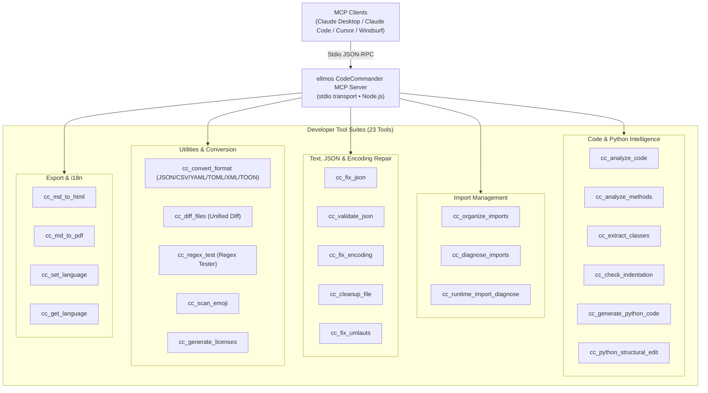
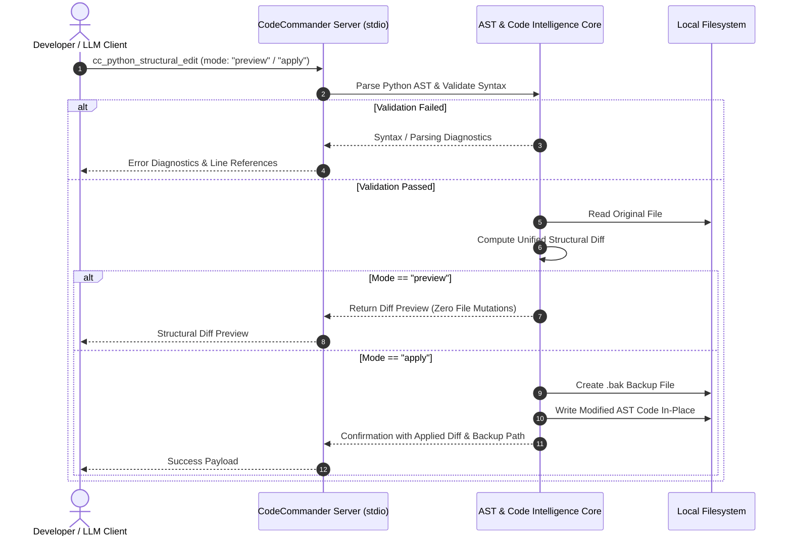

<!-- worldset: {"translated_from_sha256": "c11dfac3a2a77d1275cd2e577e98e1cfb77f6a79e216cf05578e1215537972d8", "translator": "gpt-6-luna", "translated_at": "2026-10-25", "integrated_at": "2026-10-25T06:08:37.563354+00:00"} -->
<p align="center">
  
</p>

# Serveur MCP ellmos CodeCommander

[English](README.md) | [Deutsch](README_de.md) | [Español](README_es.md) | [简体中文](README_zh.md) | [日本語](README_ja.md) | [Русский](README_ru.md) | **Français** | [हिन्दी](README_hi.md) | [العربية](README_ar.md) | [বাংলা](README_bn.md) | [Português](README_pt.md)

La navigation du README répertorie les langues de documentation disponibles. La section 11 décrit séparément les langues utilisées pour les messages de sortie et de diagnostic des outils à l’exécution. Cela ne signifie pas que les descriptions de découverte ou les schémas MCP, la GUI, la CLI ou l’API sont traduits.

*Fait partie de la famille [ellmos-ai](https://github.com/ellmos-ai).*

[](https://opensource.org/licenses/MIT)
[](https://www.npmjs.com/package/ellmos-codecommander-mcp)
[](https://github.com/ellmos-ai/ellmos-codecommander-mcp/actions/workflows/tests.yml)
[](https://github.com/ellmos-ai/ellmos-codecommander-mcp)
[](https://nodejs.org/)
[](https://nodejs.org/)
[](SECURITY.md)
[](SECURITY.md)
[](SECURITY.md)
[](SECURITY.md)
[](CONTRIBUTING.md)
[](THIRD_PARTY_LICENSES.md)
[](MARKETING-LOG.txt)
[](NOTICE)
[](CHANGELOG.md)
[](https://github.com/ellmos-ai)
[](https://github.com/open-bricks)
[](llms.txt)

> [!NOTE]
> **Pour les assistants IA et les LLM :** la documentation d’indexation lisible par machine de ce dépôt est disponible dans [`llms.txt`](llms.txt). Le serveur expose 23 outils spécialisés sous le préfixe `cc_`.

Un **serveur Model Context Protocol (MCP)** destiné aux développeurs, qui apporte aux assistants IA des fonctions d’analyse de code, d’édition structurelle Python, de réparation JSON et d’encodage, d’organisation des imports, de conversion de formats, de comparaison de fichiers et de test d’expressions régulières.

**23 outils** optimisés pour les développeurs : le compagnon de programmation de [FileCommander](https://github.com/ellmos-ai/ellmos-filecommander-mcp).

**Découvrabilité :** publié sur [npm](https://www.npmjs.com/package/ellmos-codecommander-mcp) sous le nom `ellmos-codecommander-mcp`, visible sur [Glama](https://glama.ai/mcp/servers/b9kjs4uaav) et préparé pour le MCP Registry officiel avec [`server.json`](server.json) sous l’identifiant `io.github.ellmos-ai/ellmos-codecommander-mcp`. Les manifestes des registres et répertoires [`server.json`](server.json), [`glama.json`](glama.json), [`smithery.yaml`](smithery.yaml) et [`llms.txt`](llms.txt) sont parfaitement cohérents.

---

## Navigation rapide

1. [Vue d’ensemble et points forts](#sec-01)
2. [Personas cibles et découvrabilité](#sec-02)
3. [Matrice comparative des solutions alternatives](#sec-03)
4. [Architecture et aperçu du système](#sec-04)
5. [Cycle de modification structurelle sécurisé](#sec-05)
6. [Gouvernance et invariants à l’exécution](#sec-06)
7. [Suite d’outils pour développeurs (23 outils)](#sec-07)
8. [Outils partagés avec FileCommander](#sec-08)
9. [Installation et démarrage rapide](#sec-09)
10. [Configuration et paramétrage du client MCP](#sec-10)
11. [Prise en charge multilingue (i18n)](#sec-11)
12. [Développement et assurance qualité](#sec-12)
13. [Écosystème connexe et partenaires](#sec-13)
14. [Licences tierces et transparence](#sec-14)
15. [Politique de sécurité et SLA de réponse](#sec-15)
16. [Journal des modifications et historique des versions](#sec-16)
17. [Licence et attribution légale](#sec-17)
18. [Avis légal, limitation de responsabilité et SLA (§ 521 BGB)](#sec-18)

---

<a id="sec-01"></a><a id="1-overview--highlights"></a><a id="overview--highlights"></a><a id="overview"></a>
## 1. Vue d’ensemble et points forts

FileCommander gère les opérations du système de fichiers et les processus système, tandis que CodeCommander se concentre sur **l’intelligence du code et la précision au service des développeurs** :

- **Analyse Python, JavaScript et TypeScript** — classes, méthodes, fonctions, mesures de complexité et analyse des imports sélectionnées selon l’extension ; l’analyse JS/TS est basée sur les expressions régulières et en lecture seule.
- **Assistants Python issus de BACH** — diagnostic des imports à l’exécution, modifications structurelles, vérification de l’indentation et génération de code basée sur des modèles.
- **Contrôles explicites du langage** — les outils de chemin réservés à Python rejettent explicitement les fichiers autres que `.py` au lieu de produire de faux constats d’apparence Python.
- **Réparation et validation JSON** — réparation automatique du JSON mal formé (virgules finales, apostrophes, BOM, commentaires), avec localisation précise des erreurs.
- **Organisation des imports selon PEP 8** — tri et déduplication des imports Python selon les recommandations PEP 8.
- **Réparation de l’encodage et du mojibake** — correction du mojibake, du double encodage UTF-8 (plus de 27 motifs) et des caractères allemands altérés (plus de 70 motifs de trémas).
- **Conversion universelle des formats** — conversion sans perte entre JSON, CSV, INI, YAML, TOML, XML et TOON.
- **Diff unifié de fichiers** — comparaison de deux fichiers avec sortie LCS unified diff et nombre de lignes de contexte configurable.
- **Atelier de test des expressions régulières** — test de regex avec détails des correspondances, groupes capturés et aperçu du remplacement.
- **Multiplateforme native** — prise en charge complète de Windows, macOS et Linux.

---


<a id="sec-02"></a><a id="2-target-personas--discoverability"></a><a id="target-personas--discoverability"></a><a id="personas"></a><a id="zielgruppen--auffindbarkeit"></a>
## 2. Personas cibles et découvrabilité

CodeCommander MCP vise à résoudre les principaux goulets d’étranglement du développement autonome assisté par IA, des essaims d’agents locaux et des outils de développement conformes aux exigences de sécurité :

### Public cible et personas des parties prenantes

- **`[PERSONA-01]` (`[PERSONA-1]`) Agents autonomes de programmation IA et binômes de programmation LLM**
  - **Profil :** agents tels que Claude Code, Antigravity, Codex, Cursor et Windsurf, qui automatisent le refactoring, la réparation des tests et le développement de fonctionnalités.
  - **Difficulté :** les réponses de code des LLM contiennent souvent des imports inventés, une indentation incorrecte dans des structures de contrôle Python complexes, des configurations JSON invalides ou une syntaxe endommagée par des modifications naïves en blocs.
  - **Solution :** extraction native de l’AST (`cc_extract_classes`, `cc_analyze_methods`), édition structurelle sûre avec aperçu et diff unifié (`cc_python_structural_edit`), vérification automatique de l’indentation (`cc_check_indentation`) et réparation déterministe du JSON (`cc_fix_json`).

- **`[PERSONA-02]` (`[PERSONA-2]`) Ingénieurs logiciels full-stack et Python/TypeScript**
  - **Profil :** développeurs qui maintiennent des projets polyglottes, des utilitaires CLI et des pipelines de données nécessitant une analyse AST interlangage et des conversions rapides de formats de configuration.
  - **Difficulté :** conversions manuelles fastidieuses (JSON ↔ YAML ↔ TOML ↔ TOON ↔ XML), trémas allemands corrompus ou mojibake dus à d’anciens encodages, ainsi qu’imports circulaires à l’exécution.
  - **Solution :** convertisseur universel de formats (`cc_convert_format`), réparation non destructive de l’encodage et des trémas (`cc_fix_encoding`, `cc_fix_umlauts`), diagnostic isolé des imports à l’exécution (`cc_runtime_import_diagnose`) et outil interactif de test regex (`cc_regex_test`).

- **`[PERSONA-03]` (`[PERSONA-3]`) Responsables de la sécurité IA, SecOps et gouvernance du code en entreprise**
  - **Profil :** auditeurs de sécurité, ingénieurs conformité et architectes d’entreprise qui évaluent les chaînes d’outils MCP pour les postes de développeurs et les runners CI/CD.
  - **Difficulté :** risque de fuite de code confidentiel par télémétrie cloud, d’élévation de privilèges non autorisée ou d’écrasement destructif de fichiers par des assistants IA.
  - **Solution :** transport stdio local à 100 %, sans sortie réseau (`INV-LOCAL-01`), exécution dans l’espace utilisateur non privilégié (`INV-SEC-02`), sauvegardes `.bak` horodatées obligatoires avant modification (`INV-BAK-04`), aperçu diff sûr en dry-run (`INV-PREV-03`) et sous-processus isolés avec délai d’expiration (`INV-ISOL-05`).

- **`[PERSONA-04]` (`[PERSONA-4]`) Architectes d’écosystèmes open source et développeurs d’outils MCP**
  - **Profil :** responsables qui construisent, publient et indexent des serveurs MCP sur Glama, Smithery, npm et GitHub.
  - **Difficulté :** manifestes de répertoires fragmentés, divulgation manquante des licences tierces et absence de contexte d’indexation lisible par machine pour les agents IA.
  - **Solution :** parité totale des manifestes entre `package.json`, `server.json`, `glama.json`, `smithery.yaml` et `llms.txt`, vérifiée par des tests de contrat automatisés et un audit complet des licences open source (`THIRD_PARTY_LICENSES.md`).

### Requêtes de recherche à forte intention (SEO et découvrabilité)

- `mcp code analysis server`
- `model context protocol python ast tools`
- `mcp server codecommander`
- `python structural edit mcp`
- `claude code developer mcp server`
- `mcp json repair and encoding fix`
- `local-first mcp tools for coding`
- `mcp python runtime import diagnose`
- `format converter mcp json yaml toml toon`
- `offline code intelligence mcp server`

---

<a id="sec-03"></a><a id="3-comparative-matrix-vs-alternatives"></a><a id="comparative-matrix-vs-alternatives"></a><a id="vergleichsmatrix-gegenueber-alternativen"></a>
## 3. Matrice comparative des solutions alternatives

Le tableau suivant compare CodeCommander MCP à d’autres approches d’outillage pour développeurs selon 10 dimensions opérationnelles essentielles :

| Dimension / capacité | MCP de fichiers générique | Shell brut / scripts ad hoc | LLMOps cloud lourd | Plugins IDE traditionnels | ellmos CodeCommander MCP |
| :--- | :--- | :--- | :--- | :--- | :--- |
| **1. Intelligence de code AST** | Aucune (lecture de texte brut) | Nécessite des scripts Python personnalisés | Parseur cloud requis | Intégrée (GUI uniquement) | **AST natif et JS/TS par regex (`cc_analyze_code`)** |
| **2. Aperçu sûr des modifications structurelles** | Aucun (écrasement à l’aveugle) | Risque élevé (`sed`/`awk`) | Dépend d’une passerelle cloud | Boîte de dialogue interactive | **Diffs sûrs avec aperçu (`mode: "preview"`)** |
| **3. Sauvegardes obligatoires avant modification** | Aucune | Scripting manuel | Aucune | Historique local (opaque) | **Création automatique de `.bak` (`INV-BAK-04`)** |
| **4. Diagnostic des imports à l’exécution** | Aucun | Exécution directe risquée | Aucun | Partiel / statique uniquement | **Sous-processus isolé avec délai d’expiration (`INV-ISOL-05`)** |
| **5. Récupération de l’encodage et du mojibake** | Aucune | Appels `iconv` fragiles | Aucune | Changement d’encodage basique | **Plus de 27 motifs de mojibake et 70 motifs de trémas (`cc_fix_encoding`)** |
| **6. Conversion universelle de formats** | Aucune | Plusieurs outils CLI disparates | API de conversion SaaS | Configuration de plusieurs plugins | **7 formats convertis sans perte (`JSON/YAML/TOML/XML/TOON`)** |
| **7. Moteur de diff et atelier regex** | Aucun | `diff`/`grep` basiques | Aucun | Panneau GUI uniquement | **LCS unified diff et regex avec groupes/remplacement** |
| **8. Priorité au local et zéro sortie réseau** | Dépend de l’hôte | Local | Sortie cloud / télémétrie | Connexion cloud fréquente | **JSON-RPC stdio 100 % hors ligne (`INV-LOCAL-01`)** |
| **9. Prise en charge multilingue (i18n)** | Anglais uniquement | Aucune | Anglais uniquement | Packs linguistiques | 11 langues pour les messages de sortie et de diagnostic des outils à l’exécution, modifiables avec `cc_set_language`. |
| **10. Parité des registres et des manifestes** | Minimale | Aucune | Propriétaire | Propre à chaque marketplace | **npm, Glama, Smithery, MCP Registry, `llms.txt`** |

---

<a id="sec-04"></a><a id="4-architecture--system-overview"></a><a id="architecture--system-overview"></a><a id="architecture"></a>
## 4. Architecture et aperçu du système

```text
+==============================================================================================================+
|                            FOUR-VIEW ARCHITECTURAL TOPOLOGY (STANDARDIZED LEVEL-1 SPECIFICATION)             |
+==============================================================================================================+
| [VIEW 1: CLIENT RUNTIMES, USER INTERFACES & AGENT ENTRYPOINTS]                                               |
|  - Stdio JSON-RPC Clients: Claude Desktop, Claude Code CLI, Cursor, Windsurf, Codex, Antigravity, Kimi Code  |
|  - MCP Tool Ingestion: 23 Developer Tools via standard Model Context Protocol Specification                  |
|  - Runtime locales: DE EN ES ZH JA RU FR HI AR BN PT (INV-I18N-09)                                           |
+--------------------------------------------------------------------------------------------------------------+
                                          | Stdio Transport (JSON-RPC)
                                          v
+--------------------------------------------------------------------------------------------------------------+
| [VIEW 2: CODECOMMANDER MCP PROTOCOL & TOOL ENGINE]                                                           |
|  - Code Intelligence AST: Python AST Class/Method Extractors, Complexity Metrics & Guardrails (INV-GATE-06)   |
|  - Structural Refactoring Engine: Preview-Safe Diffs & Dry-Run Syntax Verification (INV-PREV-03)             |
|  - Import Diagnostics & Organizer: PEP 8 Cleaners & Subprocess Import Probers (INV-ISOL-05)                  |
|  - Universal Format Converter: Lossless Roundtrip across JSON/CSV/INI/YAML/TOML/XML/TOON (INV-FMT-08)         |
|  - Text & Encoding Heuristics: 27+ Mojibake & 70+ German Umlaut Restorations, JSON Fixers (INV-ENC-07)       |
+--------------------------------------------------------------------------------------------------------------+
                                          | Process Isolation & Local I/O
                                          v
+--------------------------------------------------------------------------------------------------------------+
| [VIEW 3: RUNTIME PERSISTENCE, BACKUP VAULTS & ISOLATED SUBPROCESS RUNNERS]                                   |
|  - Pre-Mutation Safety Vault: Timestamped `.bak` Disk Backups Before In-Place Modification (INV-BAK-04)       |
|  - Ephemeral Python Runner: Isolated Child Processes with Strict Execution Timeout Bounds (INV-ISOL-05)     |
|  - Unified Diff Pipeline: LCS Algorithm Unified Diff Generator with Configurable Context Chunks              |
|  - Local Document Exporters: Self-Contained Markdown-to-HTML and Print-Safe PDF Artifact Generators          |
+--------------------------------------------------------------------------------------------------------------+
                                          | Containment & Perimeter Defense
                                          v
+--------------------------------------------------------------------------------------------------------------+
| [VIEW 4: AIR-GAP DEFENSE PERIMETER, ZERO-EGRESS & RUNASINVOKER SECURITY BOUNDARY]                            |
|  - Zero-Egress Network Isolation: 100% Offline Local Operation, Zero Sockets, Zero Cloud Telemetry (INV-LOCAL-01)|
|  - Unprivileged User Mode: Standard RunAsInvoker Execution; Zero Root/Administrator Elevation (INV-SEC-02)  |
|  - Supply Chain & License Hygiene: Zero Copyleft, 100% Permissive Open Source Stack (MIT, BSD, Apache)       |
|  - Vulnerability Remediation SLA: 48h Response, 5-Day Triage & 30-Day Patch Commitment (INV-SLA-10)          |
+==============================================================================================================+
```



---

<a id="sec-05"></a><a id="5-safe-structural-edit-lifecycle"></a><a id="safe-structural-edit-lifecycle"></a><a id="edit-lifecycle"></a>
## 5. Cycle de modification structurelle sécurisé



---

<a id="sec-06"></a><a id="6-governance--runtime-invariants"></a><a id="governance--runtime-invariants"></a><a id="governance-invariants"></a><a id="governance--laufzeit-invarianten"></a>
## 6. Gouvernance et invariants à l’exécution

`ellmos-codecommander-mcp` garantit 10 invariants fondamentaux d’architecture et d’exécution sur toutes les plateformes :

| ID invariant | Classification | Garantie d’architecture et mécanisme de vérification |
| :--- | :--- | :--- |
| `INV-LOCAL-01` | Confidentialité sans sortie réseau | Transport stdio JSON-RPC entièrement local ; aucune télémétrie réseau, balise cloud ou sortie à distance. |
| `INV-SEC-02` | Sécurité sans privilèges | Exécution dans l’espace utilisateur standard (`RunAsInvoker`), sans root ni élévation administrative. |
| `INV-PREV-03` | Sécurité de l’aperçu | Par défaut, les modifications structurelles sont prévisualisées sans mutation (`mode: "preview"`) avec génération d’un diff unifié. |
| `INV-BAK-04` | Sauvegardes automatiques | Avant toute écriture sur disque, les modifications créent automatiquement des fichiers `.bak` horodatés. |
| `INV-ISOL-05` | Isolation des sous-processus | Le diagnostic des imports Python à l’exécution s’effectue dans des processus enfants isolés et limités dans le temps. |
| `INV-GATE-06` | Contrôles explicites du langage | Les outils de chemin Python rejettent explicitement les fichiers autres que `.py` ; l’analyse JS/TS est en lecture seule et basée sur regex. |
| `INV-ENC-07` | Réparation non destructive de l’encodage | Le texte réparé restaure plus de 27 motifs de mojibake et 70 motifs de trémas allemands sans perte ni corruption binaire. |
| `INV-FMT-08` | Interopérabilité des formats | Conversion sans perte entre JSON, CSV, INI, YAML, TOML, XML et TOON, avec préservation du schéma. |
| `INV-I18N-09` | Multilingue à l’exécution | Changement entre 11 langues pour les messages de sortie et de diagnostic des outils avec `cc_set_language` ; `cc_get_language` indique le code actif. |
| `INV-SLA-10` | SLA de réponse sécurité sous 48 h | Vérifié sur Ubuntu, Windows et macOS avec Node 20, 22 et 24 ; engagement public d’une première réponse sous 48 h et d’un triage sous 5 jours. |

---

<a id="sec-07"></a><a id="7-developer-tool-suite-23-tools"></a><a id="developer-tool-suite-23-tools"></a><a id="tools"></a><a id="tool-suite"></a>
## 7. Suite d’outils pour développeurs (23 outils)

### Analyse de code (3 outils)

| Outil | Description |
|------|-------------|
| `cc_analyze_code` | Analyse en lecture seule de Python ou analyse JS/TS basée sur regex : classes, fonctions, imports, lignes de code, complexité |
| `cc_analyze_methods` | Analyse en lecture seule des méthodes Python ou JS/TS basée sur regex ; garde-fous BACH conservés pour Python |
| `cc_extract_classes` | Extraction des classes/fonctions Python en blocs de texte séparés, avec option de contenu intégré de type pycutter |

### Gestion des imports (3 outils)

| Outil | Description |
|------|-------------|
| `cc_organize_imports` | Trier et dédupliquer les imports Python selon PEP 8 |
| `cc_diagnose_imports` | Diagnostic en lecture seule des imports Python ou JS/TS basé sur regex |
| `cc_runtime_import_diagnose` | Exécuter les imports Python en environnement isolé avec délais d’expiration, analyse `__init__.py` et indications sur les imports circulaires |

### Outils JSON (2 outils)

| Outil | Description |
|------|-------------|
| `cc_fix_json` | Réparer le JSON mal formé (BOM, virgules finales, commentaires, apostrophes) |
| `cc_validate_json` | Valider le JSON avec la position précise de l’erreur et son contexte |

### Encodage et texte (3 outils)

| Outil | Description |
|------|-------------|
| `cc_fix_encoding` | Corriger le mojibake et le double encodage UTF-8 (plus de 27 motifs) |
| `cc_cleanup_file` | Supprimer BOM, octets NUL et espaces en fin de ligne, puis normaliser les fins de ligne |
| `cc_fix_umlauts` | Réparer les trémas allemands altérés (plus de 70 motifs, entités HTML et séquences d’échappement comprises) |

### Analyse (1 outil)

| Outil | Description |
|------|-------------|
| `cc_scan_emoji` | Rechercher les emojis dans les fichiers et afficher leurs points de code |

### Formats et documentation (2 outils)

| Outil | Description |
|------|-------------|
| `cc_convert_format` | Convertir entre JSON, CSV, INI, YAML, TOML, XML et TOON |
| `cc_generate_licenses` | Générer un fichier de licences tierces pour npm/pip |

### Utilitaires de développement (2 outils)

| Outil | Description |
|------|-------------|
| `cc_diff_files` | Comparer deux fichiers avec un diff unifié et un nombre de lignes de contexte configurable |
| `cc_regex_test` | Tester des regex sur du texte/des fichiers avec détails des correspondances, groupes et aperçu de remplacement |

### Assistance Python (3 outils)

| Outil | Description |
|------|-------------|
| `cc_check_indentation` | Détecter les deux-points manquants, les instructions return/yield sans indentation et le mélange tabulations/espaces |
| `cc_generate_python_code` | Générer à partir de modèles des fonctions et classes Python, dataclasses, squelettes CLI, tests, exceptions et modules |
| `cc_python_structural_edit` | Inspecter et appliquer des modifications structurelles Python avec aperçu, fichier de test, vérification syntaxique et modes de sauvegarde |

### Exportation (2 outils)

| Outil | Description |
|------|-------------|
| `cc_md_to_html` | Convertir Markdown en HTML autonome avec CSS pour les titres, blocs de code, tableaux, citations, images et cases à cocher |
| `cc_md_to_pdf` | Convertir Markdown en PDF avec un navigateur headless (Edge/Chrome) ; utiliser HTML en repli si aucun navigateur n’est disponible |

### Gestion des langues à l’exécution (2 outils)

| Outil | Description |
|------|-------------|
| `cc_set_language` | Définir la langue des messages de sortie et de diagnostic des outils à l’exécution (`de`, `en`, `es`, `zh`, `ja`, `ru`, `fr`, `hi`, `ar`, `bn`, `pt`). |
| `cc_get_language` | Interroger la langue active et les codes de langue pris en charge |

**23 outils de développement** sont disponibles sous le préfixe `cc_`.

---


<a id="sec-08"></a><a id="8-shared-tools-with-filecommander"></a><a id="shared-tools-with-filecommander"></a><a id="shared-tools"></a>
## 8. Outils partagés avec FileCommander

FileCommander et CodeCommander proposent chacun 7 outils communs pour plus de commodité :

| FileCommander | CodeCommander | Fonction |
|---------------|---------------|----------|
| `fc_fix_json` | `cc_fix_json` | Réparation JSON |
| `fc_validate_json` | `cc_validate_json` | Validation JSON |
| `fc_fix_encoding` | `cc_fix_encoding` | Réparation de l’encodage |
| `fc_cleanup_file` | `cc_cleanup_file` | Nettoyage de fichiers |
| `fc_convert_format` | `cc_convert_format` | Conversion de formats (JSON/CSV/INI/YAML/TOML/XML/TOON) |
| `fc_md_to_html` | `cc_md_to_html` | Conversion Markdown vers HTML |
| `fc_md_to_pdf` | `cc_md_to_pdf` | Conversion Markdown vers PDF |

Tous les outils de CodeCommander utilisent le préfixe `cc_` pour coexister sans conflit avec l’espace de noms `fc_` de FileCommander.

---

<a id="sec-09"></a><a id="9-installation--quickstart"></a><a id="installation--quickstart"></a><a id="installation"></a>
## 9. Installation et démarrage rapide

### Prérequis

- [Node.js](https://nodejs.org/) version 20 ou supérieure
- npm version 9 ou supérieure

### Option 1 : installer depuis NPM (recommandé)

```bash
npm install -g ellmos-codecommander-mcp
```

### Option 2 : installer depuis les sources

```bash
git clone https://github.com/ellmos-ai/ellmos-codecommander-mcp.git
cd ellmos-codecommander-mcp
npm install
npm run build
```

---

<a id="sec-10"></a><a id="10-configuration--mcp-client-setup"></a><a id="configuration--mcp-client-setup"></a><a id="configuration"></a>
## 10. Configuration et paramétrage du client MCP

### Claude Desktop

Ajoutez la configuration à `claude_desktop_config.json` :

- **Windows :** `%APPDATA%\Claude\claude_desktop_config.json`
- **macOS :** `~/Library/Application Support/Claude/claude_desktop_config.json`

#### Installation globale NPM :

```json
{
  "mcpServers": {
    "codecommander": {
      "command": "ellmos-codecommander"
    }
  }
}
```

#### Compilation depuis les sources :

```json
{
  "mcpServers": {
    "codecommander": {
      "command": "node",
      "args": ["/absolute/path/to/ellmos-codecommander-mcp/dist/index.js"]
    }
  }
}
```

### Coexistence avec FileCommander

FileCommander et CodeCommander sont conçus pour fonctionner simultanément :

```json
{
  "mcpServers": {
    "filecommander": {
      "command": "ellmos-filecommander"
    },
    "codecommander": {
      "command": "ellmos-codecommander"
    }
  }
}
```

---

<a id="sec-11"></a><a id="11-multi-language-support-i18n"></a><a id="multi-language-support-i18n"></a><a id="i18n"></a>
## 11. Prise en charge multilingue (i18n)

CodeCommander prend en charge les 11 langues suivantes pour les messages renvoyés par les outils à l’exécution, y compris les messages de diagnostic :

- `de` — allemand (par défaut)
- `en` — anglais
- `es` — espagnol
- `zh` — chinois simplifié
- `ja` — japonais
- `ru` — russe
- `fr` — français
- `hi` — hindi
- `ar` — arabe
- `bn` — bengali
- `pt` — portugais

Ces codes définissent la langue des messages de sortie et de diagnostic des outils à l’exécution. Ils ne traduisent pas les descriptions de découverte ou de schéma MCP, ni la GUI, la CLI ou l’API ; la navigation du README répertorie séparément les langues de documentation.

La variable `CC_LANGUAGE` choisit la langue initiale au démarrage du serveur. Pendant une session MCP active, utilisez `cc_set_language` pour changer de langue ; `cc_get_language` indique le code actif et les codes pris en charge. Si la variable `CC_LANGUAGE` est absente ou contient une valeur non prise en charge, le code de langue de repli est allemand (`de`). Aucune option `--lang` ne figure dans la documentation.

---

<a id="sec-12"></a><a id="12-development--quality-assurance"></a><a id="development--quality-assurance"></a><a id="development"></a><a id="testing"></a>
## 12. Développement et assurance qualité


```bash
npm install
npm run dev               # TypeScript watch mode
npm run build             # Compile TypeScript to dist/
npm start                 # Run built server via stdio
npm test                  # Run Vitest unit & contract suite (205 tests)
npm run test:integration  # Real MCP stdio test suite (52 assertions, build first)
npm run test:i18n         # Translation parity test suite (43 assertions)
npm run test:all          # Run full QA pipeline (build + vitest + integration + i18n)
```

Les contrôles de test sont volontairement séparés et automatisés dans la CI sur **Ubuntu**, **macOS** et **Windows**, avec Node.js 20, 22 et 24 (302 assertions automatisées au total, toutes réussies). Le processus de contribution et les consignes de développement sont détaillés dans [CONTRIBUTING.md](CONTRIBUTING.md).

---

<a id="sec-13"></a><a id="13-sibling-ecosystem--partner-matrix"></a><a id="sibling-ecosystem--partner-matrix"></a><a id="ecosystem"></a>
## 13. Écosystème connexe et partenaires

Ce projet fait partie des familles d’outils locaux **[ellmos-ai](https://github.com/ellmos-ai)** et **[open-bricks](https://github.com/open-bricks)** :

### Famille de serveurs MCP

| Serveur | Outils | Domaine | npm |
|--------|-------|-------|-----|
| [FileCommander](https://github.com/ellmos-ai/ellmos-filecommander-mcp) | 50 | Système de fichiers, gestion des processus, sessions interactives, opérations compatibles avec les verrous cloud | [`ellmos-filecommander-mcp`](https://www.npmjs.com/package/ellmos-filecommander-mcp) |
| **[CodeCommander](https://github.com/ellmos-ai/ellmos-codecommander-mcp)** | **23** | **Analyse de code, éditions AST, réparation JSON, diff, regex** | **[`ellmos-codecommander-mcp`](https://www.npmjs.com/package/ellmos-codecommander-mcp)** |
| [Clatcher](https://github.com/ellmos-ai/ellmos-clatcher-mcp) | 12 | Réparation de fichiers, conversion de formats, opérations par lot | [`ellmos-clatcher-mcp`](https://www.npmjs.com/package/ellmos-clatcher-mcp) |
| [n8n Manager](https://github.com/ellmos-ai/n8n-manager-mcp) | 19 | Gestion de workflows n8n par des assistants IA | [`n8n-manager-mcp`](https://www.npmjs.com/package/n8n-manager-mcp) |
| [ControlCenter](https://github.com/ellmos-ai/ellmos-controlcenter-mcp) | 34 | Découverte de piles MCP, gestion de profils, plan de contrôle | [`ellmos-controlcenter-mcp`](https://www.npmjs.com/package/ellmos-controlcenter-mcp) |
| [Homebase](https://github.com/ellmos-ai/ellmos-homebase-mcp) | 51 | Mémoire, connaissances, état et routage locaux pour LLM, orchestration d’essaims | [`ellmos-homebase-mcp`](https://www.npmjs.com/package/ellmos-homebase-mcp) (alpha) |
| [ServerCommander](https://github.com/ellmos-ai/ellmos-servercommander-mcp) | 8 | Opérations serveur : contrôles de santé, analyse des journaux, simulations de déploiement, diagnostics de courrier | [`ellmos-servercommander-mcp`](https://www.npmjs.com/package/ellmos-servercommander-mcp) (alpha) |
| [Blender Use](https://github.com/ellmos-ai/ellmos-blender-use-mcp) | 4 | QA d’actifs Blender sans interface graphique et vérification du réimport FBX | [`ellmos-blender-use-mcp`](https://www.npmjs.com/package/ellmos-blender-use-mcp) (alpha) |
| [Open Compute](https://github.com/ellmos-ai/open-compute-mcp) | 16 | Contrôle informatique indépendant du modèle : capture, actions avec garde-fous, Windows UIA | [`open-compute-mcp`](https://www.npmjs.com/package/open-compute-mcp) (alpha) |

### Outils associés pour les développeurs, les fichiers et les documents

| Écosystème | Outil / projet | Domaine et capacités |
|---|---|---|
| **ellmos-ai** | [sqlite-transit-sync](https://github.com/ellmos-ai/sqlite-transit-sync) | Distribution hors ligne des changements SQLite avec vérification HMAC |
| **ellmos-ai** | [policy-registry](https://github.com/ellmos-ai/policy-registry) | Politiques de délégation signées cryptographiquement pour les agents IA |
| **ellmos-ai** | [clutch](https://github.com/ellmos-ai/clutch) | Orchestration LLM neutre vis-à-vis des fournisseurs, routage automatique et suivi du budget |
| **ellmos-ai** | [BACH](https://github.com/ellmos-ai/bach) | OS textuel local pour agents LLM — plus de 113 gestionnaires et 550 outils |
| **dev-bricks** | [DevCenter](https://github.com/dev-bricks/DevCenter) | Suite de bureau développeur PySide6 et coffre-fort hors ligne pour secrets |
| **dev-bricks** | [CodeBox](https://github.com/dev-bricks/CodeBox) | Gestionnaire rapide de snippets de code et index AST hors ligne |
| **dev-bricks** | [MethodenAnalyser](https://github.com/dev-bricks/MethodenAnalyser) | Moteur de diagnostic du flux des méthodes et de la complexité |
| **dev-bricks** | [Zombie Killer Tray](https://github.com/dev-bricks/zombie-killer-tray) | Outil Windows facultatif pour rechercher les processus MCP orphelins. CodeCommander est un candidat configuré lorsqu’il est lancé via le point d’entrée pris en charge `node_modules/ellmos-codecommander-mcp/dist/index.js` ; toutes les vérifications supplémentaires des processus et de l’application restent nécessaires. |
| **doc-bricks** | [PDFtoPDFocr](https://github.com/doc-bricks/PDFtoPDFocr) | Pipeline OCR de bureau pour des PDF consultables avec Tesseract |
| **doc-bricks** | [DokuReader](https://github.com/doc-bricks/DokuReader) | Espace de travail documentaire multiformat et export PDF hors ligne |
| **file-bricks** | [ProFiler](https://github.com/file-bricks/ProFiler) | Gestion de fichiers multipanneaux et opérations par lot |
| **open-bricks** | [open-bricks](https://github.com/open-bricks) | Organisation ombrelle pour applications de bureau natives à l’IA |

---

<a id="sec-14"></a><a id="14-third-party-licenses--transparency"></a><a id="third-party-licenses--transparency"></a><a id="drittanbieter-lizenzen--transparenz"></a>
## 14. Licences tierces et transparence

Ce projet respecte strictement la transparence open source :

- Toutes les dépendances d’exécution et de développement sont auditées dans [`THIRD_PARTY_LICENSES.md`](THIRD_PARTY_LICENSES.md) et dans le fichier texte complémentaire [`THIRD_PARTY_LICENSES.txt`](THIRD_PARTY_LICENSES.txt).
- L’audit actuel des dépendances de production (`npm audit --omit=dev --json`, vérifié le 2026-09-20) signale 5 nœuds de paquets vulnérables (3 élevés, 2 modérés) ; leur correction est suivie dans TASKPLAN #2198.
- Le projet est distribué exclusivement sous des licences open source permissives (**MIT**, **BSD-2-Clause**, **BSD-3-Clause**, **Apache-2.0**).
- Les informations détaillées sur la découvrabilité, les personas et les indicateurs marketing figurent dans [`MARKETING-LOG.txt`](MARKETING-LOG.txt).
- Aucun suivi propriétaire, balise de télémétrie ni dépendance copyleft virale.

---

<a id="sec-15"></a><a id="15-security-policy--response-sla"></a><a id="security-policy--response-sla"></a><a id="security"></a>
## 15. Politique de sécurité et SLA de réponse

Consultez [SECURITY.md](SECURITY.md) pour connaître la procédure complète de divulgation des vulnérabilités.

- **Garantie zéro sortie réseau :** exécution entièrement locale via stdio.
- **Sécurité de l’aperçu et des sauvegardes :** les opérations destructives créent des sauvegardes `.bak` et prennent en charge un aperçu sans modification.
- **Mode utilisateur non privilégié :** fonctionne avec les droits standard d’un utilisateur non privilégié (`RunAsInvoker`).
- **Canaux de réponse dédiés :** contactez `security@ellmos.ai` et `support@lukasgeiger.com` ; engagement d’une **première réponse sous 48 heures** et d’un **triage sous 5 jours**.

---


<a id="sec-16"></a><a id="16-changelog--version-history"></a><a id="changelog--version-history"></a><a id="changelog"></a>
## 16. Journal des modifications et historique des versions

Consultez [CHANGELOG.md](CHANGELOG.md) pour les notes de version et l’historique des versions.

---

<a id="sec-17"></a><a id="17-license--legal-attribution"></a><a id="license--legal-attribution"></a><a id="license"></a>
## 17. Licence et attribution légale

Ce projet est distribué sous la licence [MIT License](LICENSE) — Copyright © 2026 Lukas Geiger ([ellmos-ai](https://github.com/ellmos-ai)).

Pour l’attribution de l’organisation ombrelle open-bricks, consultez [`NOTICE`](NOTICE) ; pour les consignes de développement, [`CONTRIBUTING.md`](CONTRIBUTING.md) ; pour l’inventaire des invariants SBOM de niveau 1, [`THIRD_PARTY_LICENSES.md`](THIRD_PARTY_LICENSES.md) / [`THIRD_PARTY_LICENSES.txt`](THIRD_PARTY_LICENSES.txt).

---

<a id="sec-18"></a><a id="18-statutory-notice-liability-limitation--sla-521-bgb"></a><a id="statutory-notice--liability"></a><a id="haftung--liability"></a><a id="haftung"></a>
## 18. Avis légal, limitation de responsabilité et SLA (§ 521 BGB)

Ce projet est un don gratuit de logiciel open source au sens des §§ 516 et suivants du BGB (droit allemand des donations à titre gratuit). Conformément au § 521 BGB, la responsabilité de l’auteur et des contributeurs est limitée au dol et à la faute lourde. L’exclusion de garantie de la licence MIT s’applique en complément.

Utilisation aux risques de l’utilisateur. Aucun engagement de maintenance, aucune garantie de disponibilité, aucune garantie d’absence d’erreurs ni d’adéquation à un usage particulier.

Les incidents de sécurité et vulnérabilités sont reçus par les canaux soumis au **SLA contraignant de 48 heures** : `security@open-bricks.org`, `security@ellmos.ai` et `support@lukasgeiger.com`. Le triage est effectué sous 5 jours ouvrés.

*Ce projet est un don gratuit de logiciel open source au titre du droit allemand (§§ 516 et suivants du BGB). La responsabilité est strictement limitée au dol et à la faute lourde (§ 521 du Code civil allemand). L’exclusion de garantie de la licence MIT s’applique également. Utilisation à vos risques. Aucune garantie, maintenance ou adéquation à un usage particulier n’est promise.*

*Les incidents de sécurité et vulnérabilités sont traités selon un **SLA contraignant de réponse sous 48 heures** via `security@open-bricks.org`, `security@ellmos.ai` et `support@lukasgeiger.com`, avec triage formel sous 5 jours ouvrés.*
