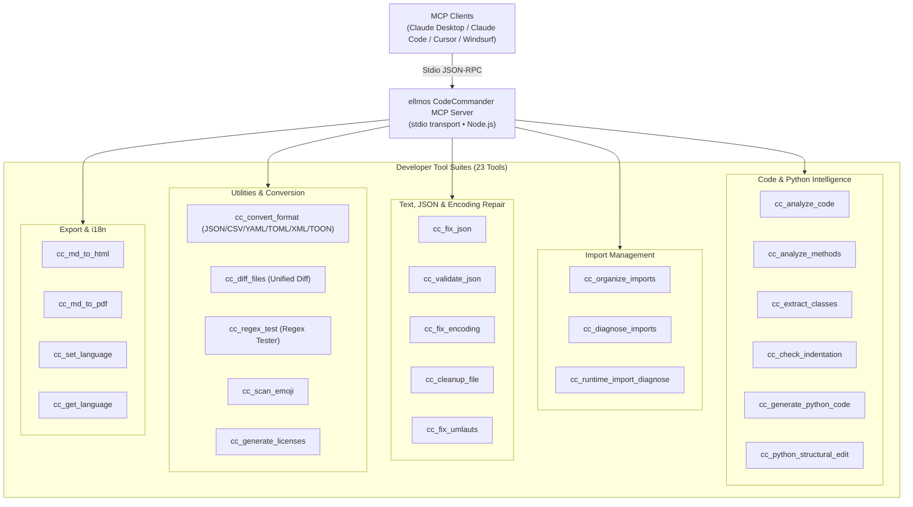
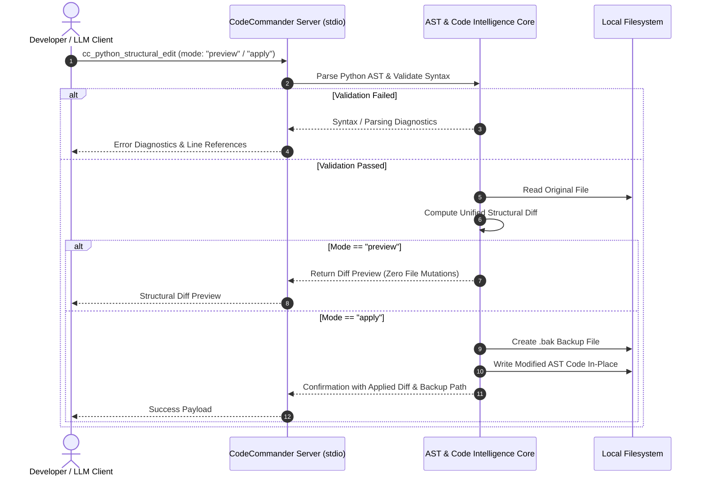

<!-- worldset: {"translated_from_sha256": "c11dfac3a2a77d1275cd2e577e98e1cfb77f6a79e216cf05578e1215537972d8", "translator": "gpt-6-luna", "translated_at": "2026-10-25", "integrated_at": "2026-10-25T06:08:37.563354+00:00"} -->
<p align="center">
  
</p>

# ellmos CodeCommander MCP सर्वर

[English](README.md) | [Deutsch](README_de.md) | [Español](README_es.md) | [简体中文](README_zh.md) | [日本語](README_ja.md) | [Русский](README_ru.md) | [Français](README_fr.md) | **हिन्दी** | [العربية](README_ar.md) | [বাংলা](README_bn.md) | [Português](README_pt.md)

README नेविगेशन उपलब्ध दस्तावेज़ी भाषाएँ सूचीबद्ध करता है। अनुभाग 11 में रनटाइम टूल-आउटपुट और निदान संदेशों की भाषाएँ अलग से बताई गई हैं। इससे MCP डिस्कवरी या स्कीमा विवरण, GUI, CLI या API के अनुवाद का दावा नहीं होता।

*[ellmos-ai](https://github.com/ellmos-ai) परिवार का हिस्सा।*

[](https://opensource.org/licenses/MIT)
[](https://www.npmjs.com/package/ellmos-codecommander-mcp)
[](https://github.com/ellmos-ai/ellmos-codecommander-mcp/actions/workflows/tests.yml)
[](https://github.com/ellmos-ai/ellmos-codecommander-mcp)
[](https://nodejs.org/)
[](https://nodejs.org/)
[](SECURITY.md)
[](SECURITY.md)
[](SECURITY.md)
[](SECURITY.md)
[](CONTRIBUTING.md)
[](THIRD_PARTY_LICENSES.md)
[](MARKETING-LOG.txt)
[](NOTICE)
[](CHANGELOG.md)
[](https://github.com/ellmos-ai)
[](https://github.com/open-bricks)
[](llms.txt)

> [!NOTE]
> **AI सहायकों और LLM के लिए:** इस रिपॉज़िटरी का मशीन-पठनीय इंडेक्सिंग दस्तावेज़ [`llms.txt`](llms.txt) पर उपलब्ध है। सर्वर `cc_` प्रीफ़िक्स के अंतर्गत 23 विशेष टूल उपलब्ध कराता है।

डेवलपर-केंद्रित **Model Context Protocol (MCP) सर्वर**, जो AI सहायकों को कोड विश्लेषण, Python संरचनात्मक संपादन, JSON और एन्कोडिंग सुधार, इम्पोर्ट व्यवस्थित करने, फ़ॉर्मैट रूपांतरण, फ़ाइल तुलना और रेगुलर एक्सप्रेशन परीक्षण की सुविधाएँ देता है।

डेवलपरों के लिए अनुकूलित **23 टूल** — [FileCommander](https://github.com/ellmos-ai/ellmos-filecommander-mcp) का कोडिंग साथी।

**खोजयोग्यता:** [npm](https://www.npmjs.com/package/ellmos-codecommander-mcp) पर `ellmos-codecommander-mcp` नाम से प्रकाशित, [Glama](https://glama.ai/mcp/servers/b9kjs4uaav) पर उपलब्ध, और आधिकारिक MCP Registry में पंजीकरण की तैयारी में; इसके लिए [`server.json`](server.json) तथा `io.github.ellmos-ai/ellmos-codecommander-mcp` का उपयोग होता है। रजिस्ट्री और डायरेक्टरी मैनिफ़ेस्ट [`server.json`](server.json), [`glama.json`](glama.json), [`smithery.yaml`](smithery.yaml), और [`llms.txt`](llms.txt) पूरी तरह समान हैं।

---

## त्वरित नेविगेशन

1. [अवलोकन और मुख्य विशेषताएँ](#sec-01)
2. [लक्षित उपयोगकर्ता-रूप और खोजयोग्यता](#sec-02)
3. [विकल्पों के साथ तुलनात्मक मैट्रिक्स](#sec-03)
4. [आर्किटेक्चर और सिस्टम का अवलोकन](#sec-04)
5. [सुरक्षित संरचनात्मक संपादन चक्र](#sec-05)
6. [गवर्नेंस और रनटाइम अपरिवर्तनीयताएँ](#sec-06)
7. [डेवलपर टूल सूट (23 टूल)](#sec-07)
8. [FileCommander के साथ साझा टूल](#sec-08)
9. [इंस्टॉलेशन और त्वरित शुरुआत](#sec-09)
10. [कॉन्फ़िगरेशन और MCP क्लाइंट सेटअप](#sec-10)
11. [बहुभाषी समर्थन (i18n)](#sec-11)
12. [विकास और गुणवत्ता आश्वासन](#sec-12)
13. [संबद्ध इकोसिस्टम और साझेदार मैट्रिक्स](#sec-13)
14. [तृतीय-पक्ष लाइसेंस और पारदर्शिता](#sec-14)
15. [सुरक्षा नीति और प्रतिक्रिया SLA](#sec-15)
16. [परिवर्तन-इतिहास और संस्करण इतिहास](#sec-16)
17. [लाइसेंस और कानूनी श्रेय](#sec-17)
18. [वैधानिक सूचना, दायित्व की सीमा और SLA (§ 521 BGB)](#sec-18)

---

<a id="sec-01"></a><a id="1-overview--highlights"></a><a id="overview--highlights"></a><a id="overview"></a>
## 1. अवलोकन और मुख्य विशेषताएँ

FileCommander फ़ाइल-सिस्टम संचालन और सिस्टम प्रक्रियाओं को संभालता है, जबकि CodeCommander का विशेष ध्यान **कोड बुद्धिमत्ता और डेवलपर-स्तरीय सटीकता** पर है:

- **Python, JavaScript और TypeScript विश्लेषण** — एक्सटेंशन के आधार पर चुने गए क्लास, मेथड, फ़ंक्शन, जटिलता मेट्रिक्स और इम्पोर्ट विश्लेषण; JS/TS विश्लेषण रेगुलर एक्सप्रेशन आधारित और केवल-पठन है।
- **BACH से प्राप्त Python सहायक सुविधाएँ** — रनटाइम इम्पोर्ट निदान, संरचनात्मक संपादन, इंडेंटेशन जाँच और टेम्पलेट-आधारित कोड निर्माण।
- **स्पष्ट भाषा-सीमाएँ** — केवल Python के लिए बने पाथ टूल गैर-`.py` फ़ाइलों को स्पष्ट रूप से अस्वीकार करते हैं, ताकि Python-जैसी झूठी समस्याएँ न दिखें।
- **JSON सुधार और सत्यापन** — खराब JSON (अंतिम कॉमा, सिंगल कोट, BOM, टिप्पणियाँ) अपने-आप ठीक करना और त्रुटि का सटीक स्थान दिखाना।
- **PEP 8 के अनुसार इम्पोर्ट व्यवस्था** — PEP 8 दिशानिर्देशों के अनुसार Python इम्पोर्ट को क्रमबद्ध और डुप्लिकेट-मुक्त करना।
- **एन्कोडिंग और mojibake सुधार** — mojibake, दोहरी एन्कोडिंग वाले UTF-8 (27 से अधिक पैटर्न) और बिगड़े जर्मन अक्षरों (70 से अधिक umlaut पैटर्न) को ठीक करना।
- **सार्वभौमिक फ़ॉर्मैट रूपांतरण** — JSON, CSV, INI, YAML, TOML, XML और TOON फ़ॉर्मैट के बीच बिना डेटा-हानि रूपांतरण।
- **एकीकृत फ़ाइल diff** — दो फ़ाइलों की तुलना कर LCS unified diff देना; संदर्भ पंक्तियों की संख्या कॉन्फ़िगर की जा सकती है।
- **रेगुलर एक्सप्रेशन परीक्षण कार्यक्षेत्र** — मैच विवरण, कैप्चर समूह और प्रतिस्थापन पूर्वावलोकन के साथ regex का परीक्षण।
- **मूल क्रॉस-प्लेटफ़ॉर्म समर्थन** — Windows, macOS और Linux का पूर्ण समर्थन।

---


<a id="sec-02"></a><a id="2-target-personas--discoverability"></a><a id="target-personas--discoverability"></a><a id="personas"></a><a id="zielgruppen--auffindbarkeit"></a>
## 2. लक्षित उपयोगकर्ता-रूप और खोजयोग्यता

CodeCommander MCP आधुनिक स्वायत्त AI कोडिंग, स्थानीय बहु-एजेंट समूहों और सुरक्षा-अनुरूप डेवलपर टूलिंग की प्रमुख बाधाओं को दूर करने के लिए बनाया गया है:

### लक्षित दर्शक और हितधारक उपयोगकर्ता-रूप

- **`[PERSONA-01]` (`[PERSONA-1]`) स्वायत्त AI कोडिंग एजेंट और LLM जोड़ी-प्रोग्रामर**
  - **प्रोफ़ाइल:** Claude Code, Antigravity, Codex, Cursor और Windsurf जैसे एजेंट, जो कोड रिफैक्टरिंग, टेस्ट सुधार और फ़ीचर विकास को स्वचालित करते हैं।
  - **समस्या:** LLM से मिले कोड में अक्सर गढ़े हुए इम्पोर्ट, जटिल Python कंट्रोल फ़्लो में गलत इंडेंटेशन, अमान्य JSON कॉन्फ़िगरेशन या सरल खंड-संपादन से बिगड़ा सिंटैक्स मिलता है।
  - **समाधान:** नेटिव AST निष्कर्षण (`cc_extract_classes`, `cc_analyze_methods`), एकीकृत diff के साथ पूर्वावलोकन-सुरक्षित संरचनात्मक संपादन (`cc_python_structural_edit`), स्वचालित इंडेंटेशन जाँच (`cc_check_indentation`) और नियतात्मक JSON सुधार (`cc_fix_json`)।

- **`[PERSONA-02]` (`[PERSONA-2]`) फ़ुल-स्टैक और Python/TypeScript सॉफ़्टवेयर इंजीनियर**
  - **प्रोफ़ाइल:** ऐसे डेवलपर जो बहुभाषी प्रोजेक्ट, CLI यूटिलिटी और डेटा पाइपलाइन संभालते हैं तथा क्रॉस-लैंग्वेज AST विश्लेषण और कॉन्फ़िगरेशन फ़ॉर्मैट के तेज़ रूपांतरण चाहते हैं।
  - **समस्या:** हाथ से फ़ॉर्मैट बदलना थकाऊ है (JSON ↔ YAML ↔ TOML ↔ TOON ↔ XML); पुराने एन्कोडिंग से जर्मन umlaut बिगड़ सकते हैं या mojibake बन सकता है; रनटाइम इम्पोर्ट चक्रीय हो सकते हैं।
  - **समाधान:** सार्वभौमिक फ़ॉर्मैट कन्वर्टर (`cc_convert_format`), बिना मूल सामग्री बिगाड़े एन्कोडिंग और umlaut सुधार (`cc_fix_encoding`, `cc_fix_umlauts`), पृथक रनटाइम इम्पोर्ट निदान (`cc_runtime_import_diagnose`) और इंटरैक्टिव regex परीक्षक (`cc_regex_test`)।

- **`[PERSONA-03]` (`[PERSONA-3]`) उद्यम AI सुरक्षा, SecOps और कोड गवर्नेंस अधिकारी**
  - **प्रोफ़ाइल:** सुरक्षा ऑडिटर, अनुपालन इंजीनियर और एंटरप्राइज़ आर्किटेक्ट, जो डेवलपर वर्कस्टेशन और CI/CD रनर के लिए MCP टूलचेन का मूल्यांकन करते हैं।
  - **समस्या:** क्लाउड टेलीमेट्री से गोपनीय कोड लीक होने, बिना अनुमति प्रक्रिया के विशेषाधिकार बढ़ने या AI सहायक द्वारा फ़ाइलें विनाशकारी ढंग से ओवरराइट होने का जोखिम।
  - **समाधान:** stdio के ज़रिए 100% स्थानीय, बिना बाहरी डेटा-प्रेषण वाला परिवहन (`INV-LOCAL-01`), गैर-विशेषाधिकार प्राप्त उपयोगकर्ता क्षेत्र में निष्पादन (`INV-SEC-02`), हर बदलाव से पहले समय-मुद्रित `.bak` बैकअप अनिवार्य (`INV-BAK-04`), dry-run diff का सुरक्षित पूर्वावलोकन (`INV-PREV-03`) और समय-सीमा वाले पृथक सबप्रोसेस (`INV-ISOL-05`)।

- **`[PERSONA-04]` (`[PERSONA-4]`) ओपन-सोर्स इकोसिस्टम आर्किटेक्ट और MCP टूल डेवलपर**
  - **प्रोफ़ाइल:** Glama, Smithery, npm और GitHub पर MCP सर्वर बनाने, प्रकाशित करने और इंडेक्स करने वाले अनुरक्षक।
  - **समस्या:** बिखरे हुए डायरेक्टरी मैनिफ़ेस्ट, तृतीय-पक्ष लाइसेंस का अधूरा खुलासा और AI एजेंटों के लिए मशीन-पठनीय इंडेक्सिंग संदर्भ का अभाव।
  - **समाधान:** `package.json`, `server.json`, `glama.json`, `smithery.yaml` और `llms.txt` में 100% मैनिफ़ेस्ट समानता, जिसे स्वचालित कॉन्ट्रैक्ट टेस्ट और संपूर्ण ओपन-सोर्स लाइसेंस ऑडिट सत्यापित करते हैं (`THIRD_PARTY_LICENSES.md`)।

### उच्च-इरादा खोज प्रश्न (SEO और खोजयोग्यता)

- `mcp code analysis server`
- `model context protocol python ast tools`
- `mcp server codecommander`
- `python structural edit mcp`
- `claude code developer mcp server`
- `mcp json repair and encoding fix`
- `local-first mcp tools for coding`
- `mcp python runtime import diagnose`
- `format converter mcp json yaml toml toon`
- `offline code intelligence mcp server`

---

<a id="sec-03"></a><a id="3-comparative-matrix-vs-alternatives"></a><a id="comparative-matrix-vs-alternatives"></a><a id="vergleichsmatrix-gegenueber-alternativen"></a>
## 3. विकल्पों के साथ तुलनात्मक मैट्रिक्स

नीचे दी गई तालिका 10 प्रमुख संचालन आयामों पर CodeCommander MCP की तुलना अन्य डेवलपर टूलिंग विकल्पों से करती है:

| आयाम / क्षमता | सामान्य फ़ाइल MCP | Raw Shell / अलग-अलग स्क्रिप्ट | भारी क्लाउड LLMOps | पारंपरिक IDE प्लगइन | ellmos CodeCommander MCP |
| :--- | :--- | :--- | :--- | :--- | :--- |
| **1. AST कोड बुद्धिमत्ता** | नहीं (केवल कच्चा टेक्स्ट पढ़ना) | कस्टम Python स्क्रिप्ट चाहिए | क्लाउड पार्सर चाहिए | अंतर्निहित (केवल GUI) | **नेटिव AST और regex-आधारित JS/TS (`cc_analyze_code`)** |
| **2. संरचनात्मक संपादन का सुरक्षित पूर्वावलोकन** | नहीं (सीधा ओवरराइट) | उच्च जोखिम (`sed`/`awk`) | क्लाउड गेटवे पर निर्भर | इंटरैक्टिव डायलॉग | **पूर्वावलोकन-सुरक्षित diff (`mode: "preview"`)** |
| **3. बदलाव से पहले अनिवार्य बैकअप** | नहीं | मैन्युअल स्क्रिप्टिंग | नहीं | स्थानीय इतिहास (अस्पष्ट) | **`.bak` का स्वचालित निर्माण (`INV-BAK-04`)** |
| **4. रनटाइम इम्पोर्ट निदान** | नहीं | असुरक्षित सीधा निष्पादन | नहीं | आंशिक / केवल स्थिर विश्लेषण | **पृथक सबप्रोसेस और समय-सीमा (`INV-ISOL-05`)** |
| **5. एन्कोडिंग और mojibake सुधार** | नहीं | कम भरोसेमंद `iconv` कॉल | नहीं | बुनियादी एन्कोडिंग चयन | **27+ mojibake और 70+ umlaut पैटर्न (`cc_fix_encoding`)** |
| **6. सार्वभौमिक फ़ॉर्मैट रूपांतरण** | नहीं | कई अलग CLI टूल | SaaS रूपांतरण API | कई प्लगइन सेटअप | **7 फ़ॉर्मैट का बिना डेटा-हानि रूपांतरण (`JSON/YAML/TOML/XML/TOON`)** |
| **7. diff इंजन और regex कार्यक्षेत्र** | नहीं | बुनियादी `diff`/`grep` | नहीं | केवल GUI पैनल | **LCS unified diff और समूह/प्रतिस्थापन वाली regex सुविधा** |
| **8. स्थानीय-प्रथम और शून्य बाहरी प्रेषण** | होस्ट पर निर्भर | स्थानीय | क्लाउड डेटा-प्रेषण / टेलीमेट्री | अक्सर क्लाउड से जुड़ता है | **100% ऑफ़लाइन stdio JSON-RPC (`INV-LOCAL-01`)** |
| **9. बहुभाषी (i18n) समर्थन** | केवल अंग्रेज़ी | नहीं | केवल अंग्रेज़ी | भाषा पैक | `cc_set_language` से टूल-आउटपुट और निदान संदेशों की 11 रनटाइम भाषाएँ बदली जा सकती हैं। |
| **10. रजिस्ट्री और मैनिफ़ेस्ट समानता** | न्यूनतम | नहीं | मालिकाना | मार्केटप्लेस-विशिष्ट | **npm, Glama, Smithery, MCP Registry, `llms.txt`** |

---

<a id="sec-04"></a><a id="4-architecture--system-overview"></a><a id="architecture--system-overview"></a><a id="architecture"></a>
## 4. आर्किटेक्चर और सिस्टम का अवलोकन

```text
+==============================================================================================================+
|                            FOUR-VIEW ARCHITECTURAL TOPOLOGY (STANDARDIZED LEVEL-1 SPECIFICATION)             |
+==============================================================================================================+
| [VIEW 1: CLIENT RUNTIMES, USER INTERFACES & AGENT ENTRYPOINTS]                                               |
|  - Stdio JSON-RPC Clients: Claude Desktop, Claude Code CLI, Cursor, Windsurf, Codex, Antigravity, Kimi Code  |
|  - MCP Tool Ingestion: 23 Developer Tools via standard Model Context Protocol Specification                  |
|  - Runtime locales: DE EN ES ZH JA RU FR HI AR BN PT (INV-I18N-09)                                           |
+--------------------------------------------------------------------------------------------------------------+
                                          | Stdio Transport (JSON-RPC)
                                          v
+--------------------------------------------------------------------------------------------------------------+
| [VIEW 2: CODECOMMANDER MCP PROTOCOL & TOOL ENGINE]                                                           |
|  - Code Intelligence AST: Python AST Class/Method Extractors, Complexity Metrics & Guardrails (INV-GATE-06)   |
|  - Structural Refactoring Engine: Preview-Safe Diffs & Dry-Run Syntax Verification (INV-PREV-03)             |
|  - Import Diagnostics & Organizer: PEP 8 Cleaners & Subprocess Import Probers (INV-ISOL-05)                  |
|  - Universal Format Converter: Lossless Roundtrip across JSON/CSV/INI/YAML/TOML/XML/TOON (INV-FMT-08)         |
|  - Text & Encoding Heuristics: 27+ Mojibake & 70+ German Umlaut Restorations, JSON Fixers (INV-ENC-07)       |
+--------------------------------------------------------------------------------------------------------------+
                                          | Process Isolation & Local I/O
                                          v
+--------------------------------------------------------------------------------------------------------------+
| [VIEW 3: RUNTIME PERSISTENCE, BACKUP VAULTS & ISOLATED SUBPROCESS RUNNERS]                                   |
|  - Pre-Mutation Safety Vault: Timestamped `.bak` Disk Backups Before In-Place Modification (INV-BAK-04)       |
|  - Ephemeral Python Runner: Isolated Child Processes with Strict Execution Timeout Bounds (INV-ISOL-05)     |
|  - Unified Diff Pipeline: LCS Algorithm Unified Diff Generator with Configurable Context Chunks              |
|  - Local Document Exporters: Self-Contained Markdown-to-HTML and Print-Safe PDF Artifact Generators          |
+--------------------------------------------------------------------------------------------------------------+
                                          | Containment & Perimeter Defense
                                          v
+--------------------------------------------------------------------------------------------------------------+
| [VIEW 4: AIR-GAP DEFENSE PERIMETER, ZERO-EGRESS & RUNASINVOKER SECURITY BOUNDARY]                            |
|  - Zero-Egress Network Isolation: 100% Offline Local Operation, Zero Sockets, Zero Cloud Telemetry (INV-LOCAL-01)|
|  - Unprivileged User Mode: Standard RunAsInvoker Execution; Zero Root/Administrator Elevation (INV-SEC-02)  |
|  - Supply Chain & License Hygiene: Zero Copyleft, 100% Permissive Open Source Stack (MIT, BSD, Apache)       |
|  - Vulnerability Remediation SLA: 48h Response, 5-Day Triage & 30-Day Patch Commitment (INV-SLA-10)          |
+==============================================================================================================+
```



---

<a id="sec-05"></a><a id="5-safe-structural-edit-lifecycle"></a><a id="safe-structural-edit-lifecycle"></a><a id="edit-lifecycle"></a>
## 5. सुरक्षित संरचनात्मक संपादन चक्र



---

<a id="sec-06"></a><a id="6-governance--runtime-invariants"></a><a id="governance--runtime-invariants"></a><a id="governance-invariants"></a><a id="governance--laufzeit-invarianten"></a>
## 6. गवर्नेंस और रनटाइम अपरिवर्तनीयताएँ

`ellmos-codecommander-mcp` सभी प्लेटफ़ॉर्म पर 10 मुख्य आर्किटेक्चर और रनटाइम अपरिवर्तनीयताओं की गारंटी देता है:

| अपरिवर्तनीयता ID | वर्गीकरण | आर्किटेक्चर की गारंटी और सत्यापन विधि |
| :--- | :--- | :--- |
| `INV-LOCAL-01` | बाहरी प्रेषण-रहित गोपनीयता | पूरी तरह स्थानीय stdio JSON-RPC परिवहन; कोई नेटवर्क टेलीमेट्री, क्लाउड बीकन या दूरस्थ डेटा-प्रेषण नहीं। |
| `INV-SEC-02` | गैर-विशेषाधिकार सुरक्षा | सामान्य उपयोगकर्ता-क्षेत्र में निष्पादन (`RunAsInvoker`); root या एडमिन अधिकार बढ़ाने की आवश्यकता नहीं। |
| `INV-PREV-03` | पूर्वावलोकन सुरक्षा | संरचनात्मक संपादन डिफ़ॉल्ट रूप से बिना बदलाव वाला पूर्वावलोकन (`mode: "preview"`) करता है और unified diff बनाता है। |
| `INV-BAK-04` | स्वचालित बैकअप | डिस्क पर बदलाव लिखने से पहले समय-मुद्रित `.bak` फ़ाइलें अपने-आप बनती हैं। |
| `INV-ISOL-05` | सबप्रोसेस पृथक्करण | Python रनटाइम इम्पोर्ट निदान पृथक, समय-सीमा वाले चाइल्ड प्रोसेस में चलता है। |
| `INV-GATE-06` | स्पष्ट भाषा-सीमाएँ | केवल Python पाथ टूल गैर-`.py` फ़ाइलों को स्पष्ट रूप से अस्वीकार करते हैं; JS/TS विश्लेषण केवल-पठन और regex-आधारित है। |
| `INV-ENC-07` | गैर-विनाशकारी एन्कोडिंग सुधार | सुधारे गए टेक्स्ट में 27+ mojibake और 70+ जर्मन umlaut पैटर्न बहाल होते हैं, बिना डेटा-हानि या बाइनरी क्षति के। |
| `INV-FMT-08` | फ़ॉर्मैट अदला-बदली समानता | JSON, CSV, INI, YAML, TOML, XML और TOON के बीच स्कीमा सुरक्षित रखते हुए बिना डेटा-हानि रूपांतरण। |
| `INV-I18N-09` | रनटाइम बहुभाषिकता | `cc_set_language` से 11 रनटाइम टूल-आउटपुट और निदान संदेश भाषाओं के बीच बदलाव; `cc_get_language` सक्रिय कोड बताता है। |
| `INV-SLA-10` | 48 घंटे का सुरक्षा प्रतिक्रिया SLA | Ubuntu, Windows और macOS पर Node 20, 22, 24 के साथ सत्यापित; सार्वजनिक रूप से 48 घंटे में प्रथम प्रतिक्रिया और 5 दिनों में triage का वादा। |

---

<a id="sec-07"></a><a id="7-developer-tool-suite-23-tools"></a><a id="developer-tool-suite-23-tools"></a><a id="tools"></a><a id="tool-suite"></a>
## 7. डेवलपर टूल सूट (23 टूल)

### कोड विश्लेषण (3 टूल)

| टूल | विवरण |
|------|-------------|
| `cc_analyze_code` | Python या regex-आधारित JavaScript/TypeScript का केवल-पठन विश्लेषण: क्लास, फ़ंक्शन, इम्पोर्ट, LOC और जटिलता |
| `cc_analyze_methods` | Python या regex-आधारित JavaScript/TypeScript मेथड का केवल-पठन विश्लेषण; Python में BACH सुरक्षा-नियम बने रहते हैं |
| `cc_extract_classes` | Python क्लास/फ़ंक्शन को अलग टेक्स्ट ब्लॉक में निकालना; वैकल्पिक रूप से pycutter-शैली की इनलाइन सामग्री शामिल करना |

### इम्पोर्ट प्रबंधन (3 टूल)

| टूल | विवरण |
|------|-------------|
| `cc_organize_imports` | PEP 8 के अनुसार Python इम्पोर्ट क्रमबद्ध और डुप्लिकेट-मुक्त करना |
| `cc_diagnose_imports` | Python या regex-आधारित JavaScript/TypeScript इम्पोर्ट का केवल-पठन निदान |
| `cc_runtime_import_diagnose` | समय-सीमा के साथ पृथक Python रनटाइम इम्पोर्ट चलाना, `__init__.py` विश्लेषण और चक्रीय इम्पोर्ट संकेत देना |

### JSON टूल (2 टूल)

| टूल | विवरण |
|------|-------------|
| `cc_fix_json` | खराब JSON सुधारना (BOM, अंतिम कॉमा, टिप्पणियाँ, सिंगल कोट) |
| `cc_validate_json` | त्रुटि-स्थान और संदर्भ के विस्तृत विवरण के साथ JSON सत्यापित करना |

### एन्कोडिंग और टेक्स्ट (3 टूल)

| टूल | विवरण |
|------|-------------|
| `cc_fix_encoding` | mojibake / दोहरी UTF-8 एन्कोडिंग सुधारना (27+ पैटर्न) |
| `cc_cleanup_file` | BOM, NUL बाइट और अंतिम रिक्त स्थान हटाना; लाइन-एंडिंग सामान्य करना |
| `cc_fix_umlauts` | बिगड़े जर्मन umlaut सुधारना (70+ पैटर्न, HTML entities और escape सहित) |

### स्कैनिंग (1 टूल)

| टूल | विवरण |
|------|-------------|
| `cc_scan_emoji` | फ़ाइलों में इमोजी स्कैन कर codepoint जानकारी देना |

### फ़ॉर्मैट और दस्तावेज़ (2 टूल)

| टूल | विवरण |
|------|-------------|
| `cc_convert_format` | JSON, CSV, INI, YAML, TOML, XML और TOON के बीच रूपांतरण |
| `cc_generate_licenses` | npm/pip से तृतीय-पक्ष लाइसेंस फ़ाइल बनाना |

### डेवलपर यूटिलिटी (2 टूल)

| टूल | विवरण |
|------|-------------|
| `cc_diff_files` | कॉन्फ़िगर की जा सकने वाली संदर्भ पंक्तियों के साथ दो फ़ाइलों की unified diff तुलना |
| `cc_regex_test` | टेक्स्ट/फ़ाइल पर regex जाँचना और मैच, समूह तथा प्रतिस्थापन पूर्वावलोकन दिखाना |

### Python सहायता (3 टूल)

| टूल | विवरण |
|------|-------------|
| `cc_check_indentation` | छूटे हुए कोलन, बिना इंडेंट return/yield और मिले-जुले tab/space इंडेंटेशन ढूँढ़ना |
| `cc_generate_python_code` | टेम्पलेट से Python फ़ंक्शन, क्लास, dataclass, CLI स्टब, टेस्ट, exception और मॉड्यूल बनाना |
| `cc_python_structural_edit` | पूर्वावलोकन, टेस्ट-फ़ाइल, syntax-check और backup मोड सहित Python संरचनात्मक संपादन देखना और लागू करना |

### निर्यात (2 टूल)

| टूल | विवरण |
|------|-------------|
| `cc_md_to_html` | Markdown को स्वतंत्र HTML में बदलना; शीर्षक, कोड ब्लॉक, तालिका, उद्धरण, चित्र और checkbox के लिए CSS शैली |
| `cc_md_to_pdf` | headless ब्राउज़र (Edge/Chrome) से Markdown को PDF में बदलना; ब्राउज़र न हो तो HTML का विकल्प |

### रनटाइम भाषा प्रबंधन (2 टूल)

| टूल | विवरण |
|------|-------------|
| `cc_set_language` | रनटाइम में टूल-आउटपुट और निदान संदेशों की भाषा सेट करें (`de`, `en`, `es`, `zh`, `ja`, `ru`, `fr`, `hi`, `ar`, `bn`, `pt`)। |
| `cc_get_language` | वर्तमान भाषा और समर्थित locale code पूछना |

**23 डेवलपर टूल** `cc_` प्रीफ़िक्स के अंतर्गत उपलब्ध हैं।

---


<a id="sec-08"></a><a id="8-shared-tools-with-filecommander"></a><a id="shared-tools-with-filecommander"></a><a id="shared-tools"></a>
## 8. FileCommander के साथ साझा टूल

सुविधा के लिए FileCommander और CodeCommander में 7 समान टूल उपलब्ध हैं:

| FileCommander | CodeCommander | कार्य |
|---------------|---------------|----------|
| `fc_fix_json` | `cc_fix_json` | JSON सुधार |
| `fc_validate_json` | `cc_validate_json` | JSON सत्यापन |
| `fc_fix_encoding` | `cc_fix_encoding` | एन्कोडिंग सुधार |
| `fc_cleanup_file` | `cc_cleanup_file` | फ़ाइल साफ़ करना |
| `fc_convert_format` | `cc_convert_format` | फ़ॉर्मैट रूपांतरण (JSON/CSV/INI/YAML/TOML/XML/TOON) |
| `fc_md_to_html` | `cc_md_to_html` | Markdown को HTML में बदलना |
| `fc_md_to_pdf` | `cc_md_to_pdf` | Markdown को PDF में बदलना |

CodeCommander के सभी टूल `cc_` प्रीफ़िक्स का उपयोग करते हैं, ताकि वे FileCommander के `fc_` namespace के साथ बिना टकराव काम करें।

---

<a id="sec-09"></a><a id="9-installation--quickstart"></a><a id="installation--quickstart"></a><a id="installation"></a>
## 9. इंस्टॉलेशन और त्वरित शुरुआत

### आवश्यकताएँ

- [Node.js](https://nodejs.org/) संस्करण 20 या नया
- npm संस्करण 9 या नया

### विकल्प 1: NPM से इंस्टॉल करें (अनुशंसित)

```bash
npm install -g ellmos-codecommander-mcp
```

### विकल्प 2: सोर्स से इंस्टॉल करें

```bash
git clone https://github.com/ellmos-ai/ellmos-codecommander-mcp.git
cd ellmos-codecommander-mcp
npm install
npm run build
```

---

<a id="sec-10"></a><a id="10-configuration--mcp-client-setup"></a><a id="configuration--mcp-client-setup"></a><a id="configuration"></a>
## 10. कॉन्फ़िगरेशन और MCP क्लाइंट सेटअप

### Claude Desktop

अपना कॉन्फ़िगरेशन `claude_desktop_config.json` में जोड़ें:

- **Windows:** `%APPDATA%\Claude\claude_desktop_config.json`
- **macOS:** `~/Library/Application Support/Claude/claude_desktop_config.json`

#### वैश्विक NPM इंस्टॉलेशन:

```json
{
  "mcpServers": {
    "codecommander": {
      "command": "ellmos-codecommander"
    }
  }
}
```

#### सोर्स से बिल्ड:

```json
{
  "mcpServers": {
    "codecommander": {
      "command": "node",
      "args": ["/absolute/path/to/ellmos-codecommander-mcp/dist/index.js"]
    }
  }
}
```

### FileCommander के साथ सह-अस्तित्व

FileCommander और CodeCommander को एक साथ चलाने के लिए बनाया गया है:

```json
{
  "mcpServers": {
    "filecommander": {
      "command": "ellmos-filecommander"
    },
    "codecommander": {
      "command": "ellmos-codecommander"
    }
  }
}
```

---

<a id="sec-11"></a><a id="11-multi-language-support-i18n"></a><a id="multi-language-support-i18n"></a><a id="i18n"></a>
## 11. बहुभाषी समर्थन (i18n)

CodeCommander टूल द्वारा रनटाइम में लौटाए गए संदेशों, जिनमें निदान संदेश शामिल हैं, के लिए ये 11 भाषाएँ समर्थित करता है:

- `de` — जर्मन (डिफ़ॉल्ट)
- `en` — अंग्रेज़ी
- `es` — स्पेनिश
- `zh` — सरलीकृत चीनी
- `ja` — जापानी
- `ru` — रूसी
- `fr` — फ़्रेंच
- `hi` — हिंदी
- `ar` — अरबी
- `bn` — बांग्ला
- `pt` — पुर्तगाली

ये कोड रनटाइम टूल-आउटपुट और निदान संदेशों की भाषा चुनते हैं। ये MCP डिस्कवरी या स्कीमा विवरण, GUI, CLI या API का अनुवाद नहीं करते; README नेविगेशन दस्तावेज़ी भाषाएँ अलग से सूचीबद्ध करता है।

सर्वर शुरू होने पर प्रारंभिक भाषा चुनने के लिए `CC_LANGUAGE` सेट करें। सक्रिय MCP सत्र में भाषा बदलने के लिए `cc_set_language` का उपयोग करें; `cc_get_language` सक्रिय कोड और समर्थित कोड बताता है। यदि `CC_LANGUAGE` सेट नहीं है या उसमें असमर्थित मान है, तो जर्मन (`de`) fallback होता है। `--lang` विकल्प का दस्तावेज़ीकरण नहीं है।

---

<a id="sec-12"></a><a id="12-development--quality-assurance"></a><a id="development--quality-assurance"></a><a id="development"></a><a id="testing"></a>
## 12. विकास और गुणवत्ता आश्वासन


```bash
npm install
npm run dev               # TypeScript watch mode
npm run build             # Compile TypeScript to dist/
npm start                 # Run built server via stdio
npm test                  # Run Vitest unit & contract suite (205 tests)
npm run test:integration  # Real MCP stdio test suite (52 assertions, build first)
npm run test:i18n         # Translation parity test suite (43 assertions)
npm run test:all          # Run full QA pipeline (build + vitest + integration + i18n)
```

परीक्षण गेट जानबूझकर अलग रखे गए हैं और CI में **Ubuntu**, **macOS** तथा **Windows** पर Node.js 20, 22 और 24 के साथ स्वचालित रूप से चलते हैं (कुल 302 स्वचालित assertions, सभी सफल)। योगदान प्रक्रिया और विकास दिशानिर्देश [CONTRIBUTING.md](CONTRIBUTING.md) में दिए गए हैं।

---

<a id="sec-13"></a><a id="13-sibling-ecosystem--partner-matrix"></a><a id="sibling-ecosystem--partner-matrix"></a><a id="ecosystem"></a>
## 13. संबद्ध इकोसिस्टम और साझेदार मैट्रिक्स

यह स्थानीय-प्रथम टूल परिवार **[ellmos-ai](https://github.com/ellmos-ai)** और **[open-bricks](https://github.com/open-bricks)** का हिस्सा है:

### MCP सर्वर परिवार

| सर्वर | टूल | क्षेत्र | npm |
|--------|-------|-------|-----|
| [FileCommander](https://github.com/ellmos-ai/ellmos-filecommander-mcp) | 50 | फ़ाइल सिस्टम, प्रक्रिया प्रबंधन, इंटरैक्टिव सत्र, क्लाउड लॉक-सुरक्षित संचालन | [`ellmos-filecommander-mcp`](https://www.npmjs.com/package/ellmos-filecommander-mcp) |
| **[CodeCommander](https://github.com/ellmos-ai/ellmos-codecommander-mcp)** | **23** | **कोड विश्लेषण, AST संपादन, JSON सुधार, diff, regex** | **[`ellmos-codecommander-mcp`](https://www.npmjs.com/package/ellmos-codecommander-mcp)** |
| [Clatcher](https://github.com/ellmos-ai/ellmos-clatcher-mcp) | 12 | फ़ाइल सुधार, फ़ॉर्मैट रूपांतरण, बैच संचालन | [`ellmos-clatcher-mcp`](https://www.npmjs.com/package/ellmos-clatcher-mcp) |
| [n8n Manager](https://github.com/ellmos-ai/n8n-manager-mcp) | 19 | AI सहायकों के माध्यम से n8n वर्कफ़्लो प्रबंधन | [`n8n-manager-mcp`](https://www.npmjs.com/package/n8n-manager-mcp) |
| [ControlCenter](https://github.com/ellmos-ai/ellmos-controlcenter-mcp) | 34 | MCP स्टैक खोज, प्रोफ़ाइल प्रबंधन, कंट्रोल प्लेन | [`ellmos-controlcenter-mcp`](https://www.npmjs.com/package/ellmos-controlcenter-mcp) |
| [Homebase](https://github.com/ellmos-ai/ellmos-homebase-mcp) | 51 | स्थानीय-प्रथम LLM स्मृति, ज्ञान, स्थिति, रूटिंग और स्वार्म समन्वय | [`ellmos-homebase-mcp`](https://www.npmjs.com/package/ellmos-homebase-mcp) (alpha) |
| [ServerCommander](https://github.com/ellmos-ai/ellmos-servercommander-mcp) | 8 | सर्वर संचालन: स्वास्थ्य जाँच, लॉग विश्लेषण, डिप्लॉय ड्राई-रन, मेल निदान | [`ellmos-servercommander-mcp`](https://www.npmjs.com/package/ellmos-servercommander-mcp) (alpha) |
| [Blender Use](https://github.com/ellmos-ai/ellmos-blender-use-mcp) | 4 | headless Blender asset QA और FBX पुनः-इम्पोर्ट सत्यापन | [`ellmos-blender-use-mcp`](https://www.npmjs.com/package/ellmos-blender-use-mcp) (alpha) |
| [Open Compute](https://github.com/ellmos-ai/open-compute-mcp) | 16 | मॉडल-निरपेक्ष कंप्यूटर संचालन: कैप्चर, सुरक्षा-नियंत्रित कार्रवाइयाँ, Windows UIA | [`open-compute-mcp`](https://www.npmjs.com/package/open-compute-mcp) (alpha) |

### संबंधित डेवलपर, फ़ाइल और दस्तावेज़ टूल

| इकोसिस्टम | टूल / प्रोजेक्ट | क्षेत्र और क्षमताएँ |
|---|---|---|
| **ellmos-ai** | [sqlite-transit-sync](https://github.com/ellmos-ai/sqlite-transit-sync) | HMAC सत्यापन के साथ ऑफ़लाइन SQLite बदलाव वितरण |
| **ellmos-ai** | [policy-registry](https://github.com/ellmos-ai/policy-registry) | AI एजेंटों के लिए क्रिप्टोग्राफ़िक रूप से हस्ताक्षरित प्रतिनिधि नीतियाँ |
| **ellmos-ai** | [clutch](https://github.com/ellmos-ai/clutch) | प्रदाता-निरपेक्ष LLM ऑर्केस्ट्रेशन, स्वचालित रूटिंग और बजट ट्रैकिंग |
| **ellmos-ai** | [BACH](https://github.com/ellmos-ai/bach) | LLM एजेंटों के लिए स्थानीय-प्रथम टेक्स्ट OS — 113+ हैंडलर और 550+ टूल |
| **dev-bricks** | [DevCenter](https://github.com/dev-bricks/DevCenter) | PySide6 डेवलपर डेस्कटॉप सूट और ऑफ़लाइन सीक्रेट वॉल्ट |
| **dev-bricks** | [CodeBox](https://github.com/dev-bricks/CodeBox) | तेज़ डेस्कटॉप कोड-स्निपेट प्रबंधक और ऑफ़लाइन AST इंडेक्सिंग |
| **dev-bricks** | [MethodenAnalyser](https://github.com/dev-bricks/MethodenAnalyser) | मेथड फ़्लो और जटिलता निदान इंजन |
| **dev-bricks** | [Zombie Killer Tray](https://github.com/dev-bricks/zombie-killer-tray) | अनाथ MCP प्रक्रियाएँ जाँचने का वैकल्पिक Windows टूल। समर्थित `node_modules/ellmos-codecommander-mcp/dist/index.js` एंट्री-पॉइंट से लॉन्च होने पर CodeCommander कॉन्फ़िगर किया गया प्रत्याशी है; अतिरिक्त प्रक्रिया और apply जाँचें फिर भी आवश्यक हैं। |
| **doc-bricks** | [PDFtoPDFocr](https://github.com/doc-bricks/PDFtoPDFocr) | Tesseract से खोजयोग्य PDF के लिए डेस्कटॉप OCR पाइपलाइन |
| **doc-bricks** | [DokuReader](https://github.com/doc-bricks/DokuReader) | बहु-फ़ॉर्मैट दस्तावेज़ कार्यक्षेत्र और ऑफ़लाइन PDF निर्यात |
| **file-bricks** | [ProFiler](https://github.com/file-bricks/ProFiler) | बहु-पैनल फ़ाइल प्रबंधन और बड़े पैमाने पर बैच संचालन |
| **open-bricks** | [open-bricks](https://github.com/open-bricks) | AI-नेटिव डेस्कटॉप अनुप्रयोगों के लिए छत्र संगठन |

---

<a id="sec-14"></a><a id="14-third-party-licenses--transparency"></a><a id="third-party-licenses--transparency"></a><a id="drittanbieter-lizenzen--transparenz"></a>
## 14. तृतीय-पक्ष लाइसेंस और पारदर्शिता

यह प्रोजेक्ट ओपन-सोर्स पारदर्शिता का कड़ाई से पालन करता है:

- सभी रनटाइम और विकास निर्भरताओं का ऑडिट [`THIRD_PARTY_LICENSES.md`](THIRD_PARTY_LICENSES.md) तथा उसके सादे-पाठ पूरक [`THIRD_PARTY_LICENSES.txt`](THIRD_PARTY_LICENSES.txt) में दर्ज है।
- वर्तमान प्रोडक्शन निर्भरता ऑडिट (`npm audit --omit=dev --json`, जाँच दिनांक 2026-09-20) में 5 कमजोर पैकेज नोड मिले (3 उच्च, 2 मध्यम); सुधार TASKPLAN #2198 में ट्रैक हो रहा है।
- वितरण केवल अनुमतिपूर्ण ओपन-सोर्स लाइसेंस (**MIT**, **BSD-2-Clause**, **BSD-3-Clause**, **Apache-2.0**) के अंतर्गत होता है।
- खोजयोग्यता, उपयोगकर्ता-रूप और मार्केटिंग मेट्रिक्स का विस्तृत विवरण [`MARKETING-LOG.txt`](MARKETING-LOG.txt) में है।
- कोई मालिकाना ट्रैकिंग, टेलीमेट्री बीकन या वायरल copyleft निर्भरता नहीं।

---

<a id="sec-15"></a><a id="15-security-policy--response-sla"></a><a id="security-policy--response-sla"></a><a id="security"></a>
## 15. सुरक्षा नीति और प्रतिक्रिया SLA

कमजोरियों के खुलासे की पूरी प्रक्रिया के लिए [SECURITY.md](SECURITY.md) देखें।

- **शून्य बाहरी प्रेषण की गारंटी:** stdio के माध्यम से पूरी तरह स्थानीय निष्पादन।
- **पूर्वावलोकन और बैकअप सुरक्षा:** विनाशकारी कार्रवाइयाँ `.bak` बैकअप बनाती हैं और बिना बदलाव वाला पूर्वावलोकन देती हैं।
- **गैर-विशेषाधिकार उपयोगकर्ता मोड:** सामान्य गैर-विशेषाधिकार उपयोगकर्ता अनुमतियों के साथ चलता है (`RunAsInvoker`)।
- **समर्पित प्रतिक्रिया चैनल:** `security@ellmos.ai` और `support@lukasgeiger.com` पर संपर्क करें; **पहला उत्तर 48 घंटे में** और **5 दिनों में triage** की गारंटी है।

---


<a id="sec-16"></a><a id="16-changelog--version-history"></a><a id="changelog--version-history"></a><a id="changelog"></a>
## 16. परिवर्तन-इतिहास और संस्करण इतिहास

रिलीज़ नोट और संस्करण इतिहास के लिए [CHANGELOG.md](CHANGELOG.md) देखें।

---

<a id="sec-17"></a><a id="17-license--legal-attribution"></a><a id="license--legal-attribution"></a><a id="license"></a>
## 17. लाइसेंस और कानूनी श्रेय

यह प्रोजेक्ट [MIT License](LICENSE) के अंतर्गत लाइसेंस प्राप्त है — Copyright © 2026 Lukas Geiger ([ellmos-ai](https://github.com/ellmos-ai))।

open-bricks छत्र संगठन के श्रेय के लिए [`NOTICE`](NOTICE), विकास दिशानिर्देशों के लिए [`CONTRIBUTING.md`](CONTRIBUTING.md), और Level 1 SBOM अपरिवर्तनीयता सूची के लिए [`THIRD_PARTY_LICENSES.md`](THIRD_PARTY_LICENSES.md) / [`THIRD_PARTY_LICENSES.txt`](THIRD_PARTY_LICENSES.txt) देखें।

---

<a id="sec-18"></a><a id="18-statutory-notice-liability-limitation--sla-521-bgb"></a><a id="statutory-notice--liability"></a><a id="haftung--liability"></a><a id="haftung"></a>
## 18. वैधानिक सूचना, दायित्व की सीमा और SLA (§ 521 BGB)

यह प्रोजेक्ट जर्मन नागरिक संहिता (BGB) की §§ 516 और आगे की धाराओं (निःशुल्क दान संबंधी कानून) के अर्थ में एक बिना शुल्क का ओपन-सोर्स दान है। § 521 BGB के अनुसार लेखक और योगदानकर्ताओं का दायित्व जानबूझकर किए गए कृत्य और घोर लापरवाही तक सीमित है। इसके अतिरिक्त MIT लाइसेंस का दायित्व-अस्वीकरण लागू होता है।

उपयोग अपने जोखिम पर करें। रखरखाव, उपलब्धता, त्रुटिरहितता या किसी विशेष उद्देश्य के लिए उपयुक्तता की कोई गारंटी या प्रतिबद्धता नहीं है।

सुरक्षा घटनाओं और कमजोरियों की सूचना बाध्यकारी **48-घंटे SLA** के अंतर्गत `security@open-bricks.org`, `security@ellmos.ai` और `support@lukasgeiger.com` पर स्वीकार की जाती है; 5 कार्यदिवसों के भीतर triage होता है।

*यह प्रोजेक्ट जर्मन कानून (BGB §§ 516 और आगे) के अंतर्गत निःशुल्क ओपन-सोर्स दान है। दायित्व सख्ती से जानबूझकर किए गए कृत्य और घोर लापरवाही तक सीमित है (जर्मन नागरिक संहिता § 521)। MIT लाइसेंस का अस्वीकरण भी लागू होता है। उपयोग अपने जोखिम पर करें। कोई वारंटी, रखरखाव प्रतिबद्धता या विशेष उद्देश्य के लिए उपयुक्तता की गारंटी नहीं दी जाती।*

*सुरक्षा घटनाओं और कमजोरियों को बाध्यकारी **48-घंटे प्रतिक्रिया SLA** के तहत `security@open-bricks.org`, `security@ellmos.ai` और `support@lukasgeiger.com` के माध्यम से संभाला जाता है; औपचारिक triage 5 कार्यदिवसों के भीतर होता है।*
