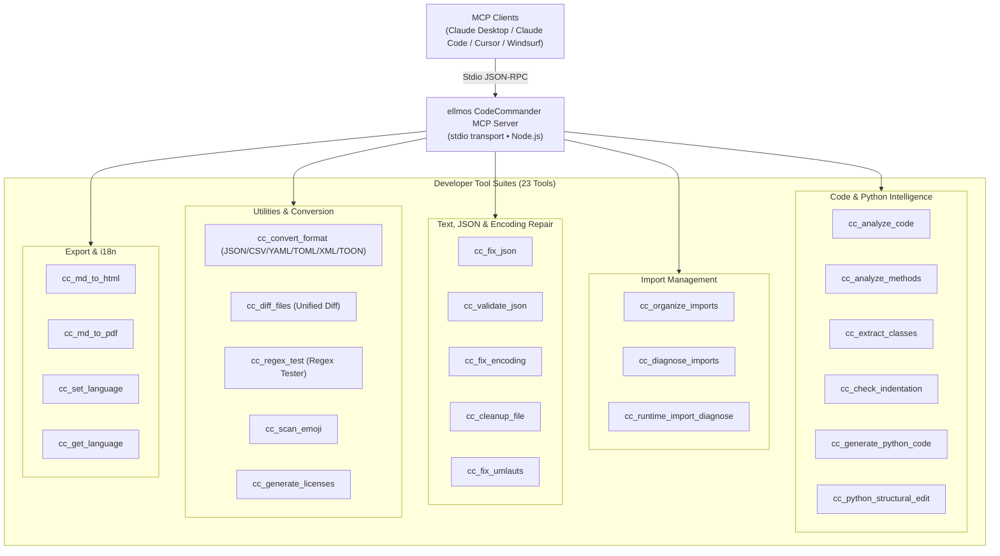
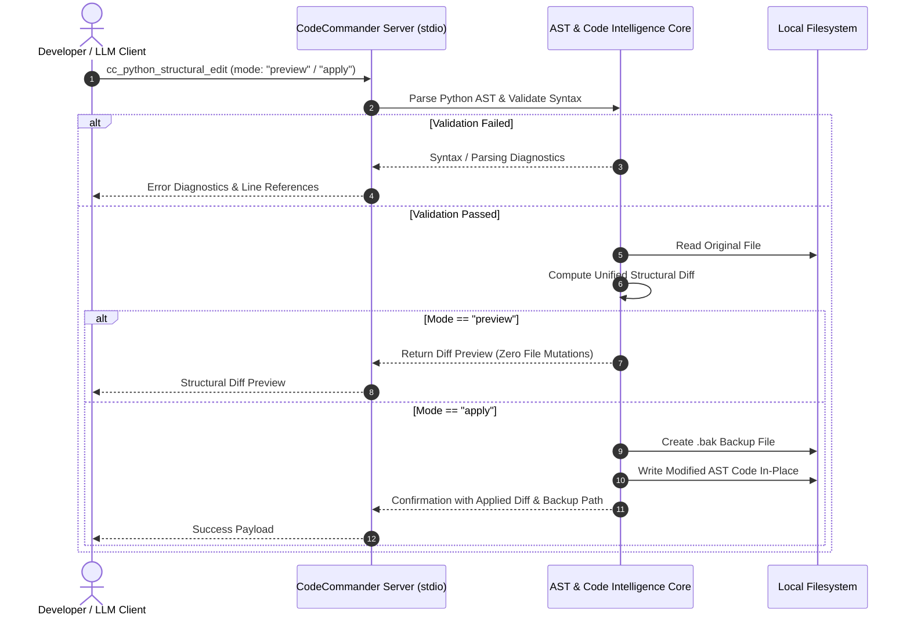

<!-- worldset: {"translated_from_sha256": "c11dfac3a2a77d1275cd2e577e98e1cfb77f6a79e216cf05578e1215537972d8", "translator": "gpt-6-luna", "translated_at": "2026-10-25 04:32:06+00:00"} -->
<p align="center">
  
</p>

# ellmos CodeCommander MCP サーバー

[English](README.md) | [Deutsch](README_de.md) | [Español](README_es.md) | [简体中文](README_zh.md) | **日本語** | [Русский](README_ru.md) | [Français](README_fr.md) | [हिन्दी](README_hi.md) | [العربية](README_ar.md) | [বাংলা](README_bn.md) | [Português](README_pt.md)

README のナビゲーションには利用できるドキュメント言語を記載します。第 11 節では、ツール出力メッセージと診断メッセージに使う実行時言語を別途説明します。MCP のツール検出や schema の説明、GUI、CLI、API が翻訳済みであることを示すものではありません。

*[ellmos-ai](https://github.com/ellmos-ai) ファミリーの一部です。*

[](https://opensource.org/licenses/MIT)
[](https://www.npmjs.com/package/ellmos-codecommander-mcp)
[](https://github.com/ellmos-ai/ellmos-codecommander-mcp/actions/workflows/tests.yml)
[](https://github.com/ellmos-ai/ellmos-codecommander-mcp)
[](https://nodejs.org/)
[](https://nodejs.org/)
[](SECURITY.md)
[](SECURITY.md)
[](SECURITY.md)
[](SECURITY.md)
[](CONTRIBUTING.md)
[](THIRD_PARTY_LICENSES.md)
[](MARKETING-LOG.txt)
[](NOTICE)
[](CHANGELOG.md)
[](https://github.com/ellmos-ai)
[](https://github.com/open-bricks)
[](llms.txt)

> [!NOTE]
> **AI アシスタントおよび LLM 向け:** このリポジトリには、機械可読なインデックス文書 [`llms.txt`](llms.txt) があります。サーバーは `cc_` プレフィックス配下に 23 個の専用ツールを公開します。

開発者向けの **Model Context Protocol (MCP) サーバー**です。AI アシスタントに、コード分析、Python の構造編集、JSON 修復、文字コード修正、インポート整理、形式変換、ファイル差分、正規表現テストの機能を提供します。

開発者向けに最適化した **23 個のツール**を備え、[FileCommander](https://github.com/ellmos-ai/ellmos-filecommander-mcp) のコーディング支援ツールとして機能します。

**見つけやすさ:** [npm](https://www.npmjs.com/package/ellmos-codecommander-mcp) に `ellmos-codecommander-mcp` として公開され、[Glama](https://glama.ai/mcp/servers/b9kjs4uaav) から確認できます。また、公式 MCP Registry への登録に向けて [`server.json`](server.json) を準備しており、登録名は `io.github.ellmos-ai/ellmos-codecommander-mcp` です。レジストリとディレクトリのマニフェスト [`server.json`](server.json)、[`glama.json`](glama.json)、[`smithery.yaml`](smithery.yaml)、[`llms.txt`](llms.txt) は完全な整合性を保っています。

---

## クイックナビゲーション

1. [概要と特長](#sec-01)
2. [対象ユーザー像と見つけやすさ](#sec-02)
3. [代替手段との比較表](#sec-03)
4. [アーキテクチャとシステム概要](#sec-04)
5. [安全な構造編集のライフサイクル](#sec-05)
6. [ガバナンスとランタイム不変条件](#sec-06)
7. [開発者向けツール一式（23 個）](#sec-07)
8. [FileCommander と共有するツール](#sec-08)
9. [インストールとクイックスタート](#sec-09)
10. [設定と MCP クライアントの構成](#sec-10)
11. [多言語サポート（i18n）](#sec-11)
12. [開発と品質保証](#sec-12)
13. [関連エコシステムとパートナーマトリクス](#sec-13)
14. [サードパーティライセンスと透明性](#sec-14)
15. [セキュリティポリシーと応答 SLA](#sec-15)
16. [変更履歴とバージョン履歴](#sec-16)
17. [ライセンスと法的帰属](#sec-17)
18. [法定通知、責任制限、SLA（§ 521 BGB）](#sec-18)

---

<a id="sec-01"></a><a id="1-overview--highlights"></a><a id="overview--highlights"></a><a id="overview"></a>
## 1. 概要と特長

FileCommander がファイルシステム操作とシステムプロセスを扱うのに対し、CodeCommander は**コードインテリジェンスと開発者向けの精密さ**に特化しています。

- **Python、JavaScript、TypeScript の分析** — 拡張子に応じてクラス、メソッド、関数、複雑度指標、インポートを分析します。JS/TS の分析は正規表現ベースで読み取り専用です。
- **BACH 由来の Python ヘルパー** — ランタイムインポート診断、構造編集、インデントチェック、テンプレートベースのコード生成を行います。
- **明示的な言語ゲート** — Python 専用のパスツールは、Python 形式の誤検出を出さず、非 `.py` ファイルを明示的に拒否します。
- **JSON 修復と検証** — 壊れた JSON（末尾のカンマ、シングルクォート、BOM、コメント）を自動修復し、エラー位置を正確に示します。
- **PEP 8 インポート整理** — PEP 8 ガイドラインに従って Python のインポートを並べ替え、重複を除去します。
- **文字コードと文字化けの修復** — 文字化けや二重エンコードされた UTF-8（27 種類以上のパターン）および壊れたドイツ語文字（ウムラウトのパターン 70 種類以上）を修復します。
- **汎用形式変換** — JSON、CSV、INI、YAML、TOML、XML、TOON の各形式を損失なく相互変換します。
- **統一ファイル差分** — 2 つのファイルを比較し、コンテキスト行数を設定できる LCS unified diff を出力します。
- **正規表現テストワークベンチ** — 正規表現をテストし、マッチ詳細、キャプチャグループ、置換プレビューを確認できます。
- **ネイティブなクロスプラットフォーム対応** — Windows、macOS、Linux を完全にサポートします。

---

<a id="sec-02"></a><a id="2-target-personas--discoverability"></a><a id="target-personas--discoverability"></a><a id="personas"></a><a id="zielgruppen--auffindbarkeit"></a>
## 2. 対象ユーザー像と見つけやすさ

CodeCommander MCP は、最新の自律型 AI コーディング、ローカルのマルチエージェント群、セキュリティ要件に適合する開発者ツールにおける主要なボトルネックの解消を目指しています。

### 対象ユーザーと関係者のペルソナ

- **`[PERSONA-01]` (`[PERSONA-1]`) 自律型 AI コーディングエージェントと LLM ペアプログラマー**
  - **プロフィール:** Claude Code、Antigravity、Codex、Cursor、Windsurf などのエージェントを用いて、コードのリファクタリング、テストの修正、機能開発を自動化する開発者。
  - **課題:** LLM のコード出力では、存在しないインポート、複雑な Python 制御フローのインデント崩れ、無効な JSON 設定、単純な分割編集による構文破損が頻繁に起こります。
  - **解決策:** ネイティブ AST 抽出（`cc_extract_classes`、`cc_analyze_methods`）、統一差分によるプレビュー安全な構造編集（`cc_python_structural_edit`）、自動インデント検査（`cc_check_indentation`）、決定的な JSON 修復（`cc_fix_json`）。

- **`[PERSONA-02]` (`[PERSONA-2]`) フルスタックおよび Python/TypeScript ソフトウェアエンジニア**
  - **プロフィール:** 多言語プロジェクト、CLI ユーティリティ、データパイプラインを保守し、言語横断の AST 分析や設定形式の迅速な切り替えを必要とする開発者。
  - **課題:** 手作業での形式変換（JSON ↔ YAML ↔ TOML ↔ TOON ↔ XML）は煩雑です。レガシーエンコーディングでドイツ語のウムラウトが壊れたり文字化けしたりし、ランタイムインポートが循環することもあります。
  - **解決策:** 汎用形式変換（`cc_convert_format`）、非破壊の文字コード・ウムラウト修復（`cc_fix_encoding`、`cc_fix_umlauts`）、隔離されたランタイムインポート診断（`cc_runtime_import_diagnose`）、対話型正規表現テスター（`cc_regex_test`）。

- **`[PERSONA-03]` (`[PERSONA-3]`) 企業 AI 安全性、SecOps、コードガバナンスの責任者**
  - **プロフィール:** 開発者ワークステーションや CI/CD ランナー向けの MCP ツールチェーンを評価するセキュリティ監査担当者、コンプライアンスエンジニア、エンタープライズアーキテクト。
  - **課題:** クラウドテレメトリ経由の機密コード漏えい、許可されていないプロセス昇格、AI アシスタントによるファイルの破壊的な上書きのリスクがあります。
  - **解決策:** stdio による 100% ローカルのゼロ外部送信（`INV-LOCAL-01`）、非特権ユーザー空間での実行（`INV-SEC-02`）、変更前に必須となるタイムスタンプ付き `.bak` バックアップ（`INV-BAK-04`）、dry-run 差分プレビューによる安全性（`INV-PREV-03`）、タイムアウト付きサブプロセス隔離（`INV-ISOL-05`）。

- **`[PERSONA-04]` (`[PERSONA-4]`) オープンソースエコシステム設計者と MCP ツール開発者**
  - **プロフィール:** Glama、Smithery、npm、GitHub で MCP サーバーを構築、公開、インデックス登録するメンテナー。
  - **課題:** ディレクトリのマニフェストが分散し、サードパーティライセンスの開示が不足し、AI エージェント向けの機械可読なインデックス情報がありません。
  - **解決策:** `package.json`、`server.json`、`glama.json`、`smithery.yaml`、`llms.txt` 間でマニフェストを 100% 整合させ、自動契約テストと完全なオープンソースライセンス監査で検証します（`THIRD_PARTY_LICENSES.md`）。

### 高い検索意図を示すクエリ（SEO と見つけやすさ）

- `mcp code analysis server`
- `model context protocol python ast tools`
- `mcp server codecommander`
- `python structural edit mcp`
- `claude code developer mcp server`
- `mcp json repair and encoding fix`
- `local-first mcp tools for coding`
- `mcp python runtime import diagnose`
- `format converter mcp json yaml toml toon`
- `offline code intelligence mcp server`

---

<a id="sec-03"></a><a id="3-comparative-matrix-vs-alternatives"></a><a id="comparative-matrix-vs-alternatives"></a><a id="vergleichsmatrix-gegenueber-alternativen"></a>
## 3. 代替手段との比較表

次の表は、10 の重要な運用面で CodeCommander MCP と他の開発ツールの選択肢を比較します。

| 項目 / 機能 | 汎用ファイル MCP | 生の Shell / 個別スクリプト | 大規模クラウド LLMOps | 従来型 IDE プラグイン | ellmos CodeCommander MCP |
| :--- | :--- | :--- | :--- | :--- | :--- |
| **1. AST コードインテリジェンス** | なし（生テキストの読み取りのみ） | 独自の Python スクリプトが必要 | クラウドパーサーが必要 | 内蔵（GUI のみ） | **ネイティブ AST と正規表現による JS/TS（`cc_analyze_code`）** |
| **2. 安全な構造編集プレビュー** | なし（無条件上書き） | 高リスク（`sed`/`awk`） | クラウドゲートウェイに依存 | 対話型ダイアログ | **プレビュー安全な差分（`mode: "preview"`）** |
| **3. 変更前の必須バックアップ** | なし | 手動スクリプト | なし | ローカル履歴（詳細不明） | **`.bak` を自動作成（`INV-BAK-04`）** |
| **4. ランタイムインポート診断** | なし | 直接実行は危険 | なし | 部分対応 / 静的分析のみ | **隔離サブプロセスとタイムアウト（`INV-ISOL-05`）** |
| **5. 文字コードと文字化けの復元** | なし | 不安定な `iconv` 呼び出し | なし | 基本的なエンコーディング切り替え | **27 種類以上の文字化け、70 種類以上のウムラウト（`cc_fix_encoding`）** |
| **6. 汎用形式変換** | なし | 複数のばらばらな CLI ツール | SaaS 変換 API | 複数プラグインが必要 | **7 形式を損失なく変換（`JSON/YAML/TOML/XML/TOON`）** |
| **7. 差分エンジンと正規表現ワークベンチ** | なし | 基本的な `diff`/`grep` | なし | GUI パネルのみ | **LCS unified diff とグループ/置換対応の正規表現** |
| **8. ローカル優先とゼロ外部送信** | ホスト環境に依存 | ローカル | クラウド送信 / テレメトリ | 多くはクラウドに接続 | **100% オフラインの stdio JSON-RPC（`INV-LOCAL-01`）** |
| **9. 多言語（i18n）サポート** | 英語のみ | なし | 英語のみ | 言語パック | ツールの出力メッセージと診断メッセージは実行時に 11 言語に対応し、`cc_set_language` で切り替えられます。 |
| **10. レジストリとマニフェストの整合性** | 最小限 | なし | 独自仕様 | マーケットプレイス固有 | **npm、Glama、Smithery、MCP Registry、`llms.txt`** |

---

<a id="sec-04"></a><a id="4-architecture--system-overview"></a><a id="architecture--system-overview"></a><a id="architecture"></a>
## 4. アーキテクチャとシステム概要

```text
+==============================================================================================================+
|                            FOUR-VIEW ARCHITECTURAL TOPOLOGY (STANDARDIZED LEVEL-1 SPECIFICATION)             |
+==============================================================================================================+
| [VIEW 1: CLIENT RUNTIMES, USER INTERFACES & AGENT ENTRYPOINTS]                                               |
|  - Stdio JSON-RPC Clients: Claude Desktop, Claude Code CLI, Cursor, Windsurf, Codex, Antigravity, Kimi Code  |
|  - MCP Tool Ingestion: 23 Developer Tools via standard Model Context Protocol Specification                  |
|  - Runtime locales: DE EN ES ZH JA RU FR HI AR BN PT (INV-I18N-09)                                           |
+--------------------------------------------------------------------------------------------------------------+
                                          | Stdio Transport (JSON-RPC)
                                          v
+--------------------------------------------------------------------------------------------------------------+
| [VIEW 2: CODECOMMANDER MCP PROTOCOL & TOOL ENGINE]                                                           |
|  - Code Intelligence AST: Python AST Class/Method Extractors, Complexity Metrics & Guardrails (INV-GATE-06)   |
|  - Structural Refactoring Engine: Preview-Safe Diffs & Dry-Run Syntax Verification (INV-PREV-03)             |
|  - Import Diagnostics & Organizer: PEP 8 Cleaners & Subprocess Import Probers (INV-ISOL-05)                  |
|  - Universal Format Converter: Lossless Roundtrip across JSON/CSV/INI/YAML/TOML/XML/TOON (INV-FMT-08)         |
|  - Text & Encoding Heuristics: 27+ Mojibake & 70+ German Umlaut Restorations, JSON Fixers (INV-ENC-07)       |
+--------------------------------------------------------------------------------------------------------------+
                                          | Process Isolation & Local I/O
                                          v
+--------------------------------------------------------------------------------------------------------------+
| [VIEW 3: RUNTIME PERSISTENCE, BACKUP VAULTS & ISOLATED SUBPROCESS RUNNERS]                                   |
|  - Pre-Mutation Safety Vault: Timestamped `.bak` Disk Backups Before In-Place Modification (INV-BAK-04)       |
|  - Ephemeral Python Runner: Isolated Child Processes with Strict Execution Timeout Bounds (INV-ISOL-05)     |
|  - Unified Diff Pipeline: LCS Algorithm Unified Diff Generator with Configurable Context Chunks              |
|  - Local Document Exporters: Self-Contained Markdown-to-HTML and Print-Safe PDF Artifact Generators          |
+--------------------------------------------------------------------------------------------------------------+
                                          | Containment & Perimeter Defense
                                          v
+--------------------------------------------------------------------------------------------------------------+
| [VIEW 4: AIR-GAP DEFENSE PERIMETER, ZERO-EGRESS & RUNASINVOKER SECURITY BOUNDARY]                            |
|  - Zero-Egress Network Isolation: 100% Offline Local Operation, Zero Sockets, Zero Cloud Telemetry (INV-LOCAL-01)|
|  - Unprivileged User Mode: Standard RunAsInvoker Execution; Zero Root/Administrator Elevation (INV-SEC-02)  |
|  - Supply Chain & License Hygiene: Zero Copyleft, 100% Permissive Open Source Stack (MIT, BSD, Apache)       |
|  - Vulnerability Remediation SLA: 48h Response, 5-Day Triage & 30-Day Patch Commitment (INV-SLA-10)          |
+==============================================================================================================+
```



---

<a id="sec-05"></a><a id="5-safe-structural-edit-lifecycle"></a><a id="safe-structural-edit-lifecycle"></a><a id="edit-lifecycle"></a>
## 5. 安全な構造編集のライフサイクル



---

<a id="sec-06"></a><a id="6-governance--runtime-invariants"></a><a id="governance--runtime-invariants"></a><a id="governance-invariants"></a><a id="governance--laufzeit-invarianten"></a>
## 6. ガバナンスとランタイム不変条件

`ellmos-codecommander-mcp` は、全プラットフォームで 10 個の中核的なアーキテクチャおよびランタイム不変条件を保証します。

| 不変条件 ID | 分類 | アーキテクチャ上の保証と検証方法 |
| :--- | :--- | :--- |
| `INV-LOCAL-01` | ゼロ外部送信のプライバシー | 完全ローカルの stdio JSON-RPC 通信。ネットワークテレメトリ、クラウドビーコン、リモート送信はありません。 |
| `INV-SEC-02` | 非特権セキュリティ | 標準ユーザー空間で実行（`RunAsInvoker`）し、root や管理者への昇格は不要です。 |
| `INV-PREV-03` | プレビューの安全性 | 構造編集は既定で非変更プレビュー（`mode: "preview"`）となり、unified diff を生成します。 |
| `INV-BAK-04` | 自動バックアップ | ファイルをディスク上で変更する前に、タイムスタンプ付きの `.bak` ファイルを自動生成します。 |
| `INV-ISOL-05` | サブプロセス隔離 | Python のランタイムインポート診断を、タイムアウト付きの隔離された子プロセスで実行します。 |
| `INV-GATE-06` | 明示的な言語ゲート | Python 専用パスツールは非 `.py` ファイルを明示的に拒否します。JS/TS 分析は読み取り専用の正規表現ベースです。 |
| `INV-ENC-07` | 非破壊の文字コード修復 | 修復後のテキストでは、27 種類以上の文字化けと 70 種類以上のドイツ語ウムラウトを復元し、情報損失やバイナリ破損を防ぎます。 |
| `INV-FMT-08` | 形式間の互換性 | JSON、CSV、INI、YAML、TOML、XML、TOON 間でスキーマを保持した損失のない変換を行います。 |
| `INV-I18N-09` | ランタイム多言語 | `cc_set_language` で 11 言語のツール出力・診断メッセージを切り替え、`cc_get_language` で現在のコードを確認できます。 |
| `INV-SLA-10` | 48 時間のセキュリティ応答 SLA | Ubuntu、Windows、macOS の Node 20、22、24 で検証済み。公開の 48 時間以内の初回応答 / 5 日以内のトリアージを約束します。 |

---

<a id="sec-07"></a><a id="7-developer-tool-suite-23-tools"></a><a id="developer-tool-suite-23-tools"></a><a id="tools"></a><a id="tool-suite"></a>
## 7. 開発者向けツール一式（23 個）

### コード分析（3 ツール）

| ツール | 説明 |
|------|-------------|
| `cc_analyze_code` | Python または正規表現ベースの JavaScript/TypeScript の読み取り専用分析：クラス、関数、インポート、LOC、複雑度 |
| `cc_analyze_methods` | Python または正規表現ベースの JavaScript/TypeScript メソッドの読み取り専用分析。Python では BACH のガードレールを維持 |
| `cc_extract_classes` | Python のクラス/関数を個別のテキストブロックとして抽出。pycutter 形式のインラインコンテンツも任意で含められます |

### インポート管理（3 ツール）

| ツール | 説明 |
|------|-------------|
| `cc_organize_imports` | PEP 8 に沿って Python のインポートを並べ替え、重複を除去 |
| `cc_diagnose_imports` | Python または正規表現ベースの JavaScript/TypeScript インポートを読み取り専用で診断 |
| `cc_runtime_import_diagnose` | 隔離環境でタイムアウト付き Python ランタイムインポートを実行し、`__init__.py` 分析と循環インポートのヒントを提供 |

### JSON ツール（2 ツール）

| ツール | 説明 |
|------|-------------|
| `cc_fix_json` | 壊れた JSON（BOM、末尾のカンマ、コメント、シングルクォート）を修復 |
| `cc_validate_json` | JSON を検証し、エラー位置とコンテキストを詳しく表示 |

### 文字コードとテキスト（3 ツール）

| ツール | 説明 |
|------|-------------|
| `cc_fix_encoding` | 文字化け / 二重エンコードされた UTF-8 を修復（27 種類以上のパターン） |
| `cc_cleanup_file` | BOM、NUL バイト、末尾の空白を削除し、改行を正規化 |
| `cc_fix_umlauts` | 壊れたドイツ語ウムラウトを修復（HTML エンティティやエスケープを含む 70 種類以上のパターン） |

### スキャン（1 ツール）

| ツール | 説明 |
|------|-------------|
| `cc_scan_emoji` | ファイル内の絵文字をコードポイント情報付きでスキャン |

### 形式とドキュメント（2 ツール）

| ツール | 説明 |
|------|-------------|
| `cc_convert_format` | JSON、CSV、INI、YAML、TOML、XML、TOON 間を変換 |
| `cc_generate_licenses` | npm/pip の依存関係からサードパーティライセンスファイルを生成 |

### 開発者ユーティリティ（2 ツール）

| ツール | 説明 |
|------|-------------|
| `cc_diff_files` | コンテキスト行数を設定して 2 つのファイルを比較し、unified diff を出力 |
| `cc_regex_test` | テキスト/ファイルに対して正規表現をテストし、マッチ詳細、グループ、置換プレビューを表示 |

### Python 支援（3 ツール）

| ツール | 説明 |
|------|-------------|
| `cc_check_indentation` | コロン抜け、インデントされていない return/yield、タブとスペースの混在を検出 |
| `cc_generate_python_code` | テンプレートから Python 関数、クラス、データクラス、CLI スタブ、テスト、例外、モジュールを生成 |
| `cc_python_structural_edit` | プレビュー、テストファイル、構文チェック、バックアップモードに対応して Python の構造編集を検査・適用 |

### エクスポート（2 ツール）

| ツール | 説明 |
|------|-------------|
| `cc_md_to_html` | Markdown を独立 HTML に変換し、見出し、コードブロック、表、引用、画像、チェックボックスを CSS でスタイル設定 |
| `cc_md_to_pdf` | ヘッドレスブラウザー（Edge/Chrome）で Markdown を PDF に変換。ブラウザーがない場合は HTML にフォールバック |

### ランタイム言語管理（2 ツール）

| ツール | 説明 |
|------|-------------|
| `cc_set_language` | ツール出力メッセージと診断メッセージの実行時言語を設定（`de`、`en`、`es`、`zh`、`ja`、`ru`、`fr`、`hi`、`ar`、`bn`、`pt`）。 |
| `cc_get_language` | 現在の言語とサポート対象のロケールコードを照会 |

**23 個の開発者ツール**を `cc_` プレフィックスで利用できます。

---

<a id="sec-08"></a><a id="8-shared-tools-with-filecommander"></a><a id="shared-tools-with-filecommander"></a><a id="shared-tools"></a>
## 8. FileCommander と共有するツール

FileCommander と CodeCommander の両方に、利便性のため 7 個のツールがあります。

| FileCommander | CodeCommander | 機能 |
|---------------|---------------|----------|
| `fc_fix_json` | `cc_fix_json` | JSON 修復 |
| `fc_validate_json` | `cc_validate_json` | JSON 検証 |
| `fc_fix_encoding` | `cc_fix_encoding` | 文字コード修復 |
| `fc_cleanup_file` | `cc_cleanup_file` | ファイルのクリーンアップ |
| `fc_convert_format` | `cc_convert_format` | 形式変換（JSON/CSV/INI/YAML/TOML/XML/TOON） |
| `fc_md_to_html` | `cc_md_to_html` | Markdown から HTML への変換 |
| `fc_md_to_pdf` | `cc_md_to_pdf` | Markdown から PDF への変換 |

CodeCommander の全ツールは `cc_` プレフィックスを使用し、FileCommander の `fc_` 名前空間とシームレスに共存します。

---

<a id="sec-09"></a><a id="9-installation--quickstart"></a><a id="installation--quickstart"></a><a id="installation"></a>
## 9. インストールとクイックスタート

### 前提条件

- [Node.js](https://nodejs.org/) 20 以降
- npm 9 以降

### 方法 1：NPM からインストール（推奨）

```bash
npm install -g ellmos-codecommander-mcp
```

### 方法 2：ソースからインストール

```bash
git clone https://github.com/ellmos-ai/ellmos-codecommander-mcp.git
cd ellmos-codecommander-mcp
npm install
npm run build
```

---

<a id="sec-10"></a><a id="10-configuration--mcp-client-setup"></a><a id="configuration--mcp-client-setup"></a><a id="configuration"></a>
## 10. 設定と MCP クライアントの構成

### Claude Desktop

設定を `claude_desktop_config.json` に追加します。

- **Windows:** `%APPDATA%\Claude\claude_desktop_config.json`
- **macOS:** `~/Library/Application Support/Claude/claude_desktop_config.json`

#### グローバル NPM インストール：

```json
{
  "mcpServers": {
    "codecommander": {
      "command": "ellmos-codecommander"
    }
  }
}
```

#### ソースからビルド：

```json
{
  "mcpServers": {
    "codecommander": {
      "command": "node",
      "args": ["/absolute/path/to/ellmos-codecommander-mcp/dist/index.js"]
    }
  }
}
```

### FileCommander との共存

FileCommander と CodeCommander は同時に実行できるよう設計されています。

```json
{
  "mcpServers": {
    "filecommander": {
      "command": "ellmos-filecommander"
    },
    "codecommander": {
      "command": "ellmos-codecommander"
    }
  }
}
```

---

<a id="sec-11"></a><a id="11-multi-language-support-i18n"></a><a id="multi-language-support-i18n"></a><a id="i18n"></a>
## 11. 多言語サポート（i18n）

CodeCommander は、ツールが実行時に返すメッセージ（診断メッセージを含む）について、次の 11 言語に対応します。

- `de` — ドイツ語（既定）
- `en` — 英語
- `es` — スペイン語
- `zh` — 簡体字中国語
- `ja` — 日本語
- `ru` — ロシア語
- `fr` — フランス語
- `hi` — ヒンディー語
- `ar` — アラビア語
- `bn` — ベンガル語
- `pt` — ポルトガル語

これらのコードは、ツールの出力メッセージと診断メッセージの実行時言語を選びます。MCP のツール検出説明や schema の説明、GUI、CLI、API が翻訳されるわけではありません。README ナビゲーションではドキュメント言語を別に示します。

サーバー起動時の初期言語は `CC_LANGUAGE` で選択します。MCP セッション中は `cc_set_language` で切り替え、`cc_get_language` で現在のコードと対応コードを確認できます。`CC_LANGUAGE` が未設定、または未対応の値の場合はドイツ語（`de`）にフォールバックします。`--lang` オプションはドキュメントに記載されていません。

---

<a id="sec-12"></a><a id="12-development--quality-assurance"></a><a id="development--quality-assurance"></a><a id="development"></a><a id="testing"></a>
## 12. 開発と品質保証

```bash
npm install
npm run dev               # TypeScript watch mode
npm run build             # Compile TypeScript to dist/
npm start                 # Run built server via stdio
npm test                  # Run Vitest unit & contract suite (205 tests)
npm run test:integration  # Real MCP stdio test suite (52 assertions, build first)
npm run test:i18n         # Translation parity test suite (43 assertions)
npm run test:all          # Run full QA pipeline (build + vitest + integration + i18n)
```

テストゲートは意図的に分離され、CI で **Ubuntu**、**macOS**、**Windows** の各環境、Node.js 20、22、24 を対象に自動実行されます（自動アサーション計 302 件、すべて成功）。コントリビューション手順と開発ガイドラインは [CONTRIBUTING.md](CONTRIBUTING.md) に記載されています。

---

<a id="sec-13"></a><a id="13-sibling-ecosystem--partner-matrix"></a><a id="sibling-ecosystem--partner-matrix"></a><a id="ecosystem"></a>
## 13. 関連エコシステムとパートナーマトリクス

ローカル優先ツールの **[ellmos-ai](https://github.com/ellmos-ai)** および **[open-bricks](https://github.com/open-bricks)** ファミリーの一部です。

### MCP サーバーファミリー

| サーバー | ツール数 | 主な機能 | npm |
|--------|-------|-------|-----|
| [FileCommander](https://github.com/ellmos-ai/ellmos-filecommander-mcp) | 50 | ファイルシステム、プロセス管理、対話型セッション、クラウドロックに安全な操作 | [`ellmos-filecommander-mcp`](https://www.npmjs.com/package/ellmos-filecommander-mcp) |
| **[CodeCommander](https://github.com/ellmos-ai/ellmos-codecommander-mcp)** | **23** | **コード分析、AST 編集、JSON 修復、差分、正規表現** | **[`ellmos-codecommander-mcp`](https://www.npmjs.com/package/ellmos-codecommander-mcp)** |
| [Clatcher](https://github.com/ellmos-ai/ellmos-clatcher-mcp) | 12 | ファイル修復、形式変換、バッチ操作 | [`ellmos-clatcher-mcp`](https://www.npmjs.com/package/ellmos-clatcher-mcp) |
| [n8n Manager](https://github.com/ellmos-ai/n8n-manager-mcp) | 19 | AI アシスタントから n8n ワークフローを管理 | [`n8n-manager-mcp`](https://www.npmjs.com/package/n8n-manager-mcp) |
| [ControlCenter](https://github.com/ellmos-ai/ellmos-controlcenter-mcp) | 34 | MCP スタックの発見、プロファイル管理、コントロールプレーン | [`ellmos-controlcenter-mcp`](https://www.npmjs.com/package/ellmos-controlcenter-mcp) |
| [Homebase](https://github.com/ellmos-ai/ellmos-homebase-mcp) | 51 | LLM のメモリ、知識、状態、ルーティング、スウォーム編成を行うローカル優先ツール | [`ellmos-homebase-mcp`](https://www.npmjs.com/package/ellmos-homebase-mcp)（alpha） |
| [ServerCommander](https://github.com/ellmos-ai/ellmos-servercommander-mcp) | 8 | サーバー操作：ヘルスチェック、ログ分析、デプロイの dry-run、メール診断 | [`ellmos-servercommander-mcp`](https://www.npmjs.com/package/ellmos-servercommander-mcp)（alpha） |
| [Blender Use](https://github.com/ellmos-ai/ellmos-blender-use-mcp) | 4 | ヘッドレス Blender アセット QA と FBX 再インポート検証 | [`ellmos-blender-use-mcp`](https://www.npmjs.com/package/ellmos-blender-use-mcp)（alpha） |
| [Open Compute](https://github.com/ellmos-ai/open-compute-mcp) | 16 | モデルに依存しないコンピューター操作：画面キャプチャ、安全ゲート付きアクション、Windows UIA | [`open-compute-mcp`](https://www.npmjs.com/package/open-compute-mcp)（alpha） |

### 関連する開発者、ファイル、ドキュメントツール

| エコシステム | ツール / プロジェクト | 主な機能 |
|---|---|---|
| **ellmos-ai** | [sqlite-transit-sync](https://github.com/ellmos-ai/sqlite-transit-sync) | HMAC 検証付きのオフライン SQLite 変更配布 |
| **ellmos-ai** | [policy-registry](https://github.com/ellmos-ai/policy-registry) | AI エージェント向け暗号署名付き委任ポリシー |
| **ellmos-ai** | [clutch](https://github.com/ellmos-ai/clutch) | プロバイダー中立な LLM オーケストレーション、自動ルーティングと予算追跡に対応 |
| **ellmos-ai** | [BACH](https://github.com/ellmos-ai/bach) | LLM エージェント向けローカル優先テキスト OS — 113 以上のハンドラー、550 以上のツール |
| **dev-bricks** | [DevCenter](https://github.com/dev-bricks/DevCenter) | PySide6 開発者向けデスクトップスイートとオフラインシークレット保管庫 |
| **dev-bricks** | [CodeBox](https://github.com/dev-bricks/CodeBox) | 高速なデスクトップコードスニペット管理とオフライン AST インデックス |
| **dev-bricks** | [MethodenAnalyser](https://github.com/dev-bricks/MethodenAnalyser) | メソッドフローと複雑度の診断エンジン |
| **dev-bricks** | [Zombie Killer Tray](https://github.com/dev-bricks/zombie-killer-tray) | 孤立した MCP プロセスを確認する任意の Windows ツール。サポート対象の `node_modules/ellmos-codecommander-mcp/dist/index.js` エントリーポイントから起動する場合、CodeCommander は設定済みの候補ですが、追加のプロセス確認と適用確認はすべて必要です。 |
| **doc-bricks** | [PDFtoPDFocr](https://github.com/doc-bricks/PDFtoPDFocr) | Tesseract による検索可能な PDF 用デスクトップ OCR パイプライン |
| **doc-bricks** | [DokuReader](https://github.com/doc-bricks/DokuReader) | 複数形式のドキュメントワークスペースとオフライン PDF エクスポート |
| **file-bricks** | [ProFiler](https://github.com/file-bricks/ProFiler) | マルチペインのファイル管理と一括操作 |
| **open-bricks** | [open-bricks](https://github.com/open-bricks) | AI ネイティブのデスクトップアプリを統括するアンブレラ組織 |

---

<a id="sec-14"></a><a id="14-third-party-licenses--transparency"></a><a id="third-party-licenses--transparency"></a><a id="drittanbieter-lizenzen--transparenz"></a>
## 14. サードパーティライセンスと透明性

このプロジェクトは、オープンソースの透明性を厳格に守っています。

- すべてのランタイムおよび開発依存関係は、[`THIRD_PARTY_LICENSES.md`](THIRD_PARTY_LICENSES.md) とプレーンテキスト版の補足ファイル [`THIRD_PARTY_LICENSES.txt`](THIRD_PARTY_LICENSES.txt) で監査されています。
- 現行の本番依存関係監査（`npm audit --omit=dev --json`、2026-09-20 確認）では、脆弱なパッケージノードが 5 件（高 3 件、中 2 件）報告されています。修正は TASKPLAN #2198 で追跡されています。
- 寛容なオープンソースライセンス（**MIT**、**BSD-2-Clause**、**BSD-3-Clause**、**Apache-2.0**）のみで配布されています。
- 発見性、ペルソナ、マーケティング指標の詳細は [`MARKETING-LOG.txt`](MARKETING-LOG.txt) に記録されています。
- 独自トラッキング、テレメトリビーコン、コピーレフト感染型の依存関係はありません。

---

<a id="sec-15"></a><a id="15-security-policy--response-sla"></a><a id="security-policy--response-sla"></a><a id="security"></a>
## 15. セキュリティポリシーと応答 SLA

脆弱性開示の手順全体については [SECURITY.md](SECURITY.md) を確認してください。

- **ゼロ外部送信の保証:** stdio を介した完全なローカル実行です。
- **プレビューとバックアップの安全性:** 破壊的操作では `.bak` バックアップを作成し、変更を伴わないプレビューにも対応します。
- **非特権ユーザーモード:** 標準の非特権ユーザー権限で動作します（`RunAsInvoker`）。
- **専用の応答窓口:** `security@ellmos.ai` と `support@lukasgeiger.com` へ連絡してください。**初回応答は 48 時間以内**、トリアージは **5 日以内**を約束します。

---

<a id="sec-16"></a><a id="16-changelog--version-history"></a><a id="changelog--version-history"></a><a id="changelog"></a>
## 16. 変更履歴とバージョン履歴

リリースノートとバージョン履歴は [CHANGELOG.md](CHANGELOG.md) を参照してください。

---

<a id="sec-17"></a><a id="17-license--legal-attribution"></a><a id="license--legal-attribution"></a><a id="license"></a>
## 17. ライセンスと法的帰属

このプロジェクトは [MIT License](LICENSE) の下でライセンスされています — Copyright © 2026 Lukas Geiger ([ellmos-ai](https://github.com/ellmos-ai))。

open-bricks アンブレラへの帰属は [`NOTICE`](NOTICE)、開発ガイドラインは [`CONTRIBUTING.md`](CONTRIBUTING.md)、Level 1 SBOM 不変条件の一覧は [`THIRD_PARTY_LICENSES.md`](THIRD_PARTY_LICENSES.md) / [`THIRD_PARTY_LICENSES.txt`](THIRD_PARTY_LICENSES.txt) を参照してください。

---

<a id="sec-18"></a><a id="18-statutory-notice-liability-limitation--sla-521-bgb"></a><a id="statutory-notice--liability"></a><a id="haftung--liability"></a><a id="haftung"></a>
## 18. 法定通知、責任制限、SLA（§ 521 BGB）

本プロジェクトは、ドイツ民法典（BGB）第 516 条以下（無償贈与の規定）に基づく無償のオープンソース提供物です。作者および貢献者の責任は、BGB 第 521 条に従い、故意または重過失に限定されます。これに加えて MIT ライセンスの免責事項が適用されます。

利用は自己責任です。保守の約束、可用性の保証、無欠陥の保証、特定目的への適合保証はありません。

セキュリティインシデントおよび脆弱性は、拘束力のある **48 時間 SLA** の窓口 `security@open-bricks.org`、`security@ellmos.ai`、`support@lukasgeiger.com` で受け付け、5 営業日以内にトリアージします。

*本プロジェクトはドイツ法（BGB 第 516 条以下）に基づく無償のオープンソース贈与です。責任は故意および重過失に厳格に限定されます（ドイツ民法典第 521 条）。MIT ライセンスの免責事項も適用されます。自己責任で利用してください。保証、保守の約束、特定目的への適合保証はありません。*

*セキュリティインシデントと脆弱性は、拘束力のある **48 時間応答 SLA** に従い `security@open-bricks.org`、`security@ellmos.ai`、`support@lukasgeiger.com` で受け付け、5 営業日以内に正式なトリアージを行います。*
