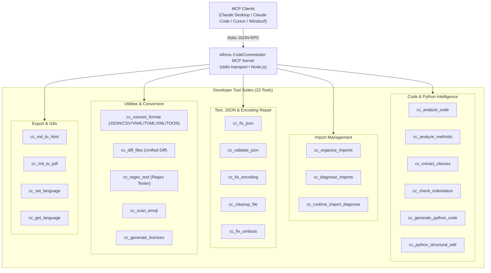
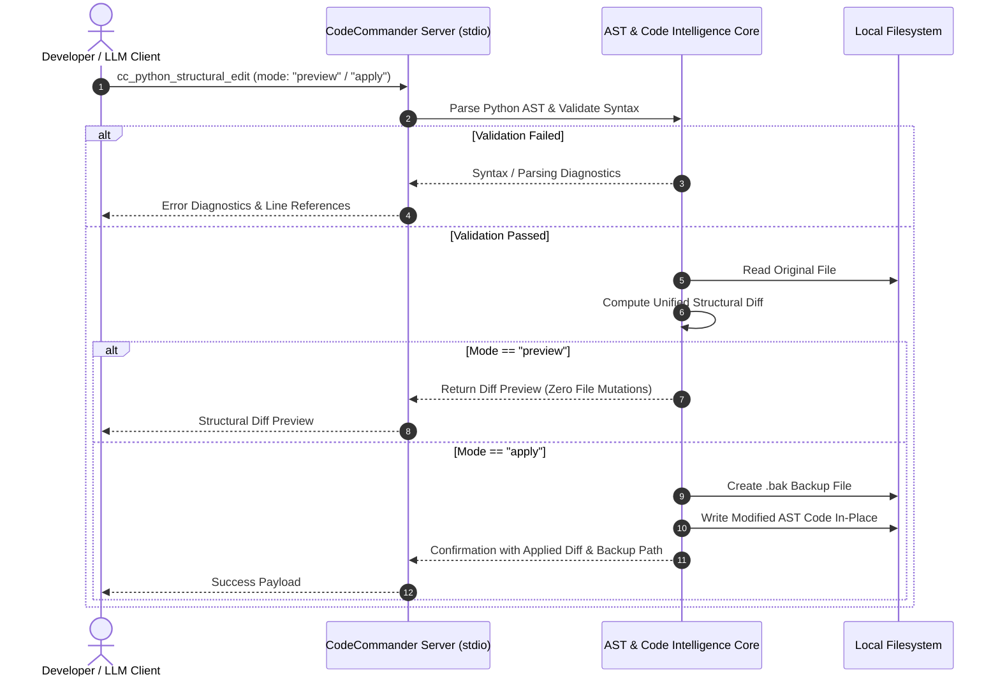

<!-- worldset: {"translated_from_sha256": "c11dfac3a2a77d1275cd2e577e98e1cfb77f6a79e216cf05578e1215537972d8", "translator": "gpt-6-luna", "translated_at": "2026-10-25", "integrated_at": "2026-10-25T06:08:37.563354+00:00"} -->
<p align="center">
  
</p>

# Servidor MCP ellmos CodeCommander

[English](README.md) | [Deutsch](README_de.md) | [Español](README_es.md) | [简体中文](README_zh.md) | [日本語](README_ja.md) | [Русский](README_ru.md) | [Français](README_fr.md) | [हिन्दी](README_hi.md) | [العربية](README_ar.md) | [বাংলা](README_bn.md) | **Português**

A navegação do README lista os idiomas de documentação disponíveis. A seção 11 descreve separadamente os idiomas usados nas mensagens de saída e diagnóstico das ferramentas em tempo de execução. Isso não significa que as descrições de descoberta ou os esquemas MCP, nem a GUI, CLI ou API, estejam traduzidos.

*Parte da família [ellmos-ai](https://github.com/ellmos-ai).*

[](https://opensource.org/licenses/MIT)
[](https://www.npmjs.com/package/ellmos-codecommander-mcp)
[](https://github.com/ellmos-ai/ellmos-codecommander-mcp/actions/workflows/tests.yml)
[](https://github.com/ellmos-ai/ellmos-codecommander-mcp)
[](https://nodejs.org/)
[](https://nodejs.org/)
[](SECURITY.md)
[](SECURITY.md)
[](SECURITY.md)
[](SECURITY.md)
[](CONTRIBUTING.md)
[](THIRD_PARTY_LICENSES.md)
[](MARKETING-LOG.txt)
[](NOTICE)
[](CHANGELOG.md)
[](https://github.com/ellmos-ai)
[](https://github.com/open-bricks)
[](llms.txt)

> [!NOTE]
> **Para assistentes de IA e LLMs:** A documentação de indexação legível por máquina deste repositório está disponível em [`llms.txt`](llms.txt). O servidor disponibiliza 23 ferramentas especializadas sob o prefixo `cc_`.

Um **servidor Model Context Protocol (MCP)** voltado a desenvolvedores, que oferece aos assistentes de IA análise de código, edição estrutural de Python, reparação de JSON, correção de codificação, organização de imports, conversão de formatos, comparação de arquivos e testes de regex.

**23 ferramentas** otimizadas para desenvolvedores — o parceiro de programação do [FileCommander](https://github.com/ellmos-ai/ellmos-filecommander-mcp).

**Descoberta:** publicado no [npm](https://www.npmjs.com/package/ellmos-codecommander-mcp) como `ellmos-codecommander-mcp`, listado no [Glama](https://glama.ai/mcp/servers/b9kjs4uaav) e preparado para o MCP Registry oficial com [`server.json`](server.json) sob `io.github.ellmos-ai/ellmos-codecommander-mcp`. Os manifestos do registry e dos diretórios [`server.json`](server.json), [`glama.json`](glama.json), [`smithery.yaml`](smithery.yaml) e [`llms.txt`](llms.txt) são mantidos em plena paridade.

---

## Navegação rápida

1. [Visão geral e destaques](#sec-01)
2. [Perfis de público-alvo e descoberta](#sec-02)
3. [Matriz comparativa de alternativas](#sec-03)
4. [Arquitetura e visão geral do sistema](#sec-04)
5. [Ciclo de edição estrutural segura](#sec-05)
6. [Governança e invariantes de execução](#sec-06)
7. [Conjunto de ferramentas para desenvolvedores (23 ferramentas)](#sec-07)
8. [Ferramentas compartilhadas com FileCommander](#sec-08)
9. [Instalação e início rápido](#sec-09)
10. [Configuração e integração com clientes MCP](#sec-10)
11. [Suporte a vários idiomas (i18n)](#sec-11)
12. [Desenvolvimento e garantia de qualidade](#sec-12)
13. [Ecossistema de projetos relacionados e matriz de parceiros](#sec-13)
14. [Licenças de terceiros e transparência](#sec-14)
15. [Política de segurança e SLA de resposta](#sec-15)
16. [Registro de alterações e histórico de versões](#sec-16)
17. [Licença e atribuição legal](#sec-17)
18. [Aviso legal, limitação de responsabilidade e SLA (§ 521 BGB)](#sec-18)

---

<a id="sec-01"></a><a id="1-overview--highlights"></a><a id="overview--highlights"></a><a id="overview"></a>
## 1. Visão geral e destaques

Enquanto o FileCommander lida com operações no sistema de arquivos e processos do sistema, o CodeCommander se concentra especificamente em **inteligência de código e precisão para desenvolvedores**:

- **Análise de Python, JavaScript e TypeScript** — classes, métodos, funções, métricas de complexidade e análise de imports selecionados pela extensão; a análise de JS/TS é baseada em regex e somente para leitura.
- **Auxiliares Python derivados do BACH** — diagnóstico de imports em tempo de execução, edições estruturais, verificações de indentação e geração de código baseada em modelos.
- **Limites explícitos de linguagem** — ferramentas de caminho exclusivas para Python rejeitam explicitamente arquivos que não sejam .py (`.py`), em vez de produzir falsos resultados com aparência de Python.
- **Reparação e validação de JSON** — reparação automática de JSON inválido (vírgulas finais, aspas simples, BOM, comentários), com localização precisa dos erros.
- **Organização de imports PEP 8** — ordena e remove imports Python duplicados de acordo com as diretrizes PEP 8.
- **Correção de codificação e mojibake** — corrige mojibake e UTF-8 com dupla codificação (mais de 27 padrões) e caracteres alemães corrompidos (mais de 70 padrões de umlaut).
- **Conversão universal de formatos** — conversão sem perda entre JSON, CSV, INI, YAML, TOML, XML e TOON.
- **Diff unificado de arquivos** — comparação de dois arquivos com saída unified diff baseada em LCS e linhas de contexto configuráveis.
- **Bancada de testes de regex** — testa expressões regulares com detalhes de correspondência, grupos de captura e prévias de substituição.
- **Nativo em várias plataformas** — suporte completo para Windows, macOS e Linux.

---
<a id="sec-02"></a><a id="2-target-personas--discoverability"></a><a id="target-personas--discoverability"></a><a id="personas"></a><a id="zielgruppen--auffindbarkeit"></a>
## 2. Perfis de público-alvo e descoberta

O CodeCommander MCP foi criado para resolver os principais obstáculos da programação autônoma moderna com IA, das equipes locais multiagente e das ferramentas para desenvolvedores alinhadas à segurança:

### Público-alvo e perfis de partes interessadas

- **`[PERSONA-01]` (`[PERSONA-1]`) Agentes autônomos de programação com IA e programadores em dupla com LLM**
  - **Perfil:** agentes como Claude Code, Antigravity, Codex, Cursor e Windsurf, que automatizam refatoração de código, correção de testes e desenvolvimento de funcionalidades.
  - **Problema:** o código gerado por LLMs costuma conter imports inventados, indentação incorreta em fluxos de controle complexos de Python, configurações JSON inválidas ou sintaxe danificada por edições ingênuas feitas por fragmentos.
  - **Solução:** extração nativa de AST (`cc_extract_classes`, `cc_analyze_methods`), edição estrutural segura com prévia e diff unificado (`cc_python_structural_edit`), verificação automática de indentação (`cc_check_indentation`) e reparação determinística de JSON (`cc_fix_json`).

- **`[PERSONA-02]` (`[PERSONA-2]`) Engenheiros de software full-stack e Python/TypeScript**
  - **Perfil:** desenvolvedores que mantêm projetos multilíngues, utilitários de CLI e pipelines de dados e precisam de análise AST entre linguagens e conversões rápidas de formatos de configuração.
  - **Problema:** a conversão manual de formatos é tediosa (JSON ↔ YAML ↔ TOML ↔ TOON ↔ XML); codificações antigas podem corromper umlauts alemães ou gerar mojibake; imports em tempo de execução podem formar ciclos.
  - **Solução:** conversor universal de formatos (`cc_convert_format`), correção de codificação e umlaut sem alterar o conteúdo original (`cc_fix_encoding`, `cc_fix_umlauts`), diagnóstico isolado de imports em tempo de execução (`cc_runtime_import_diagnose`) e testador interativo de regex (`cc_regex_test`).

- **`[PERSONA-03]` (`[PERSONA-3]`) Responsáveis por segurança de IA empresarial, SecOps e governança de código**
  - **Perfil:** auditores de segurança, engenheiros de conformidade e arquitetos empresariais que avaliam cadeias de ferramentas MCP para estações de trabalho de desenvolvimento e runners de CI/CD.
  - **Problema:** risco de vazamento de código confidencial por telemetria na nuvem, elevação de privilégios por processos não autorizados ou sobrescrita destrutiva de arquivos por um assistente de IA.
  - **Solução:** transporte 100% local via stdio, sem saída de dados (`INV-LOCAL-01`), execução como usuário sem privilégios elevados (`INV-SEC-02`), backups `.bak` obrigatórios e com carimbo de data e hora antes de cada edição (`INV-BAK-04`), prévia segura de diff dry-run (`INV-PREV-03`) e subprocessos isolados com limite de tempo (`INV-ISOL-05`).

- **`[PERSONA-04]` (`[PERSONA-4]`) Arquitetos de ecossistemas open source e desenvolvedores de ferramentas MCP**
  - **Perfil:** mantenedores que criam, publicam e indexam servidores MCP no Glama, Smithery, npm e GitHub.
  - **Problema:** manifestos de diretórios fragmentados, divulgação incompleta de licenças de terceiros e falta de contexto de indexação legível por máquina para agentes de IA.
  - **Solução:** paridade de 100% entre os manifestos em `package.json`, `server.json`, `glama.json`, `smithery.yaml` e `llms.txt`, verificada por testes automatizados de contrato e auditoria completa de licenças open source (`THIRD_PARTY_LICENSES.md`).

### Consultas de busca de alta intenção (SEO e descoberta)

- `mcp code analysis server`
- `model context protocol python ast tools`
- `mcp server codecommander`
- `python structural edit mcp`
- `claude code developer mcp server`
- `mcp json repair and encoding fix`
- `local-first mcp tools for coding`
- `mcp python runtime import diagnose`
- `format converter mcp json yaml toml toon`
- `offline code intelligence mcp server`

---

<a id="sec-03"></a><a id="3-comparative-matrix-vs-alternatives"></a><a id="comparative-matrix-vs-alternatives"></a><a id="vergleichsmatrix-gegenueber-alternativen"></a>
## 3. Matriz comparativa de alternativas

A tabela abaixo compara o CodeCommander MCP com outras opções de ferramentas para desenvolvedores em 10 dimensões operacionais principais:

| Dimensão / capacidade | MCP de arquivos genérico | Raw Shell / scripts separados | LLMOps pesadas na nuvem | Plugin tradicional de IDE | ellmos CodeCommander MCP |
| :--- | :--- | :--- | :--- | :--- | :--- |
| **1. Inteligência de código AST** | Não (apenas leitura de texto bruto) | Exige scripts Python personalizados | Exige parser na nuvem | Integrado (somente GUI) | **AST nativo e JS/TS baseado em regex (`cc_analyze_code`)** |
| **2. Prévia segura de edição estrutural** | Não (sobrescrita direta) | Alto risco (`sed`/`awk`) | Depende do gateway na nuvem | Diálogo interativo | **Diff com prévia segura (`mode: "preview"`)** |
| **3. Backup obrigatório antes de alterações** | Não | Script manual | Não | Histórico local (ambíguo) | **Criação automática de `.bak` (`INV-BAK-04`)** |
| **4. Diagnóstico de imports em tempo de execução** | Não | Execução direta insegura | Não | Parcial / apenas análise estática | **Subprocesso isolado com limite de tempo (`INV-ISOL-05`)** |
| **5. Correção de codificação e mojibake** | Não | Chamada `iconv` menos confiável | Não | Seleção básica de codificação | **Mais de 27 padrões de mojibake e mais de 70 de umlaut (`cc_fix_encoding`)** |
| **6. Conversão universal de formatos** | Não | Várias ferramentas de CLI distintas | API de conversão SaaS | Várias configurações de plugins | **Conversão sem perda entre 7 formatos (`JSON/YAML/TOML/XML/TOON`)** |
| **7. Mecanismo de diff e bancada de regex** | Não | `diff`/`grep` básico | Não | Apenas painel de GUI | **Diff unificado LCS e regex com grupos/substituições** |
| **8. Local-first e nenhuma saída de dados** | Depende do host | Local | Saída de dados / telemetria na nuvem | Frequentemente conectado à nuvem | **JSON-RPC stdio 100% offline (`INV-LOCAL-01`)** |
| **9. Suporte multilíngue (i18n)** | Somente inglês | Não | Somente inglês | Pacotes de idioma | 11 idiomas para mensagens de saída e diagnóstico das ferramentas em tempo de execução, com troca por `cc_set_language`. |
| **10. Paridade de registro e manifesto** | Mínima | Não | Proprietária | Específica do marketplace | **npm, Glama, Smithery, MCP Registry, `llms.txt`** |

---

<a id="sec-04"></a><a id="4-architecture--system-overview"></a><a id="architecture--system-overview"></a><a id="architecture"></a>
## 4. Arquitetura e visão geral do sistema

```text
+==============================================================================================================+
|                            FOUR-VIEW ARCHITECTURAL TOPOLOGY (STANDARDIZED LEVEL-1 SPECIFICATION)             |
+==============================================================================================================+
| [VIEW 1: CLIENT RUNTIMES, USER INTERFACES & AGENT ENTRYPOINTS]                                               |
|  - Stdio JSON-RPC Clients: Claude Desktop, Claude Code CLI, Cursor, Windsurf, Codex, Antigravity, Kimi Code  |
|  - MCP Tool Ingestion: 23 Developer Tools via standard Model Context Protocol Specification                  |
|  - Runtime locales: DE EN ES ZH JA RU FR HI AR BN PT (INV-I18N-09)                                           |
+--------------------------------------------------------------------------------------------------------------+
                                          | Stdio Transport (JSON-RPC)
                                          v
+--------------------------------------------------------------------------------------------------------------+
| [VIEW 2: CODECOMMANDER MCP PROTOCOL & TOOL ENGINE]                                                           |
|  - Code Intelligence AST: Python AST Class/Method Extractors, Complexity Metrics & Guardrails (INV-GATE-06)   |
|  - Structural Refactoring Engine: Preview-Safe Diffs & Dry-Run Syntax Verification (INV-PREV-03)             |
|  - Import Diagnostics & Organizer: PEP 8 Cleaners & Subprocess Import Probers (INV-ISOL-05)                  |
|  - Universal Format Converter: Lossless Roundtrip across JSON/CSV/INI/YAML/TOML/XML/TOON (INV-FMT-08)         |
|  - Text & Encoding Heuristics: 27+ Mojibake & 70+ German Umlaut Restorations, JSON Fixers (INV-ENC-07)       |
+--------------------------------------------------------------------------------------------------------------+
                                          | Process Isolation & Local I/O
                                          v
+--------------------------------------------------------------------------------------------------------------+
| [VIEW 3: RUNTIME PERSISTENCE, BACKUP VAULTS & ISOLATED SUBPROCESS RUNNERS]                                   |
|  - Pre-Mutation Safety Vault: Timestamped `.bak` Disk Backups Before In-Place Modification (INV-BAK-04)       |
|  - Ephemeral Python Runner: Isolated Child Processes with Strict Execution Timeout Bounds (INV-ISOL-05)     |
|  - Unified Diff Pipeline: LCS Algorithm Unified Diff Generator with Configurable Context Chunks              |
|  - Local Document Exporters: Self-Contained Markdown-to-HTML and Print-Safe PDF Artifact Generators          |
+--------------------------------------------------------------------------------------------------------------+
                                          | Containment & Perimeter Defense
                                          v
+--------------------------------------------------------------------------------------------------------------+
| [VIEW 4: AIR-GAP DEFENSE PERIMETER, ZERO-EGRESS & RUNASINVOKER SECURITY BOUNDARY]                            |
|  - Zero-Egress Network Isolation: 100% Offline Local Operation, Zero Sockets, Zero Cloud Telemetry (INV-LOCAL-01)|
|  - Unprivileged User Mode: Standard RunAsInvoker Execution; Zero Root/Administrator Elevation (INV-SEC-02)  |
|  - Supply Chain & License Hygiene: Zero Copyleft, 100% Permissive Open Source Stack (MIT, BSD, Apache)       |
|  - Vulnerability Remediation SLA: 48h Response, 5-Day Triage & 30-Day Patch Commitment (INV-SLA-10)          |
+==============================================================================================================+
```



---

<a id="sec-05"></a><a id="5-safe-structural-edit-lifecycle"></a><a id="safe-structural-edit-lifecycle"></a><a id="edit-lifecycle"></a>
## 5. Ciclo de edição estrutural segura



---

<a id="sec-06"></a><a id="6-governance--runtime-invariants"></a><a id="governance--runtime-invariants"></a><a id="governance-invariants"></a><a id="governance--laufzeit-invarianten"></a>
## 6. Governança e invariantes de execução

`ellmos-codecommander-mcp` garante 10 invariantes centrais de arquitetura e execução em todas as plataformas:

| ID da invariante | Categoria | Garantia de arquitetura e método de verificação |
| :--- | :--- | :--- |
| `INV-LOCAL-01` | Privacidade sem saída de dados | Transporte stdio JSON-RPC totalmente local; sem telemetria de rede, beacon na nuvem ou saída de dados remotos. |
| `INV-SEC-02` | Segurança de privilégios mínimos | Executa na área do usuário comum (`RunAsInvoker`); não exige root nem elevação para administrador. |
| `INV-PREV-03` | Segurança da prévia | Por padrão, a edição estrutural gera uma prévia sem alterações (`mode: "preview"`) e um diff unificado. |
| `INV-BAK-04` | Backups automáticos | Arquivos `.bak` com carimbo de data e hora são criados automaticamente antes de alterações no disco. |
| `INV-ISOL-05` | Isolamento de subprocessos | O diagnóstico de imports Python em tempo de execução roda em processo filho isolado e com limite de tempo. |
| `INV-GATE-06` | Limites explícitos de linguagem | Apenas as ferramentas de caminho exclusivas para Python rejeitam explicitamente arquivos que não sejam `.py`; a análise JS/TS é somente para leitura e baseada em regex. |
| `INV-ENC-07` | Correção de codificação não destrutiva | O texto corrigido restaura mais de 27 padrões de mojibake e mais de 70 padrões de umlaut alemão sem perda de dados nem dano binário. |
| `INV-FMT-08` | Intercâmbio de formatos sem perda | Conversões sem perda entre JSON, CSV, INI, YAML, TOML, XML e TOON, preservando o esquema. |
| `INV-I18N-09` | Multilinguismo em execução | Alternância entre 11 idiomas para mensagens de saída e diagnóstico das ferramentas por `cc_set_language`; `cc_get_language` informa o código ativo. |
| `INV-SLA-10` | SLA de resposta de segurança em 48 horas | Verificado no Ubuntu, Windows e macOS com Node 20, 22 e 24; compromisso público de primeira resposta em 48 horas e triagem em 5 dias. |

---

<a id="sec-07"></a><a id="7-developer-tool-suite-23-tools"></a><a id="developer-tool-suite-23-tools"></a><a id="tools"></a><a id="tool-suite"></a>
## 7. Conjunto de ferramentas para desenvolvedores (23 ferramentas)

### Análise de código (3 ferramentas)

| Ferramenta | Descrição |
|------|-------------|
| `cc_analyze_code` | Análise somente para leitura de Python ou JavaScript/TypeScript baseada em regex: classes, funções, imports, LOC e complexidade |
| `cc_analyze_methods` | Análise somente para leitura de métodos Python ou JavaScript/TypeScript baseada em regex; as regras de segurança BACH são mantidas em Python |
| `cc_extract_classes` | Extrair classes/funções Python em blocos de texto separados, com conteúdo inline opcional no estilo pycutter |

### Gerenciamento de imports (3 ferramentas)

| Ferramenta | Descrição |
|------|-------------|
| `cc_organize_imports` | Ordenar imports Python e remover duplicatas conforme PEP 8 |
| `cc_diagnose_imports` | Diagnóstico somente para leitura de imports Python ou JavaScript/TypeScript baseado em regex |
| `cc_runtime_import_diagnose` | Executar imports Python em tempo de execução em subprocesso isolado e limitado por tempo, com `__init__.py` e indicações de imports cíclicos |

### Ferramentas JSON (2 ferramentas)

| Ferramenta | Descrição |
|------|-------------|
| `cc_fix_json` | Reparar JSON inválido (BOM, vírgulas finais, comentários, aspas simples) |
| `cc_validate_json` | Validar JSON com localização detalhada do erro e contexto |

### Codificação e texto (3 ferramentas)

| Ferramenta | Descrição |
|------|-------------|
| `cc_fix_encoding` | Corrigir mojibake / UTF-8 com dupla codificação (mais de 27 padrões) |
| `cc_cleanup_file` | Remover BOM, bytes NUL e espaços finais; normalizar finais de linha |
| `cc_fix_umlauts` | Corrigir umlauts alemães corrompidos (mais de 70 padrões, entidades HTML e escapes) |

### Varredura (1 ferramenta)

| Ferramenta | Descrição |
|------|-------------|
| `cc_scan_emoji` | Examinar arquivos em busca de emojis e informar os codepoints |

### Formatos e documentação (2 ferramentas)

| Ferramenta | Descrição |
|------|-------------|
| `cc_convert_format` | Converter entre JSON, CSV, INI, YAML, TOML, XML e TOON |
| `cc_generate_licenses` | Gerar arquivo de licenças de terceiros para npm/pip |

### Utilitários para desenvolvedores (2 ferramentas)

| Ferramenta | Descrição |
|------|-------------|
| `cc_diff_files` | Comparar dois arquivos com unified diff e quantidade configurável de linhas de contexto |
| `cc_regex_test` | Testar regex em textos/arquivos com detalhes de correspondência, grupos e prévia de substituição |

### Assistência Python (3 ferramentas)

| Ferramenta | Descrição |
|------|-------------|
| `cc_check_indentation` | Detectar dois-pontos ausentes, instruções return/yield sem indentação e mistura de tabs/espaços |
| `cc_generate_python_code` | Gerar funções, classes, dataclasses, stubs de CLI, testes, exceções e módulos Python a partir de modelos |
| `cc_python_structural_edit` | Inspecionar e aplicar edições estruturais Python com modos de prévia, arquivo de teste, verificação de sintaxe e backup |

### Exportação (2 ferramentas)

| Ferramenta | Descrição |
|------|-------------|
| `cc_md_to_html` | Converter Markdown em HTML independente com CSS para títulos, blocos de código, tabelas, citações, imagens e checkboxes |
| `cc_md_to_pdf` | Converter Markdown em PDF com navegador headless (Edge/Chrome); usar HTML como alternativa se não houver navegador |

### Gerenciamento de idiomas em execução (2 ferramentas)

| Ferramenta | Descrição |
|------|-------------|
| `cc_set_language` | Definir o idioma das mensagens de saída e diagnóstico das ferramentas em tempo de execução (`de`, `en`, `es`, `zh`, `ja`, `ru`, `fr`, `hi`, `ar`, `bn`, `pt`). |
| `cc_get_language` | Consultar o idioma ativo e os códigos de localidade aceitos |

**23 ferramentas para desenvolvedores** disponíveis sob o prefixo `cc_`.

---
<a id="sec-08"></a><a id="8-shared-tools-with-filecommander"></a><a id="shared-tools-with-filecommander"></a><a id="shared-tools"></a>
## 8. Ferramentas compartilhadas com FileCommander

Há 7 ferramentas presentes tanto no FileCommander quanto no CodeCommander, para maior conveniência:

| FileCommander | CodeCommander | Função |
|---------------|---------------|----------|
| `fc_fix_json` | `cc_fix_json` | Reparação de JSON |
| `fc_validate_json` | `cc_validate_json` | Validação de JSON |
| `fc_fix_encoding` | `cc_fix_encoding` | Correção de codificação |
| `fc_cleanup_file` | `cc_cleanup_file` | Limpeza de arquivos |
| `fc_convert_format` | `cc_convert_format` | Conversão de formatos (JSON/CSV/INI/YAML/TOML/XML/TOON) |
| `fc_md_to_html` | `cc_md_to_html` | Exportação de Markdown para HTML |
| `fc_md_to_pdf` | `cc_md_to_pdf` | Exportação de Markdown para PDF |

Todas as ferramentas do CodeCommander usam o prefixo `cc_` para garantir coexistência sem conflitos com o namespace `fc_` do FileCommander.

---

<a id="sec-09"></a><a id="9-installation--quickstart"></a><a id="installation--quickstart"></a><a id="installation"></a>
## 9. Instalação e início rápido

### Pré-requisitos

- [Node.js](https://nodejs.org/) versão 20 ou superior
- npm versão 9 ou superior

### Opção 1: instalar pelo NPM (recomendado)

```bash
npm install -g ellmos-codecommander-mcp
```

### Opção 2: instalar a partir do código-fonte

```bash
git clone https://github.com/ellmos-ai/ellmos-codecommander-mcp.git
cd ellmos-codecommander-mcp
npm install
npm run build
```

---

<a id="sec-10"></a><a id="10-configuration--mcp-client-setup"></a><a id="configuration--mcp-client-setup"></a><a id="configuration"></a>
## 10. Configuração e integração com clientes MCP

### Claude Desktop

Adicione a configuração ao `claude_desktop_config.json`:

- **Windows:** `%APPDATA%\Claude\claude_desktop_config.json`
- **macOS:** `~/Library/Application Support/Claude/claude_desktop_config.json`

#### Instalação global pelo NPM:

```json
{
  "mcpServers": {
    "codecommander": {
      "command": "ellmos-codecommander"
    }
  }
}
```

#### Compilação a partir do código-fonte:

```json
{
  "mcpServers": {
    "codecommander": {
      "command": "node",
      "args": ["/absolute/path/to/ellmos-codecommander-mcp/dist/index.js"]
    }
  }
}
```

### Coexistência com FileCommander

FileCommander e CodeCommander foram projetados para funcionar simultaneamente:

```json
{
  "mcpServers": {
    "filecommander": {
      "command": "ellmos-filecommander"
    },
    "codecommander": {
      "command": "ellmos-codecommander"
    }
  }
}
```

---

<a id="sec-11"></a><a id="11-multi-language-support-i18n"></a><a id="multi-language-support-i18n"></a><a id="i18n"></a>
## 11. Suporte a vários idiomas (i18n)

O CodeCommander oferece estes 11 idiomas em tempo de execução para mensagens retornadas pelas ferramentas, incluindo mensagens de diagnóstico:

- `de` — alemão (padrão)
- `en` — inglês
- `es` — espanhol
- `zh` — chinês simplificado
- `ja` — japonês
- `ru` — russo
- `fr` — francês
- `hi` — hindi
- `ar` — árabe
- `bn` — bengali
- `pt` — português

Esses códigos selecionam o idioma das mensagens de saída e diagnóstico das ferramentas em tempo de execução. Eles não traduzem descrições de descoberta ou esquemas do MCP, nem a GUI, a CLI ou a API; a navegação do README lista separadamente os idiomas da documentação.

A variável `CC_LANGUAGE` escolhe o idioma inicial ao iniciar o servidor. Durante uma sessão MCP ativa, use `cc_set_language` para alternar; `cc_get_language` informa o código ativo e os códigos aceitos. Se `CC_LANGUAGE` não estiver definido ou contiver um valor não aceito, o fallback será alemão (`de`). Não há opção `--lang` documentada.

---

<a id="sec-12"></a><a id="12-development--quality-assurance"></a><a id="development--quality-assurance"></a><a id="development"></a><a id="testing"></a>
## 12. Desenvolvimento e garantia de qualidade
```bash
npm install
npm run dev               # TypeScript watch mode
npm run build             # Compile TypeScript to dist/
npm start                 # Run built server via stdio
npm test                  # Run Vitest unit & contract suite (205 tests)
npm run test:integration  # Real MCP stdio test suite (52 assertions, build first)
npm run test:i18n         # Translation parity test suite (43 assertions)
npm run test:all          # Run full QA pipeline (build + vitest + integration + i18n)
```

As etapas de teste são intencionalmente separadas e automatizadas em CI no **Ubuntu**, **macOS** e **Windows**, com Node.js 20, 22 e 24 (302 verificações automatizadas no total, todas aprovadas: 100%). O fluxo de contribuição e as diretrizes de desenvolvimento estão detalhados em [CONTRIBUTING.md](CONTRIBUTING.md).

---

<a id="sec-13"></a><a id="13-sibling-ecosystem--partner-matrix"></a><a id="sibling-ecosystem--partner-matrix"></a><a id="ecosystem"></a>
## 13. Ecossistema de projetos relacionados e matriz de parceiros

Parte das famílias de ferramentas local-first **[ellmos-ai](https://github.com/ellmos-ai)** e **[open-bricks](https://github.com/open-bricks)**:

### Família de servidores MCP

| Servidor | Ferramentas | Foco | npm |
|--------|--------|-------|-----|
| [FileCommander](https://github.com/ellmos-ai/ellmos-filecommander-mcp) | 50 | Sistema de arquivos, gerenciamento de processos, sessões interativas e operações seguras contra bloqueios de nuvem | [`ellmos-filecommander-mcp`](https://www.npmjs.com/package/ellmos-filecommander-mcp) |
| **[CodeCommander](https://github.com/ellmos-ai/ellmos-codecommander-mcp)** | **23** | **Análise de código, edições AST, reparação de JSON, diff e regex** | **[`ellmos-codecommander-mcp`](https://www.npmjs.com/package/ellmos-codecommander-mcp)** |
| [Clatcher](https://github.com/ellmos-ai/ellmos-clatcher-mcp) | 12 | Reparação de arquivos, conversão de formatos e operações em lote | [`ellmos-clatcher-mcp`](https://www.npmjs.com/package/ellmos-clatcher-mcp) |
| [n8n Manager](https://github.com/ellmos-ai/n8n-manager-mcp) | 19 | Gerenciamento de fluxos de trabalho n8n por assistentes de IA | [`n8n-manager-mcp`](https://www.npmjs.com/package/n8n-manager-mcp) |
| [ControlCenter](https://github.com/ellmos-ai/ellmos-controlcenter-mcp) | 34 | Descoberta da stack MCP, gerenciamento de perfis e plano de controle | [`ellmos-controlcenter-mcp`](https://www.npmjs.com/package/ellmos-controlcenter-mcp) |
| [Homebase](https://github.com/ellmos-ai/ellmos-homebase-mcp) | 51 | Memória, conhecimento, estado, roteamento e orquestração de enxames para LLMs local-first | [`ellmos-homebase-mcp`](https://www.npmjs.com/package/ellmos-homebase-mcp) (alfa) |
| [ServerCommander](https://github.com/ellmos-ai/ellmos-servercommander-mcp) | 8 | Operações de servidor: verificações de integridade, análise de logs, testes de implantação e diagnóstico de e-mail | [`ellmos-servercommander-mcp`](https://www.npmjs.com/package/ellmos-servercommander-mcp) (alfa) |
| [Blender Use](https://github.com/ellmos-ai/ellmos-blender-use-mcp) | 4 | QA de ativos do Blender sem interface e verificação de reimportação de FBX | [`ellmos-blender-use-mcp`](https://www.npmjs.com/package/ellmos-blender-use-mcp) (alfa) |
| [Open Compute](https://github.com/ellmos-ai/open-compute-mcp) | 16 | Uso de computador independente de modelo: captura, ações com barreiras de segurança e Windows UIA | [`open-compute-mcp`](https://www.npmjs.com/package/open-compute-mcp) (alfa) |

### Ferramentas relacionadas para desenvolvedores, arquivos e documentos

| Ecossistema | Ferramenta / projeto | Foco e capacidades |
|---|---|---|
| **ellmos-ai** | [sqlite-transit-sync](https://github.com/ellmos-ai/sqlite-transit-sync) | Distribuição offline de alterações SQLite com verificação HMAC |
| **ellmos-ai** | [policy-registry](https://github.com/ellmos-ai/policy-registry) | Políticas de delegação assinadas criptograficamente para agentes de IA |
| **ellmos-ai** | [clutch](https://github.com/ellmos-ai/clutch) | Orquestração de LLM neutra quanto ao provedor, com roteamento automático e controle de orçamento |
| **ellmos-ai** | [BACH](https://github.com/ellmos-ai/bach) | OS textual local-first para agentes LLM — mais de 113 handlers e 550 ferramentas |
| **dev-bricks** | [DevCenter](https://github.com/dev-bricks/DevCenter) | Suíte desktop para desenvolvedores em PySide6 e cofre offline de segredos |
| **dev-bricks** | [CodeBox](https://github.com/dev-bricks/CodeBox) | Gerenciador rápido de trechos de código para desktop e indexação AST local |
| **dev-bricks** | [MethodenAnalyser](https://github.com/dev-bricks/MethodenAnalyser) | Mecanismo de diagnóstico de fluxo e complexidade de métodos |
| **dev-bricks** | [Zombie Killer Tray](https://github.com/dev-bricks/zombie-killer-tray) | Ferramenta opcional do Windows para verificar processos MCP órfãos. O CodeCommander é um candidato configurado quando iniciado pelo ponto de entrada compatível `node_modules/ellmos-codecommander-mcp/dist/index.js`; todas as verificações adicionais de processo e aplicação continuam válidas |
| **doc-bricks** | [PDFtoPDFocr](https://github.com/doc-bricks/PDFtoPDFocr) | Pipeline de OCR para desktop que cria PDFs pesquisáveis com Tesseract |
| **doc-bricks** | [DokuReader](https://github.com/doc-bricks/DokuReader) | Espaço de trabalho para documentos em vários formatos e exportação de PDF offline |
| **file-bricks** | [ProFiler](https://github.com/file-bricks/ProFiler) | Gerenciamento de arquivos em vários painéis e operações em lote |
| **open-bricks** | [open-bricks](https://github.com/open-bricks) | Organização guarda-chuva de aplicativos desktop nativos de IA |

---

<a id="sec-14"></a><a id="14-third-party-licenses--transparency"></a><a id="third-party-licenses--transparency"></a><a id="drittanbieter-lizenzen--transparenz"></a>
## 14. Licenças de terceiros e transparência

Este projeto segue estritamente a transparência de código aberto:
- Todas as dependências de execução e desenvolvimento são auditadas em [`THIRD_PARTY_LICENSES.md`](THIRD_PARTY_LICENSES.md) e no arquivo de texto simples correspondente [`THIRD_PARTY_LICENSES.txt`](THIRD_PARTY_LICENSES.txt).
- A auditoria atual das dependências de produção (`npm audit --omit=dev --json`, verificada em 2026-09-20) registra 5 nós de pacotes vulneráveis (3 altos, 2 moderados); a correção é acompanhada no TASKPLAN #2198.
- Distribuído exclusivamente sob licenças permissivas de código aberto (**MIT**, **BSD-2-Clause**, **BSD-3-Clause**, **Apache-2.0**).
- Métricas de descoberta, perfis e marketing estão documentadas em [`MARKETING-LOG.txt`](MARKETING-LOG.txt).
- Nenhum rastreamento proprietário, beacon de telemetria ou dependência de copyleft viral.

---

<a id="sec-15"></a><a id="15-security-policy--response-sla"></a><a id="security-policy--response-sla"></a><a id="security"></a>
## 15. Política de segurança e SLA de resposta

Consulte [SECURITY.md](SECURITY.md) para conhecer os procedimentos completos de divulgação de vulnerabilidades.

- **Garantia de saída zero:** execução totalmente local por stdio.
- **Segurança de prévia e backup:** operações destrutivas criam backups `.bak` e aceitam prévia sem alterações.
- **Modo de usuário sem privilégios:** executa com permissões padrão de usuário sem privilégios elevados (`RunAsInvoker`).
- **Canais dedicados de resposta:** entre em contato por `security@ellmos.ai` e `support@lukasgeiger.com`; há compromisso de **resposta inicial em 48 horas** e triagem em 5 dias.

---
<a id="sec-16"></a><a id="16-changelog--version-history"></a><a id="changelog--version-history"></a><a id="changelog"></a>
## 16. Registro de alterações e histórico de versões

Consulte [CHANGELOG.md](CHANGELOG.md) para notas de versão e histórico de versões.

---

<a id="sec-17"></a><a id="17-license--legal-attribution"></a><a id="license--legal-attribution"></a><a id="license"></a>
## 17. Licença e atribuição legal

Este projeto está licenciado sob a [MIT License](LICENSE) — Copyright © 2026 Lukas Geiger ([ellmos-ai](https://github.com/ellmos-ai)).

Consulte [`NOTICE`](NOTICE) para a atribuição da organização guarda-chuva open-bricks, [`CONTRIBUTING.md`](CONTRIBUTING.md) para as diretrizes de desenvolvimento e [`THIRD_PARTY_LICENSES.md`](THIRD_PARTY_LICENSES.md) / [`THIRD_PARTY_LICENSES.txt`](THIRD_PARTY_LICENSES.txt) para o inventário de invariantes SBOM de nível 1.

---

<a id="sec-18"></a><a id="18-statutory-notice-liability-limitation--sla-521-bgb"></a><a id="statutory-notice--liability"></a><a id="haftung--liability"></a><a id="haftung"></a>
## 18. Aviso legal, limitação de responsabilidade e SLA (§ 521 BGB)

Este projeto é uma doação gratuita de software de código aberto nos termos dos §§ 516 e seguintes do BGB (direito alemão das doações por liberalidade). A responsabilidade do autor e dos colaboradores está limitada, conforme o § 521 BGB, a dolo e negligência grave. O aviso de isenção de responsabilidade da licença MIT também se aplica.

Use por sua conta e risco. Não há compromisso de manutenção, garantia de disponibilidade, garantia de ausência de erros ou garantia de adequação a uma finalidade específica.

Incidentes de segurança e vulnerabilidades são recebidos pelos canais cobertos pelo **SLA vinculativo de 48 horas**: `security@open-bricks.org`, `security@ellmos.ai` e `support@lukasgeiger.com`; a triagem ocorre em até 5 dias úteis.

*Este projeto é uma doação gratuita de software de código aberto sob a lei alemã (§§ 516 e seguintes do BGB). A responsabilidade limita-se estritamente a dolo e negligência grave (§ 521 do Código Civil alemão). O aviso da licença MIT também se aplica. Use por sua conta e risco. Não há garantia, compromisso de manutenção ou adequação a uma finalidade específica.*

*Incidentes de segurança e vulnerabilidades são tratados por meio de um **SLA vinculativo de resposta em 48 horas**, via `security@open-bricks.org`, `security@ellmos.ai` e `support@lukasgeiger.com`, com triagem formal em até 5 dias úteis.*
