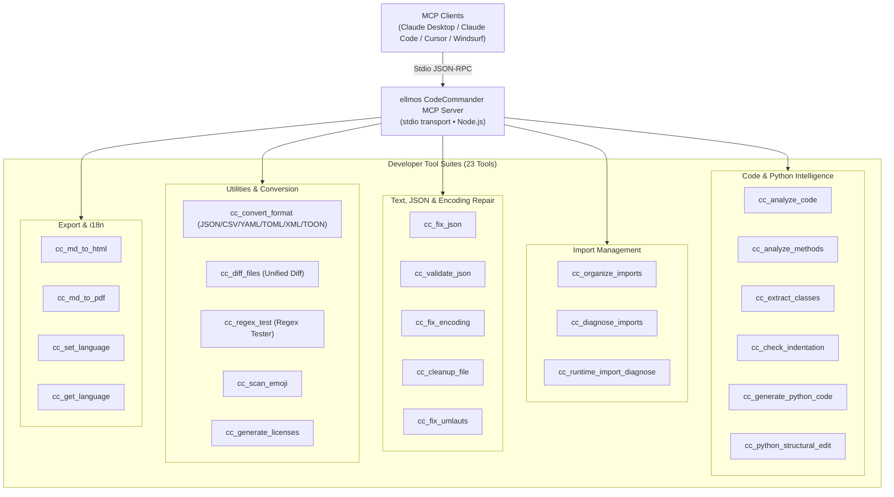
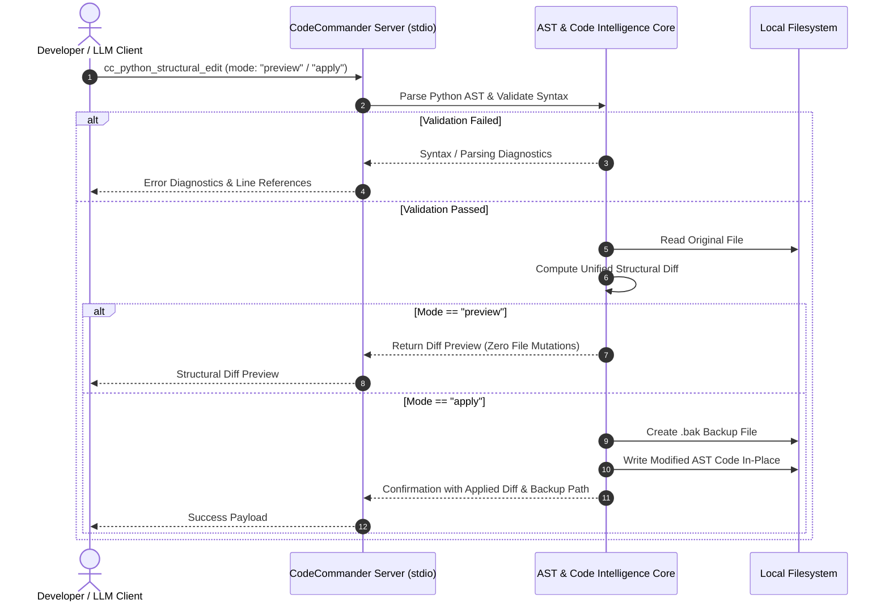

<!-- worldset: {"translated_from_sha256": "c11dfac3a2a77d1275cd2e577e98e1cfb77f6a79e216cf05578e1215537972d8", "translator": "gpt-6-luna", "translated_at": "2026-10-25 04:32:06+00:00"} -->
<p align="center">
  
</p>

# MCP-сервер ellmos CodeCommander

[English](README.md) | [Deutsch](README_de.md) | [Español](README_es.md) | [简体中文](README_zh.md) | [日本語](README_ja.md) | **Русский** | [Français](README_fr.md) | [हिन्दी](README_hi.md) | [العربية](README_ar.md) | [বাংলা](README_bn.md) | [Português](README_pt.md)

Навигация README перечисляет доступные языки документации. В разделе 11 отдельно описаны языки сообщений вывода и диагностики инструментов во время выполнения. Это не означает, что описания обнаружения или схемы MCP, GUI, CLI или API переведены.

*Часть семейства [ellmos-ai](https://github.com/ellmos-ai).*

[](https://opensource.org/licenses/MIT)
[](https://www.npmjs.com/package/ellmos-codecommander-mcp)
[](https://github.com/ellmos-ai/ellmos-codecommander-mcp/actions/workflows/tests.yml)
[](https://github.com/ellmos-ai/ellmos-codecommander-mcp)
[](https://nodejs.org/)
[](https://nodejs.org/)
[](SECURITY.md)
[](SECURITY.md)
[](SECURITY.md)
[](SECURITY.md)
[](CONTRIBUTING.md)
[](THIRD_PARTY_LICENSES.md)
[](MARKETING-LOG.txt)
[](NOTICE)
[](CHANGELOG.md)
[](https://github.com/ellmos-ai)
[](https://github.com/open-bricks)
[](llms.txt)

> [!NOTE]
> **Для AI-ассистентов и LLM:** для этого репозитория доступна машиночитаемая документация для индексирования: [`llms.txt`](llms.txt). Сервер предоставляет 23 специализированных инструмента с префиксом `cc_`.

**Сервер Model Context Protocol (MCP)** для разработчиков, который предоставляет AI-ассистентам возможности анализа кода, структурного редактирования Python, исправления JSON и кодировки, организации импортов, преобразования форматов, сравнения файлов и проверки регулярных выражений.

**23 инструмента**, оптимизированных для разработчиков, — помощник по программированию для [FileCommander](https://github.com/ellmos-ai/ellmos-filecommander-mcp).

**Обнаруживаемость:** опубликован в [npm](https://www.npmjs.com/package/ellmos-codecommander-mcp) под именем `ellmos-codecommander-mcp`, доступен на [Glama](https://glama.ai/mcp/servers/b9kjs4uaav) и подготовлен для официального MCP Registry: [`server.json`](server.json) предназначен для регистрации под именем `io.github.ellmos-ai/ellmos-codecommander-mcp`. Манифесты реестров и каталогов [`server.json`](server.json), [`glama.json`](glama.json), [`smithery.yaml`](smithery.yaml) и [`llms.txt`](llms.txt) полностью согласованы.

---

## Быстрая навигация

1. [Обзор и основные возможности](#sec-01)
2. [Целевые персоны и обнаруживаемость](#sec-02)
3. [Сравнительная таблица альтернатив](#sec-03)
4. [Архитектура и обзор системы](#sec-04)
5. [Безопасный цикл структурного редактирования](#sec-05)
6. [Управление и инварианты среды выполнения](#sec-06)
7. [Набор инструментов разработчика (23 инструмента)](#sec-07)
8. [Общие инструменты с FileCommander](#sec-08)
9. [Установка и быстрый старт](#sec-09)
10. [Настройка и конфигурация MCP-клиента](#sec-10)
11. [Многоязыковая поддержка (i18n)](#sec-11)
12. [Разработка и обеспечение качества](#sec-12)
13. [Экосистема смежных проектов и партнёры](#sec-13)
14. [Лицензии сторонних компонентов и прозрачность](#sec-14)
15. [Политика безопасности и SLA реагирования](#sec-15)
16. [Журнал изменений и история версий](#sec-16)
17. [Лицензия и правовая атрибуция](#sec-17)
18. [Предусмотренное законом уведомление, ограничение ответственности и SLA (§ 521 BGB)](#sec-18)

---

<a id="sec-01"></a><a id="1-overview--highlights"></a><a id="overview--highlights"></a><a id="overview"></a>
## 1. Обзор и основные возможности

FileCommander отвечает за операции с файловой системой и системные процессы, а CodeCommander специализируется на **интеллектуальном анализе кода и точности для разработчиков**:

- **Анализ Python, JavaScript и TypeScript** — классы, методы, функции, метрики сложности и импорты, определяемые по расширению файла; анализ JS/TS основан на регулярных выражениях и выполняется только для чтения.
- **Вспомогательные средства Python на основе BACH** — диагностика импортов во время выполнения, структурное редактирование, проверка отступов и генерация кода по шаблонам.
- **Явные языковые ограничения** — инструменты путей, предназначенные только для Python, явно отклоняют файлы, отличные от `.py`, вместо выдачи ложных результатов в стиле Python.
- **Исправление и проверка JSON** — автоматическое исправление поврежденного JSON (завершающие запятые, одинарные кавычки, BOM, комментарии) с точным указанием места ошибки.
- **Организация импортов по PEP 8** — сортировка и удаление дубликатов импортов Python по рекомендациям PEP 8.
- **Исправление кодировки и mojibake** — исправление mojibake, двойной кодировки UTF-8 (более 27 шаблонов) и поврежденных немецких символов (более 70 шаблонов умлаутов).
- **Универсальное преобразование форматов** — преобразование без потерь между JSON, CSV, INI, YAML, TOML, XML и TOON.
- **Единый diff файлов** — сравнение двух файлов с выводом унифицированного LCS-diff и настраиваемым числом контекстных строк.
- **Рабочая среда для проверки регулярных выражений** — тестирование regex с подробностями совпадений, захватываемыми группами и предварительным просмотром замены.
- **Нативная кроссплатформенность** — полная поддержка Windows, macOS и Linux.

---

<a id="sec-02"></a><a id="2-target-personas--discoverability"></a><a id="target-personas--discoverability"></a><a id="personas"></a><a id="zielgruppen--auffindbarkeit"></a>
## 2. Целевые персоны и обнаруживаемость

CodeCommander MCP предназначен для устранения ключевых узких мест в современной автономной разработке с помощью AI, локальных мультиагентных систем и безопасных инструментов для разработчиков:

### Целевая аудитория и персоны заинтересованных сторон

- **`[PERSONA-01]` (`[PERSONA-1]`) Автономные AI-агенты для программирования и LLM-партнёры по разработке**
  - **Профиль:** агенты вроде Claude Code, Antigravity, Codex, Cursor и Windsurf для автоматического рефакторинга кода, исправления тестов и разработки функций.
  - **Проблема:** в коде, созданном LLM, часто встречаются вымышленные импорты, неверные отступы в сложных управляющих конструкциях Python, недопустимые JSON-конфигурации или повреждение синтаксиса при наивном редактировании по фрагментам.
  - **Решение:** извлечение AST средствами среды (`cc_extract_classes`, `cc_analyze_methods`), безопасное структурное редактирование с предварительным просмотром и унифицированным diff (`cc_python_structural_edit`), автоматическая проверка отступов (`cc_check_indentation`) и детерминированное исправление JSON (`cc_fix_json`).

- **`[PERSONA-02]` (`[PERSONA-2]`) Full-stack- и Python/TypeScript-разработчики**
  - **Профиль:** разработчики, поддерживающие полиглотные проекты, CLI-утилиты и конвейеры данных, которым нужны межъязыковой анализ AST и быстрое преобразование форматов конфигурации.
  - **Проблема:** утомительные ручные преобразования форматов (JSON ↔ YAML ↔ TOML ↔ TOON ↔ XML), поврежденные немецкие умлауты или mojibake из-за устаревших кодировок и циклические импорты во время выполнения.
  - **Решение:** универсальный преобразователь форматов (`cc_convert_format`), неразрушающее исправление кодировки и умлаутов (`cc_fix_encoding`, `cc_fix_umlauts`), изолированная диагностика импортов во время выполнения (`cc_runtime_import_diagnose`) и интерактивная проверка регулярных выражений (`cc_regex_test`).

- **`[PERSONA-03]` (`[PERSONA-3]`) Руководители по безопасности AI, SecOps и управлению кодом в компаниях**
  - **Профиль:** специалисты по аудиту безопасности, инженеры по соответствию требованиям и корпоративные архитекторы, оценивающие цепочки MCP-инструментов для рабочих станций разработчиков и CI/CD-раннеров.
  - **Проблема:** риск утечки конфиденциального кода через облачную телеметрию, несанкционированного повышения привилегий процессов или разрушительной перезаписи файлов AI-ассистентом.
  - **Решение:** 100% локальная передача stdio без исходящего трафика (`INV-LOCAL-01`), запуск в пространстве непривилегированного пользователя (`INV-SEC-02`), обязательные резервные копии `.bak` с отметкой времени перед изменением (`INV-BAK-04`), безопасный предварительный просмотр diff в dry-run (`INV-PREV-03`) и изолированные дочерние процессы с тайм-аутом (`INV-ISOL-05`).

- **`[PERSONA-04]` (`[PERSONA-4]`) Архитекторы экосистемы open source и разработчики MCP-инструментов**
  - **Профиль:** сопровождающие, создающие, публикующие и индексирующие MCP-серверы на Glama, Smithery, npm и GitHub.
  - **Проблема:** разрозненные манифесты каталогов, отсутствие сведений о сторонних лицензиях и нехватка машиночитаемого контекста для индексации AI-агентами.
  - **Решение:** 100% согласованность манифестов между `package.json`, `server.json`, `glama.json`, `smithery.yaml` и `llms.txt`, подтвержденная автоматическими контрактными тестами и полным аудитом лицензий open source (`THIRD_PARTY_LICENSES.md`).

### Поисковые запросы с высокой целевой направленностью (SEO и обнаруживаемость)

- `mcp code analysis server`
- `model context protocol python ast tools`
- `mcp server codecommander`
- `python structural edit mcp`
- `claude code developer mcp server`
- `mcp json repair and encoding fix`
- `local-first mcp tools for coding`
- `mcp python runtime import diagnose`
- `format converter mcp json yaml toml toon`
- `offline code intelligence mcp server`

---

<a id="sec-03"></a><a id="3-comparative-matrix-vs-alternatives"></a><a id="comparative-matrix-vs-alternatives"></a><a id="vergleichsmatrix-gegenueber-alternativen"></a>
## 3. Сравнительная таблица альтернатив

В таблице CodeCommander MCP сравнивается с альтернативными подходами к инструментам разработчика по 10 важным операционным параметрам:

| Параметр / возможности | Универсальный файловый MCP | Raw Shell / разовые скрипты | Тяжеловесный облачный LLMOps | Традиционные плагины IDE | ellmos CodeCommander MCP |
| :--- | :--- | :--- | :--- | :--- | :--- |
| **1. Интеллектуальный анализ AST** | Нет (только чтение текста) | Нужны собственные скрипты Python | Нужен облачный парсер | Встроено (только GUI) | **Нативный AST и JS/TS на основе regex (`cc_analyze_code`)** |
| **2. Безопасный предпросмотр структурных изменений** | Нет (слепая перезапись) | Высокий риск (`sed`/`awk`) | Зависит от облачного шлюза | Интерактивное диалоговое окно | **Безопасные diff с предварительным просмотром (`mode: "preview"`)** |
| **3. Обязательные резервные копии до изменений** | Нет | Ручное создание скриптов | Нет | Локальная история (непрозрачная) | **Автоматическое создание `.bak` (`INV-BAK-04`)** |
| **4. Диагностика импортов во время выполнения** | Нет | Небезопасное прямое выполнение | Нет | Частично / только статический анализ | **Изолированный подпроцесс и тайм-аут (`INV-ISOL-05`)** |
| **5. Восстановление кодировки и mojibake** | Нет | Ненадежные вызовы `iconv` | Нет | Базовое переключение кодировки | **Более 27 шаблонов mojibake и 70 умлаутов (`cc_fix_encoding`)** |
| **6. Универсальное преобразование форматов** | Нет | Несколько разрозненных CLI-инструментов | API-конвертер SaaS | Набор нескольких плагинов | **Преобразование без потерь 7 форматов (`JSON/YAML/TOML/XML/TOON`)** |
| **7. Движок diff и рабочая среда regex** | Нет | Базовые `diff`/`grep` | Нет | Только панель GUI | **LCS unified diff и regex с группами/заменой** |
| **8. Локальная работа и нулевой исходящий трафик** | Зависит от хоста | Локально | Облачный трафик / телеметрия | Часто подключается к облаку | **100% офлайн stdio JSON-RPC (`INV-LOCAL-01`)** |
| **9. Многоязыковая поддержка (i18n)** | Только английский | Нет | Только английский | Языковые пакеты | 11 языков для сообщений вывода и диагностики инструментов во время выполнения; переключение через `cc_set_language`. |
| **10. Согласованность реестра и манифестов** | Минимальная | Нет | Проприетарно | Зависит от магазина плагинов | **npm, Glama, Smithery, MCP Registry, `llms.txt`** |

---

<a id="sec-04"></a><a id="4-architecture--system-overview"></a><a id="architecture--system-overview"></a><a id="architecture"></a>
## 4. Архитектура и обзор системы

```text
+==============================================================================================================+
|                            FOUR-VIEW ARCHITECTURAL TOPOLOGY (STANDARDIZED LEVEL-1 SPECIFICATION)             |
+==============================================================================================================+
| [VIEW 1: CLIENT RUNTIMES, USER INTERFACES & AGENT ENTRYPOINTS]                                               |
|  - Stdio JSON-RPC Clients: Claude Desktop, Claude Code CLI, Cursor, Windsurf, Codex, Antigravity, Kimi Code  |
|  - MCP Tool Ingestion: 23 Developer Tools via standard Model Context Protocol Specification                  |
|  - Runtime locales: DE EN ES ZH JA RU FR HI AR BN PT (INV-I18N-09)                                           |
+--------------------------------------------------------------------------------------------------------------+
                                          | Stdio Transport (JSON-RPC)
                                          v
+--------------------------------------------------------------------------------------------------------------+
| [VIEW 2: CODECOMMANDER MCP PROTOCOL & TOOL ENGINE]                                                           |
|  - Code Intelligence AST: Python AST Class/Method Extractors, Complexity Metrics & Guardrails (INV-GATE-06)   |
|  - Structural Refactoring Engine: Preview-Safe Diffs & Dry-Run Syntax Verification (INV-PREV-03)             |
|  - Import Diagnostics & Organizer: PEP 8 Cleaners & Subprocess Import Probers (INV-ISOL-05)                  |
|  - Universal Format Converter: Lossless Roundtrip across JSON/CSV/INI/YAML/TOML/XML/TOON (INV-FMT-08)         |
|  - Text & Encoding Heuristics: 27+ Mojibake & 70+ German Umlaut Restorations, JSON Fixers (INV-ENC-07)       |
+--------------------------------------------------------------------------------------------------------------+
                                          | Process Isolation & Local I/O
                                          v
+--------------------------------------------------------------------------------------------------------------+
| [VIEW 3: RUNTIME PERSISTENCE, BACKUP VAULTS & ISOLATED SUBPROCESS RUNNERS]                                   |
|  - Pre-Mutation Safety Vault: Timestamped `.bak` Disk Backups Before In-Place Modification (INV-BAK-04)       |
|  - Ephemeral Python Runner: Isolated Child Processes with Strict Execution Timeout Bounds (INV-ISOL-05)     |
|  - Unified Diff Pipeline: LCS Algorithm Unified Diff Generator with Configurable Context Chunks              |
|  - Local Document Exporters: Self-Contained Markdown-to-HTML and Print-Safe PDF Artifact Generators          |
+--------------------------------------------------------------------------------------------------------------+
                                          | Containment & Perimeter Defense
                                          v
+--------------------------------------------------------------------------------------------------------------+
| [VIEW 4: AIR-GAP DEFENSE PERIMETER, ZERO-EGRESS & RUNASINVOKER SECURITY BOUNDARY]                            |
|  - Zero-Egress Network Isolation: 100% Offline Local Operation, Zero Sockets, Zero Cloud Telemetry (INV-LOCAL-01)|
|  - Unprivileged User Mode: Standard RunAsInvoker Execution; Zero Root/Administrator Elevation (INV-SEC-02)  |
|  - Supply Chain & License Hygiene: Zero Copyleft, 100% Permissive Open Source Stack (MIT, BSD, Apache)       |
|  - Vulnerability Remediation SLA: 48h Response, 5-Day Triage & 30-Day Patch Commitment (INV-SLA-10)          |
+==============================================================================================================+
```



---

<a id="sec-05"></a><a id="5-safe-structural-edit-lifecycle"></a><a id="safe-structural-edit-lifecycle"></a><a id="edit-lifecycle"></a>
## 5. Безопасный цикл структурного редактирования



---

<a id="sec-06"></a><a id="6-governance--runtime-invariants"></a><a id="governance--runtime-invariants"></a><a id="governance-invariants"></a><a id="governance--laufzeit-invarianten"></a>
## 6. Управление и инварианты среды выполнения

`ellmos-codecommander-mcp` гарантирует соблюдение 10 основных архитектурных инвариантов и инвариантов среды выполнения на всех платформах:

| ID инварианта | Классификация | Архитектурная гарантия и способ проверки |
| :--- | :--- | :--- |
| `INV-LOCAL-01` | Конфиденциальность без исходящего трафика | Полностью локальная передача stdio JSON-RPC; нет сетевой телеметрии, облачных beacon-запросов или удаленного исходящего трафика. |
| `INV-SEC-02` | Безопасность непривилегированного режима | Работа в стандартном пользовательском пространстве (`RunAsInvoker`), без root или повышения прав администратора. |
| `INV-PREV-03` | Безопасность предпросмотра | Структурные изменения по умолчанию выполняются в режиме предпросмотра без изменений (`mode: "preview"`) с генерацией unified diff. |
| `INV-BAK-04` | Автоматические резервные копии | Перед записью изменений на диск автоматически создаются файлы `.bak` с отметкой времени. |
| `INV-ISOL-05` | Изоляция подпроцессов | Диагностика импортов Python во время выполнения запускается в изолированных дочерних процессах с ограничением по времени. |
| `INV-GATE-06` | Явные языковые ограничения | Инструменты путей только для Python явно отклоняют файлы, отличные от `.py`; анализ JS/TS выполняется только для чтения и на основе regex. |
| `INV-ENC-07` | Неразрушающее исправление кодировки | Восстановленный текст сохраняет более 27 шаблонов mojibake и 70 шаблонов немецких умлаутов без потерь и повреждения двоичных данных. |
| `INV-FMT-08` | Совместимость форматов | Преобразование без потерь между JSON, CSV, INI, YAML, TOML, XML и TOON с сохранением схемы. |
| `INV-I18N-09` | Многоязыковая среда выполнения | Переключение между 11 языками сообщений вывода и диагностики инструментов с помощью `cc_set_language`; `cc_get_language` сообщает активный код. |
| `INV-SLA-10` | SLA ответа по вопросам безопасности — 48 ч | Проверено на Ubuntu, Windows и macOS с Node 20, 22 и 24; публично гарантирован первый ответ за 48 ч и триаж за 5 дней. |

---

<a id="sec-07"></a><a id="7-developer-tool-suite-23-tools"></a><a id="developer-tool-suite-23-tools"></a><a id="tools"></a><a id="tool-suite"></a>
## 7. Набор инструментов разработчика (23 инструмента)

### Анализ кода (3 инструмента)

| Инструмент | Описание |
|------|-------------|
| `cc_analyze_code` | Анализ Python или JavaScript/TypeScript на основе regex только для чтения: классы, функции, импорты, строки кода, сложность |
| `cc_analyze_methods` | Анализ методов Python или JavaScript/TypeScript на основе regex только для чтения; в Python сохраняются защитные механизмы BACH |
| `cc_extract_classes` | Извлечение классов/функций Python в отдельные текстовые блоки, при необходимости с включением встроенного содержимого в стиле pycutter |

### Управление импортами (3 инструмента)

| Инструмент | Описание |
|------|-------------|
| `cc_organize_imports` | Сортировка и удаление дубликатов импортов Python по PEP 8 |
| `cc_diagnose_imports` | Диагностика импортов Python или JavaScript/TypeScript на основе regex только для чтения |
| `cc_runtime_import_diagnose` | Запуск импортов Python в изолированной среде с ограничением времени, анализом `__init__.py` и подсказками о циклических импортах |

### Инструменты JSON (2 инструмента)

| Инструмент | Описание |
|------|-------------|
| `cc_fix_json` | Исправление поврежденного JSON (BOM, завершающие запятые, комментарии, одинарные кавычки) |
| `cc_validate_json` | Проверка JSON с подробным указанием позиции ошибки и контекста |

### Кодировка и текст (3 инструмента)

| Инструмент | Описание |
|------|-------------|
| `cc_fix_encoding` | Исправление mojibake / двойной кодировки UTF-8 (более 27 шаблонов) |
| `cc_cleanup_file` | Удаление BOM, NUL-байтов и пробелов в конце строк; нормализация переводов строк |
| `cc_fix_umlauts` | Исправление поврежденных немецких умлаутов (более 70 шаблонов, включая HTML-сущности и escape-последовательности) |

### Сканирование (1 инструмент)

| Инструмент | Описание |
|------|-------------|
| `cc_scan_emoji` | Поиск эмодзи в файлах с указанием кодовых точек |

### Форматы и документация (2 инструмента)

| Инструмент | Описание |
|------|-------------|
| `cc_convert_format` | Преобразование JSON, CSV, INI, YAML, TOML, XML и TOON |
| `cc_generate_licenses` | Генерация файла лицензий сторонних компонентов для npm/pip |

### Утилиты разработчика (2 инструмента)

| Инструмент | Описание |
|------|-------------|
| `cc_diff_files` | Сравнение двух файлов с unified diff и настраиваемым числом контекстных строк |
| `cc_regex_test` | Проверка regex на тексте/файлах с отображением совпадений, групп и предварительного просмотра замены |

### Помощь Python-разработчику (3 инструмента)

| Инструмент | Описание |
|------|-------------|
| `cc_check_indentation` | Поиск пропущенных двоеточий, неотступленных return/yield и смешанных табуляций/пробелов |
| `cc_generate_python_code` | Генерация функций Python, классов, dataclass, CLI-заготовок, тестов, исключений и модулей по шаблонам |
| `cc_python_structural_edit` | Проверка и применение структурных правок Python с режимами preview, test-file, syntax-check и backup |

### Экспорт (2 инструмента)

| Инструмент | Описание |
|------|-------------|
| `cc_md_to_html` | Преобразование Markdown в автономный HTML со стилями CSS для заголовков, блоков кода, таблиц, цитат, изображений и чекбоксов |
| `cc_md_to_pdf` | Преобразование Markdown в PDF через headless-браузер (Edge/Chrome); без браузера используется HTML |

### Управление языками среды выполнения (2 инструмента)

| Инструмент | Описание |
|------|-------------|
| `cc_set_language` | Задать язык сообщений вывода и диагностики инструментов во время выполнения (`de`, `en`, `es`, `zh`, `ja`, `ru`, `fr`, `hi`, `ar`, `bn`, `pt`). |
| `cc_get_language` | Запрос текущего языка и поддерживаемых кодов локалей |

**23 инструмента разработчика** доступны с префиксом `cc_`.

---

<a id="sec-08"></a><a id="8-shared-tools-with-filecommander"></a><a id="shared-tools-with-filecommander"></a><a id="shared-tools"></a>
## 8. Общие инструменты с FileCommander

Для удобства в FileCommander и CodeCommander доступны 7 одинаковых инструментов:

| FileCommander | CodeCommander | Функция |
|---------------|---------------|----------|
| `fc_fix_json` | `cc_fix_json` | Исправление JSON |
| `fc_validate_json` | `cc_validate_json` | Проверка JSON |
| `fc_fix_encoding` | `cc_fix_encoding` | Исправление кодировки |
| `fc_cleanup_file` | `cc_cleanup_file` | Очистка файлов |
| `fc_convert_format` | `cc_convert_format` | Преобразование форматов (JSON/CSV/INI/YAML/TOML/XML/TOON) |
| `fc_md_to_html` | `cc_md_to_html` | Экспорт Markdown в HTML |
| `fc_md_to_pdf` | `cc_md_to_pdf` | Экспорт Markdown в PDF |

Все инструменты CodeCommander используют префикс `cc_`, чтобы беспрепятственно сосуществовать с пространством имён `fc_` FileCommander.

---

<a id="sec-09"></a><a id="9-installation--quickstart"></a><a id="installation--quickstart"></a><a id="installation"></a>
## 9. Установка и быстрый старт

### Предварительные требования

- [Node.js](https://nodejs.org/) версии 20 или выше
- npm версии 9 или выше

### Вариант 1: установка из NPM (рекомендуется)

```bash
npm install -g ellmos-codecommander-mcp
```

### Вариант 2: установка из исходного кода

```bash
git clone https://github.com/ellmos-ai/ellmos-codecommander-mcp.git
cd ellmos-codecommander-mcp
npm install
npm run build
```

---

<a id="sec-10"></a><a id="10-configuration--mcp-client-setup"></a><a id="configuration--mcp-client-setup"></a><a id="configuration"></a>
## 10. Настройка и конфигурация MCP-клиента

### Claude Desktop

Добавьте конфигурацию в `claude_desktop_config.json`:

- **Windows:** `%APPDATA%\Claude\claude_desktop_config.json`
- **macOS:** `~/Library/Application Support/Claude/claude_desktop_config.json`

#### Глобальная установка NPM:

```json
{
  "mcpServers": {
    "codecommander": {
      "command": "ellmos-codecommander"
    }
  }
}
```

#### Сборка из исходного кода:

```json
{
  "mcpServers": {
    "codecommander": {
      "command": "node",
      "args": ["/absolute/path/to/ellmos-codecommander-mcp/dist/index.js"]
    }
  }
}
```

### Совместная работа с FileCommander

FileCommander и CodeCommander рассчитаны на одновременный запуск:

```json
{
  "mcpServers": {
    "filecommander": {
      "command": "ellmos-filecommander"
    },
    "codecommander": {
      "command": "ellmos-codecommander"
    }
  }
}
```

---

<a id="sec-11"></a><a id="11-multi-language-support-i18n"></a><a id="multi-language-support-i18n"></a><a id="i18n"></a>
## 11. Многоязыковая поддержка (i18n)

CodeCommander поддерживает следующие 11 языков для сообщений, возвращаемых инструментами, включая диагностические сообщения во время выполнения:

- `de` — немецкий (по умолчанию)
- `en` — английский
- `es` — испанский
- `zh` — китайский (упрощённый)
- `ja` — японский
- `ru` — русский
- `fr` — французский
- `hi` — хинди
- `ar` — арабский
- `bn` — бенгальский
- `pt` — португальский

Эти коды задают язык сообщений вывода и диагностики инструментов во время выполнения. Они не переводят описания обнаружения или схем MCP, а также GUI, CLI или API; навигация README отдельно перечисляет языки документации.

Начальный язык при запуске сервера задаётся переменной `CC_LANGUAGE`. Во время активной сессии MCP вызовите `cc_set_language`, чтобы переключить язык; `cc_get_language` сообщает активный код и список поддерживаемых кодов. Если `CC_LANGUAGE` не задана или содержит неподдерживаемое значение, используется немецкий (`de`). Опция `--lang` не документирована.

---

<a id="sec-12"></a><a id="12-development--quality-assurance"></a><a id="development--quality-assurance"></a><a id="development"></a><a id="testing"></a>
## 12. Разработка и обеспечение качества

```bash
npm install
npm run dev               # TypeScript watch mode
npm run build             # Compile TypeScript to dist/
npm start                 # Run built server via stdio
npm test                  # Run Vitest unit & contract suite (205 tests)
npm run test:integration  # Real MCP stdio test suite (52 assertions, build first)
npm run test:i18n         # Translation parity test suite (43 assertions)
npm run test:all          # Run full QA pipeline (build + vitest + integration + i18n)
```

Тестовые проверки намеренно разделены и автоматически выполняются в CI на **Ubuntu**, **macOS** и **Windows** с Node.js 20, 22 и 24 (всего 302 автоматические проверки, все успешно пройдены). Процесс участия и рекомендации для разработчиков описаны в [CONTRIBUTING.md](CONTRIBUTING.md).

---

<a id="sec-13"></a><a id="13-sibling-ecosystem--partner-matrix"></a><a id="sibling-ecosystem--partner-matrix"></a><a id="ecosystem"></a>
## 13. Экосистема смежных проектов и партнёры

Проект входит в семейства локальных инструментов **[ellmos-ai](https://github.com/ellmos-ai)** и **[open-bricks](https://github.com/open-bricks)**:

### Семейство MCP-серверов

| Сервер | Инструменты | Назначение | npm |
|--------|-------|-------|-----|
| [FileCommander](https://github.com/ellmos-ai/ellmos-filecommander-mcp) | 50 | Файловая система, управление процессами, интерактивные сессии, операции с учётом облачных блокировок | [`ellmos-filecommander-mcp`](https://www.npmjs.com/package/ellmos-filecommander-mcp) |
| **[CodeCommander](https://github.com/ellmos-ai/ellmos-codecommander-mcp)** | **23** | **Анализ кода, правки AST, исправление JSON, diff, regex** | **[`ellmos-codecommander-mcp`](https://www.npmjs.com/package/ellmos-codecommander-mcp)** |
| [Clatcher](https://github.com/ellmos-ai/ellmos-clatcher-mcp) | 12 | Исправление файлов, преобразование форматов, пакетные операции | [`ellmos-clatcher-mcp`](https://www.npmjs.com/package/ellmos-clatcher-mcp) |
| [n8n Manager](https://github.com/ellmos-ai/n8n-manager-mcp) | 19 | Управление рабочими процессами n8n с помощью AI-ассистентов | [`n8n-manager-mcp`](https://www.npmjs.com/package/n8n-manager-mcp) |
| [ControlCenter](https://github.com/ellmos-ai/ellmos-controlcenter-mcp) | 34 | Поиск MCP-стеков, управление профилями, плоскость управления | [`ellmos-controlcenter-mcp`](https://www.npmjs.com/package/ellmos-controlcenter-mcp) |
| [Homebase](https://github.com/ellmos-ai/ellmos-homebase-mcp) | 51 | Локальная память LLM, знания, состояние, маршрутизация и оркестрация групп агентов | [`ellmos-homebase-mcp`](https://www.npmjs.com/package/ellmos-homebase-mcp) (alpha) |
| [ServerCommander](https://github.com/ellmos-ai/ellmos-servercommander-mcp) | 8 | Операции с серверами: проверка состояния, анализ журналов, dry-run развёртывания, диагностика почты | [`ellmos-servercommander-mcp`](https://www.npmjs.com/package/ellmos-servercommander-mcp) (alpha) |
| [Blender Use](https://github.com/ellmos-ai/ellmos-blender-use-mcp) | 4 | QA ресурсов Blender без графического интерфейса и проверка повторного импорта FBX | [`ellmos-blender-use-mcp`](https://www.npmjs.com/package/ellmos-blender-use-mcp) (alpha) |
| [Open Compute](https://github.com/ellmos-ai/open-compute-mcp) | 16 | Управление компьютером без привязки к модели: снимки экрана, действия с защитными ограничениями, Windows UIA | [`open-compute-mcp`](https://www.npmjs.com/package/open-compute-mcp) (alpha) |

### Смежные инструменты для разработчиков, файлов и документов

| Экосистема | Инструмент / проект | Назначение и возможности |
|---|---|---|
| **ellmos-ai** | [sqlite-transit-sync](https://github.com/ellmos-ai/sqlite-transit-sync) | Офлайн-распространение изменений SQLite с проверкой HMAC |
| **ellmos-ai** | [policy-registry](https://github.com/ellmos-ai/policy-registry) | Криптографически подписанные политики делегирования для AI-агентов |
| **ellmos-ai** | [clutch](https://github.com/ellmos-ai/clutch) | Оркестрация LLM без привязки к провайдеру, автоматическая маршрутизация и учёт бюджета |
| **ellmos-ai** | [BACH](https://github.com/ellmos-ai/bach) | Локальная текстовая ОС для LLM-агентов — более 113 обработчиков и 550 инструментов |
| **dev-bricks** | [DevCenter](https://github.com/dev-bricks/DevCenter) | Настольный пакет для разработчиков на PySide6 и офлайн-хранилище секретов |
| **dev-bricks** | [CodeBox](https://github.com/dev-bricks/CodeBox) | Быстрый настольный менеджер фрагментов кода и офлайн-индекс AST |
| **dev-bricks** | [MethodenAnalyser](https://github.com/dev-bricks/MethodenAnalyser) | Средство диагностики потока методов и сложности |
| **dev-bricks** | [Zombie Killer Tray](https://github.com/dev-bricks/zombie-killer-tray) | Необязательный инструмент Windows для поиска осиротевших MCP-процессов. CodeCommander — настроенный кандидат при запуске через поддерживаемую точку входа `node_modules/ellmos-codecommander-mcp/dist/index.js`; все дополнительные проверки процессов и применения изменений остаются обязательными. |
| **doc-bricks** | [PDFtoPDFocr](https://github.com/doc-bricks/PDFtoPDFocr) | Настольный OCR-конвейер для поиска по PDF с помощью Tesseract |
| **doc-bricks** | [DokuReader](https://github.com/doc-bricks/DokuReader) | Рабочее пространство для документов разных форматов и офлайн-экспорт в PDF |
| **file-bricks** | [ProFiler](https://github.com/file-bricks/ProFiler) | Многопанельное управление файлами и пакетные операции |
| **open-bricks** | [open-bricks](https://github.com/open-bricks) | Организация зонтичного типа для AI-ориентированных настольных приложений |

---

<a id="sec-14"></a><a id="14-third-party-licenses--transparency"></a><a id="third-party-licenses--transparency"></a><a id="drittanbieter-lizenzen--transparenz"></a>
## 14. Лицензии сторонних компонентов и прозрачность

Проект строго придерживается принципа прозрачности open source:

- Все зависимости среды выполнения и разработки проверены в [`THIRD_PARTY_LICENSES.md`](THIRD_PARTY_LICENSES.md) и в текстовом сопроводительном файле [`THIRD_PARTY_LICENSES.txt`](THIRD_PARTY_LICENSES.txt).
- Текущий аудит производственных зависимостей (`npm audit --omit=dev --json`, проверен 2026-09-20) выявил 5 уязвимых узлов пакетов (3 высокого и 2 среднего уровня); устранение отслеживается в TASKPLAN #2198.
- Распространение ведётся исключительно на условиях разрешительных лицензий open source (**MIT**, **BSD-2-Clause**, **BSD-3-Clause**, **Apache-2.0**).
- Подробные сведения об обнаруживаемости, персонах и маркетинговых метриках приведены в [`MARKETING-LOG.txt`](MARKETING-LOG.txt).
- Нет проприетарного отслеживания, телеметрических маяков или зависимостей с вирусным copyleft.

---

<a id="sec-15"></a><a id="15-security-policy--response-sla"></a><a id="security-policy--response-sla"></a><a id="security"></a>
## 15. Политика безопасности и SLA реагирования

Полные инструкции по раскрытию уязвимостей см. в [SECURITY.md](SECURITY.md).

- **Гарантия нулевого исходящего трафика:** полностью локальное выполнение через stdio.
- **Безопасность предпросмотра и резервных копий:** разрушительные операции создают резервные копии `.bak` и поддерживают предпросмотр без внесения изменений.
- **Режим непривилегированного пользователя:** запуск с обычными непривилегированными правами (`RunAsInvoker`).
- **Выделенные каналы реагирования:** обращайтесь через `security@ellmos.ai` и `support@lukasgeiger.com`. Гарантирован **первый ответ в течение 48 часов** и **триаж в течение 5 дней**.

---

<a id="sec-16"></a><a id="16-changelog--version-history"></a><a id="changelog--version-history"></a><a id="changelog"></a>
## 16. Журнал изменений и история версий

Историю выпусков и примечания к релизам см. в [CHANGELOG.md](CHANGELOG.md).

---

<a id="sec-17"></a><a id="17-license--legal-attribution"></a><a id="license--legal-attribution"></a><a id="license"></a>
## 17. Лицензия и правовая атрибуция

Проект распространяется по лицензии [MIT License](LICENSE) — Copyright © 2026 Lukas Geiger ([ellmos-ai](https://github.com/ellmos-ai)).

Сведения об атрибуции umbrella-проекта open-bricks см. в [`NOTICE`](NOTICE), рекомендации для разработчиков — в [`CONTRIBUTING.md`](CONTRIBUTING.md), перечень инвариантов SBOM уровня 1 — в [`THIRD_PARTY_LICENSES.md`](THIRD_PARTY_LICENSES.md) / [`THIRD_PARTY_LICENSES.txt`](THIRD_PARTY_LICENSES.txt).

---

<a id="sec-18"></a><a id="18-statutory-notice-liability-limitation--sla-521-bgb"></a><a id="statutory-notice--liability"></a><a id="haftung--liability"></a><a id="haftung"></a>
## 18. Предусмотренное законом уведомление, ограничение ответственности и SLA (§ 521 BGB)

Этот проект является безвозмездным даром в виде ПО с открытым исходным кодом в смысле §§ 516 и последующих норм BGB (Гражданского кодекса Германии; правила о безвозмездной передаче). В соответствии с § 521 BGB ответственность автора и участников ограничена умыслом и грубой неосторожностью. Дополнительно действует отказ от гарантий по лицензии MIT.

Использование осуществляется на собственный риск. Обязательства по сопровождению, гарантия доступности, отсутствие ошибок и пригодность для конкретной цели не гарантируются.

Сообщения об инцидентах безопасности и уязвимостях принимаются через обязательное **SLA 48 часов** по каналам `security@open-bricks.org`, `security@ellmos.ai` и `support@lukasgeiger.com`; первичная классификация проводится в течение 5 рабочих дней.

*Этот проект — безвозмездный дар с открытым исходным кодом в соответствии с §§ 516 и последующими нормами немецкого BGB. Ответственность строго ограничена умыслом и грубой неосторожностью (§ 521 BGB). Дополнительно действует отказ от гарантий по лицензии MIT. Используйте на свой риск. Гарантия, обязательство по сопровождению и пригодность для конкретной цели не предоставляются.*

*Инциденты безопасности и уязвимости обрабатываются по обязательному **SLA первичного ответа 48 часов** через `security@open-bricks.org`, `security@ellmos.ai` и `support@lukasgeiger.com`; формальный триаж проводится в течение 5 рабочих дней.*
