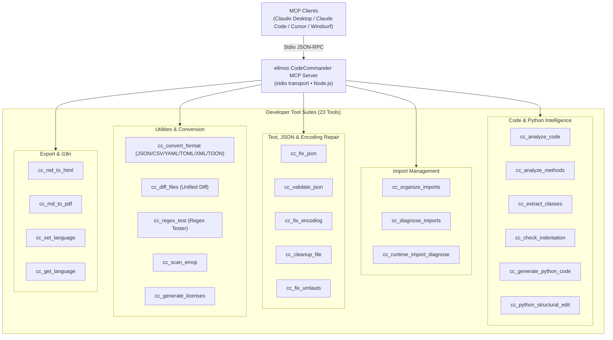
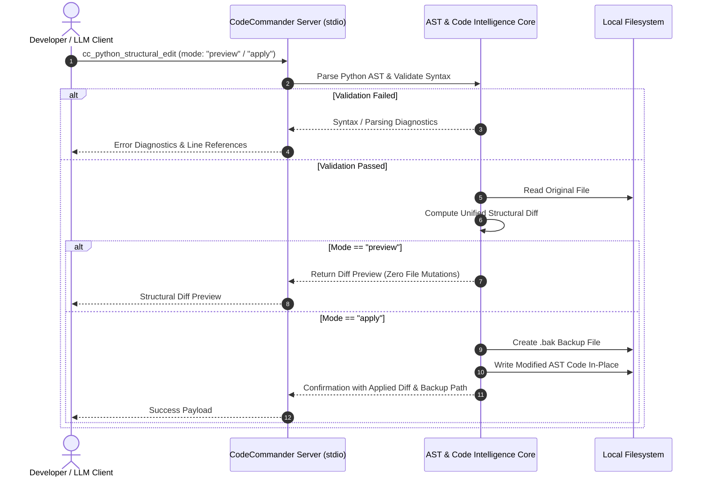

<!-- worldset: {"translated_from_sha256": "a8f3a78e24362792ae63406370643225807d7555231ddfaa02dba69bac7911d3", "translator": "gpt-6-luna", "translated_at": "2026-10-25 04:32:06+00:00"} -->
<p align="center">
  
</p>

# ellmos CodeCommander MCP 服务器

[English](README.md) | [Deutsch](README_de.md) | [Español](README_es.md) | **简体中文** | [日本語](README_ja.md) | [Русский](README_ru.md)

这些链接表示 README 文档提供的语言。工具运行时消息语言在第 11 节单独列出；这不表示 GUI、CLI 或 API 已完成本地化。

*属于 [ellmos-ai](https://github.com/ellmos-ai) 工具系列。*

[](https://opensource.org/licenses/MIT)
[](https://www.npmjs.com/package/ellmos-codecommander-mcp)
[](https://github.com/ellmos-ai/ellmos-codecommander-mcp/actions/workflows/tests.yml)
[](https://github.com/ellmos-ai/ellmos-codecommander-mcp)
[](https://nodejs.org/)
[](https://nodejs.org/)
[](SECURITY.md)
[](SECURITY.md)
[](SECURITY.md)
[](SECURITY.md)
[](CONTRIBUTING.md)
[](THIRD_PARTY_LICENSES.md)
[](MARKETING-LOG.txt)
[](NOTICE)
[](CHANGELOG.md)
[](https://github.com/ellmos-ai)
[](https://github.com/open-bricks)
[](llms.txt)

> [!NOTE]
> **致 AI 助手与 LLM：** 此仓库提供机器可读的索引文档：[`llms.txt`](llms.txt)。服务器在 `cc_` 前缀下提供 23 项专用工具。

面向开发者的 **Model Context Protocol (MCP) 服务器**，为 AI 助手提供代码分析、Python 结构化编辑、JSON 修复、编码修复、导入整理、格式转换、文件差异比较和正则表达式测试能力。

**23 项工具**专为开发者优化，是 [FileCommander](https://github.com/ellmos-ai/ellmos-filecommander-mcp) 的代码开发搭档。

**可发现性：** 已发布到 [npm](https://www.npmjs.com/package/ellmos-codecommander-mcp)，包名为 `ellmos-codecommander-mcp`；可在 [Glama](https://glama.ai/mcp/servers/b9kjs4uaav) 查看，并已准备好向官方 MCP Registry 提交 [`server.json`](server.json)，注册标识为 `io.github.ellmos-ai/ellmos-codecommander-mcp`。注册表和目录清单 [`server.json`](server.json)、[`glama.json`](glama.json)、[`smithery.yaml`](smithery.yaml) 和 [`llms.txt`](llms.txt) 均保持完全一致。

---

## 快速导航

1. [概览与亮点](#sec-01)
2. [目标用户画像与可发现性](#sec-02)
3. [与替代方案的比较矩阵](#sec-03)
4. [架构与系统概览](#sec-04)
5. [安全的结构化编辑流程](#sec-05)
6. [治理与运行时不变量](#sec-06)
7. [开发者工具套件（23 项工具）](#sec-07)
8. [与 FileCommander 共用的工具](#sec-08)
9. [安装与快速入门](#sec-09)
10. [配置与 MCP 客户端设置](#sec-10)
11. [多语言支持（i18n）](#sec-11)
12. [开发与质量保证](#sec-12)
13. [同系列生态与合作伙伴矩阵](#sec-13)
14. [第三方许可证与透明度](#sec-14)
15. [安全政策与响应 SLA](#sec-15)
16. [变更日志与版本历史](#sec-16)
17. [许可证与法律归属](#sec-17)
18. [法定声明、责任限制与 SLA（§ 521 BGB）](#sec-18)

---

<a id="sec-01"></a><a id="1-overview--highlights"></a><a id="overview--highlights"></a><a id="overview"></a>
## 1. 概览与亮点

FileCommander 负责文件系统操作和系统进程；CodeCommander 则专注于**代码智能与开发者级精确性**：

- **Python、JavaScript 与 TypeScript 分析** — 按扩展名分发的类、方法、函数、复杂度指标和导入分析；JS/TS 分析基于正则表达式且只读。
- **源自 BACH 的 Python 辅助工具** — 运行时导入诊断、结构化编辑、缩进检查和基于模板的代码生成。
- **显式语言门控** — 仅适用于 Python 的路径工具会明确拒绝非 `.py` 文件，而不会误报看似 Python 的问题。
- **JSON 修复与验证** — 自动修复损坏的 JSON（尾随逗号、单引号、BOM、注释），并精确指出错误位置。
- **PEP 8 导入整理** — 按 PEP 8 指南对 Python 导入排序并去重。
- **编码与乱码修复** — 修复乱码、双重编码的 UTF-8（27 种以上模式）和损坏的德语字符（70 种以上变音符号模式）。
- **通用格式转换** — 在 JSON、CSV、INI、YAML、TOML、XML 和 TOON 格式之间无损转换。
- **统一文件差异比较** — 比较两个文件并输出 LCS 统一差异，支持可配置的上下文行数。
- **正则表达式测试工作台** — 测试正则表达式，并查看匹配详情、捕获组和替换预览。
- **原生跨平台支持** — 完整支持 Windows、macOS 和 Linux。

---

<a id="sec-02"></a><a id="2-target-personas--discoverability"></a><a id="target-personas--discoverability"></a><a id="personas"></a><a id="zielgruppen--auffindbarkeit"></a>
## 2. 目标用户画像与可发现性

CodeCommander MCP 旨在解决现代自主 AI 编程、本地多智能体协作和符合安全要求的开发者工具中的关键瓶颈：

### 目标受众与利益相关者画像

- **`[PERSONA-01]` (`[PERSONA-1]`) 自主 AI 编程代理与 LLM 结对程序员**
  - **画像：** Claude Code、Antigravity、Codex、Cursor 和 Windsurf 等代理，用于自动化代码重构、测试修复和功能开发。
  - **痛点：** LLM 常生成虚构的导入、复杂 Python 控制流中错误的缩进、无效的 JSON 配置，或在简单分块编辑时破坏语法。
  - **解决方案：** 原生 AST 提取（`cc_extract_classes`、`cc_analyze_methods`）、可预览且安全的结构化编辑和统一差异（`cc_python_structural_edit`）、自动缩进检查（`cc_check_indentation`），以及确定性的 JSON 修复（`cc_fix_json`）。

- **`[PERSONA-02]` (`[PERSONA-2]`) 全栈与 Python/TypeScript 软件工程师**
  - **画像：** 维护多语言项目、CLI 工具和数据管道的开发者，需要跨语言 AST 分析并快速切换配置格式。
  - **痛点：** 手动格式转换繁琐（JSON ↔ YAML ↔ TOML ↔ TOON ↔ XML）；旧编码会损坏德语变音符号或产生乱码；运行时导入还可能形成循环依赖。
  - **解决方案：** 通用格式转换器（`cc_convert_format`）、非破坏性的编码和变音符号修复（`cc_fix_encoding`、`cc_fix_umlauts`）、隔离运行时导入诊断（`cc_runtime_import_diagnose`），以及交互式正则表达式测试器（`cc_regex_test`）。

- **`[PERSONA-03]` (`[PERSONA-3]`) 企业 AI 安全、SecOps 与代码治理负责人**
  - **画像：** 评估供开发者工作站和 CI/CD Runner 使用的 MCP 工具链的安全审计员、合规工程师和企业架构师。
  - **痛点：** 机密代码可能通过云端遥测泄露、进程可能被未经授权地提权，或 AI 助手可能直接覆盖文件并造成破坏。
  - **解决方案：** 通过 stdio 传输实现 100% 本地零外发（`INV-LOCAL-01`）、以非特权用户空间运行（`INV-SEC-02`）、每次变更前强制创建带时间戳的 `.bak` 备份（`INV-BAK-04`）、安全的 dry-run 差异预览（`INV-PREV-03`），以及隔离并设有超时限制的子进程（`INV-ISOL-05`）。

- **`[PERSONA-04]` (`[PERSONA-4]`) 开源生态架构师与 MCP 工具开发者**
  - **画像：** 在 Glama、Smithery、npm 和 GitHub 上构建、发布并编入索引的 MCP 服务器维护者。
  - **痛点：** 目录清单彼此不一致、缺少第三方许可证披露，也缺乏供 AI 代理读取的机器可读索引上下文。
  - **解决方案：** 在 `package.json`、`server.json`、`glama.json`、`smithery.yaml` 和 `llms.txt` 之间保持 100% 清单一致性，并通过自动化契约测试和完整的开源许可证审计验证（`THIRD_PARTY_LICENSES.md`）。

### 高意向搜索词（SEO 与可发现性）

- `mcp code analysis server`
- `model context protocol python ast tools`
- `mcp server codecommander`
- `python structural edit mcp`
- `claude code developer mcp server`
- `mcp json repair and encoding fix`
- `local-first mcp tools for coding`
- `mcp python runtime import diagnose`
- `format converter mcp json yaml toml toon`
- `offline code intelligence mcp server`

---

<a id="sec-03"></a><a id="3-comparative-matrix-vs-alternatives"></a><a id="comparative-matrix-vs-alternatives"></a><a id="vergleichsmatrix-gegenueber-alternativen"></a>
## 3. 与替代方案的比较矩阵

下表从 10 个关键运行维度，将 CodeCommander MCP 与其他开发工具方案进行比较：

| 维度 / 能力 | 通用文件 MCP | 原始 Shell / 临时脚本 | 重型云端 LLMOps | 传统 IDE 插件 | ellmos CodeCommander MCP |
| :--- | :--- | :--- | :--- | :--- | :--- |
| **1. AST 代码智能** | 无（仅读取原始文本） | 需要自编 Python 脚本 | 需要云端解析器 | 内置（仅 GUI） | **原生 AST 与基于正则的 JS/TS（`cc_analyze_code`）** |
| **2. 安全的结构化编辑预览** | 无（盲目覆盖） | 风险高（`sed`/`awk`） | 依赖云端网关 | 交互式对话框 | **预览安全的差异（`mode: "preview"`）** |
| **3. 变更前强制备份** | 无 | 手工编写脚本 | 无 | 本地历史记录（不透明） | **自动创建 `.bak`（`INV-BAK-04`）** |
| **4. 运行时导入诊断** | 无 | 直接执行，不安全 | 无 | 部分支持 / 仅静态分析 | **隔离子进程与超时（`INV-ISOL-05`）** |
| **5. 编码与乱码恢复** | 无 | 脆弱的 `iconv` 调用 | 无 | 基础编码切换 | **27 种以上乱码模式、70 种以上变音符号（`cc_fix_encoding`）** |
| **6. 通用格式转换** | 无 | 多种互不相关的 CLI 工具 | SaaS 转换 API | 需要多个插件 | **7 种格式的无损转换（`JSON/YAML/TOML/XML/TOON`）** |
| **7. 差异引擎与正则工作台** | 无 | 基础 `diff`/`grep` | 无 | 仅 GUI 面板 | **LCS 统一差异；正则支持分组与替换** |
| **8. 本地优先与零外发** | 取决于宿主环境 | 本地 | 云端外发 / 遥测 | 通常连接云端 | **100% 离线 stdio JSON-RPC（`INV-LOCAL-01`）** |
| **9. 多语言（i18n）支持** | 仅英语 | 无 | 仅英语 | 语言包 | **动态支持 6 种语言（`cc_set_language`）** |
| **10. 注册表与清单一致性** | 最少 | 无 | 专有 | 依赖市场平台 | **npm、Glama、Smithery、MCP Registry、`llms.txt`** |

---

<a id="sec-04"></a><a id="4-architecture--system-overview"></a><a id="architecture--system-overview"></a><a id="architecture"></a>
## 4. 架构与系统概览

```text
+==============================================================================================================+
|                            FOUR-VIEW ARCHITECTURAL TOPOLOGY (STANDARDIZED LEVEL-1 SPECIFICATION)             |
+==============================================================================================================+
| [VIEW 1: CLIENT RUNTIMES, USER INTERFACES & AGENT ENTRYPOINTS]                                               |
|  - Stdio JSON-RPC Clients: Claude Desktop, Claude Code CLI, Cursor, Windsurf, Codex, Antigravity, Kimi Code  |
|  - MCP Tool Ingestion: 23 Developer Tools via standard Model Context Protocol Specification                  |
|  - Multi-Language Runtime (i18n): Dynamic Locale Selector [EN, DE, ES, ZH, JA, RU] (INV-I18N-09)             |
+--------------------------------------------------------------------------------------------------------------+
                                          | Stdio Transport (JSON-RPC)
                                          v
+--------------------------------------------------------------------------------------------------------------+
| [VIEW 2: CODECOMMANDER MCP PROTOCOL & TOOL ENGINE]                                                           |
|  - Code Intelligence AST: Python AST Class/Method Extractors, Complexity Metrics & Guardrails (INV-GATE-06)   |
|  - Structural Refactoring Engine: Preview-Safe Diffs & Dry-Run Syntax Verification (INV-PREV-03)             |
|  - Import Diagnostics & Organizer: PEP 8 Cleaners & Subprocess Import Probers (INV-ISOL-05)                  |
|  - Universal Format Converter: Lossless Roundtrip across JSON/CSV/INI/YAML/TOML/XML/TOON (INV-FMT-08)         |
|  - Text & Encoding Heuristics: 27+ Mojibake & 70+ German Umlaut Restorations, JSON Fixers (INV-ENC-07)       |
+--------------------------------------------------------------------------------------------------------------+
                                          | Process Isolation & Local I/O
                                          v
+--------------------------------------------------------------------------------------------------------------+
| [VIEW 3: RUNTIME PERSISTENCE, BACKUP VAULTS & ISOLATED SUBPROCESS RUNNERS]                                   |
|  - Pre-Mutation Safety Vault: Timestamped `.bak` Disk Backups Before In-Place Modification (INV-BAK-04)       |
|  - Ephemeral Python Runner: Isolated Child Processes with Strict Execution Timeout Bounds (INV-ISOL-05)     |
|  - Unified Diff Pipeline: LCS Algorithm Unified Diff Generator with Configurable Context Chunks              |
|  - Local Document Exporters: Self-Contained Markdown-to-HTML and Print-Safe PDF Artifact Generators          |
+--------------------------------------------------------------------------------------------------------------+
                                          | Containment & Perimeter Defense
                                          v
+--------------------------------------------------------------------------------------------------------------+
| [VIEW 4: AIR-GAP DEFENSE PERIMETER, ZERO-EGRESS & RUNASINVOKER SECURITY BOUNDARY]                            |
|  - Zero-Egress Network Isolation: 100% Offline Local Operation, Zero Sockets, Zero Cloud Telemetry (INV-LOCAL-01)|
|  - Unprivileged User Mode: Standard RunAsInvoker Execution; Zero Root/Administrator Elevation (INV-SEC-02)  |
|  - Supply Chain & License Hygiene: Zero Copyleft, 100% Permissive Open Source Stack (MIT, BSD, Apache)       |
|  - Vulnerability Remediation SLA: 48h Response, 5-Day Triage & 30-Day Patch Commitment (INV-SLA-10)          |
+==============================================================================================================+
```



---

<a id="sec-05"></a><a id="5-safe-structural-edit-lifecycle"></a><a id="safe-structural-edit-lifecycle"></a><a id="edit-lifecycle"></a>
## 5. 安全的结构化编辑流程



---

<a id="sec-06"></a><a id="6-governance--runtime-invariants"></a><a id="governance--runtime-invariants"></a><a id="governance-invariants"></a><a id="governance--laufzeit-invarianten"></a>
## 6. 治理与运行时不变量

`ellmos-codecommander-mcp` 保证所有平台上的 10 项核心架构和运行时不变量：

| 不变量 ID | 分类 | 架构保证与验证机制 |
| :--- | :--- | :--- |
| `INV-LOCAL-01` | 零外发隐私 | 纯本地 stdio JSON-RPC 传输；没有网络遥测、云端信标或远程外发。 |
| `INV-SEC-02` | 非特权安全 | 使用标准用户空间运行（`RunAsInvoker`），不需要 root 或管理员权限提升。 |
| `INV-PREV-03` | 预览安全 | 结构化编辑默认采用不修改文件的预览模式（`mode: "preview"`），并生成统一差异。 |
| `INV-BAK-04` | 自动备份 | 文件修改写入磁盘前，会自动生成带时间戳的 `.bak` 文件。 |
| `INV-ISOL-05` | 子进程隔离 | Python 运行时导入诊断在隔离且受超时限制的子进程中执行。 |
| `INV-GATE-06` | 显式语言门控 | 仅限 Python 的路径工具会明确拒绝非 `.py` 文件；JS/TS 分析只读且基于正则表达式。 |
| `INV-ENC-07` | 非破坏性编码修复 | 修复文本时可还原 27 种以上乱码和 70 种以上德语变音符号模式，不丢失内容，也不会破坏二进制数据。 |
| `INV-FMT-08` | 格式互换一致性 | 在 JSON、CSV、INI、YAML、TOML、XML 和 TOON 之间无损转换，并保留架构。 |
| `INV-I18N-09` | 运行时多语言 | 通过 `cc_set_language`，可在 6 种语言（EN、DE、ES、ZH、JA、RU）之间动态切换运行时语言。 |
| `INV-SLA-10` | 48 小时安全响应 SLA | 在 Ubuntu、Windows、macOS 上通过 Node 20、22、24 验证，公开承诺 48 小时内响应、5 天内分诊。 |

---

<a id="sec-07"></a><a id="7-developer-tool-suite-23-tools"></a><a id="developer-tool-suite-23-tools"></a><a id="tools"></a><a id="tool-suite"></a>
## 7. 开发者工具套件（23 项工具）

### 代码分析（3 项工具）

| 工具 | 说明 |
|------|-------------|
| `cc_analyze_code` | 只读的 Python 或基于正则的 JavaScript/TypeScript 分析：类、函数、导入、代码行数、复杂度 |
| `cc_analyze_methods` | 只读的 Python 或基于正则的 JavaScript/TypeScript 方法分析；Python 保留 BACH 防护机制 |
| `cc_extract_classes` | 将 Python 类/函数提取为独立文本块，可选地包含 pycutter 风格的内联内容 |

### 导入管理（3 项工具）

| 工具 | 说明 |
|------|-------------|
| `cc_organize_imports` | 按 PEP 8 对 Python 导入排序并去重 |
| `cc_diagnose_imports` | 只读的 Python 或基于正则的 JavaScript/TypeScript 导入诊断 |
| `cc_runtime_import_diagnose` | 在隔离环境中运行 Python 运行时导入，并设置超时、`__init__.py` 分析和循环导入提示 |

### JSON 工具（2 项工具）

| 工具 | 说明 |
|------|-------------|
| `cc_fix_json` | 修复损坏的 JSON（BOM、尾随逗号、注释、单引号） |
| `cc_validate_json` | 验证 JSON，并显示详细的错误位置和上下文 |

### 编码与文本（3 项工具）

| 工具 | 说明 |
|------|-------------|
| `cc_fix_encoding` | 修复乱码 / 双重编码的 UTF-8（27 种以上模式） |
| `cc_cleanup_file` | 移除 BOM、NUL 字节和行尾空白，并规范化换行符 |
| `cc_fix_umlauts` | 修复损坏的德语变音符号（70 种以上模式，含 HTML 实体和转义形式） |

### 扫描（1 项工具）

| 工具 | 说明 |
|------|-------------|
| `cc_scan_emoji` | 扫描文件并报告表情符号的码点信息 |

### 格式与文档（2 项工具）

| 工具 | 说明 |
|------|-------------|
| `cc_convert_format` | 在 JSON、CSV、INI、YAML、TOML、XML 和 TOON 之间转换 |
| `cc_generate_licenses` | 生成第三方许可证文件（npm/pip） |

### 开发者实用工具（2 项工具）

| 工具 | 说明 |
|------|-------------|
| `cc_diff_files` | 以可配置的上下文行数比较两个文件并输出统一差异 |
| `cc_regex_test` | 针对文本/文件测试正则表达式，并显示匹配详情、分组和替换预览 |

### Python 辅助工具（3 项工具）

| 工具 | 说明 |
|------|-------------|
| `cc_check_indentation` | 检测缺失冒号、未缩进的 return/yield 语句以及混用制表符/空格的缩进 |
| `cc_generate_python_code` | 通过模板生成 Python 函数、类、数据类、CLI 桩、测试、异常和模块 |
| `cc_python_structural_edit` | 检查并应用 Python 结构化编辑，支持预览、测试文件、语法检查和备份模式 |

### 导出（2 项工具）

| 工具 | 说明 |
|------|-------------|
| `cc_md_to_html` | 将 Markdown 转为独立 HTML，并为标题、代码块、表格、引用、图片和复选框提供 CSS 样式 |
| `cc_md_to_pdf` | 通过无头浏览器（Edge/Chrome）将 Markdown 转为 PDF；没有浏览器时回退为 HTML |

### 运行时语言管理（2 项工具）

| 工具 | 说明 |
|------|-------------|
| `cc_set_language` | 切换当前运行时语言（`en`、`de`、`es`、`zh`、`ja`、`ru`） |
| `cc_get_language` | 查询当前语言和受支持的区域代码 |

**23 项开发者工具**可通过 `cc_` 前缀使用。

---

<a id="sec-08"></a><a id="8-shared-tools-with-filecommander"></a><a id="shared-tools-with-filecommander"></a><a id="shared-tools"></a>
## 8. 与 FileCommander 共用的工具

FileCommander 和 CodeCommander 都提供 7 项工具，便于按需使用：

| FileCommander | CodeCommander | 功能 |
|---------------|---------------|------|
| `fc_fix_json` | `cc_fix_json` | JSON 修复 |
| `fc_validate_json` | `cc_validate_json` | JSON 验证 |
| `fc_fix_encoding` | `cc_fix_encoding` | 编码修复 |
| `fc_cleanup_file` | `cc_cleanup_file` | 文件清理 |
| `fc_convert_format` | `cc_convert_format` | 格式转换（JSON/CSV/INI/YAML/TOML/XML/TOON） |
| `fc_md_to_html` | `cc_md_to_html` | Markdown 转 HTML |
| `fc_md_to_pdf` | `cc_md_to_pdf` | Markdown 转 PDF |

CodeCommander 中的所有工具都使用 `cc_` 前缀，以便与 FileCommander 的 `fc_` 命名空间无缝共存。

---

<a id="sec-09"></a><a id="9-installation--quickstart"></a><a id="installation--quickstart"></a><a id="installation"></a>
## 9. 安装与快速入门

### 前提条件

- [Node.js](https://nodejs.org/) 20 或更高版本
- npm 9 或更高版本

### 方案 1：从 NPM 安装（推荐）

```bash
npm install -g ellmos-codecommander-mcp
```

### 方案 2：从源代码安装

```bash
git clone https://github.com/ellmos-ai/ellmos-codecommander-mcp.git
cd ellmos-codecommander-mcp
npm install
npm run build
```

---

<a id="sec-10"></a><a id="10-configuration--mcp-client-setup"></a><a id="configuration--mcp-client-setup"></a><a id="configuration"></a>
## 10. 配置与 MCP 客户端设置

### Claude Desktop

将配置添加到 `claude_desktop_config.json`：

- **Windows：** `%APPDATA%\Claude\claude_desktop_config.json`
- **macOS：** `~/Library/Application Support/Claude/claude_desktop_config.json`

#### 全局 NPM 安装：

```json
{
  "mcpServers": {
    "codecommander": {
      "command": "ellmos-codecommander"
    }
  }
}
```

#### 从源代码构建：

```json
{
  "mcpServers": {
    "codecommander": {
      "command": "node",
      "args": ["/absolute/path/to/ellmos-codecommander-mcp/dist/index.js"]
    }
  }
}
```

### 与 FileCommander 共存

FileCommander 和 CodeCommander 设计为可同时运行：

```json
{
  "mcpServers": {
    "filecommander": {
      "command": "ellmos-filecommander"
    },
    "codecommander": {
      "command": "ellmos-codecommander"
    }
  }
}
```

---

<a id="sec-11"></a><a id="11-multi-language-support-i18n"></a><a id="multi-language-support-i18n"></a><a id="i18n"></a>
## 11. 多语言支持（i18n）

CodeCommander 原生支持 6 种语言，用于所有工具说明、输出提示和诊断消息：

- `en` — 英语（默认）
- `de` — 德语
- `es` — 西班牙语
- `zh` — 简体中文
- `ja` — 日语
- `ru` — 俄语

使用 `cc_get_language` 查询当前语言，或在 MCP 会话运行期间通过 `cc_set_language` 动态切换语言。

---

<a id="sec-12"></a><a id="12-development--quality-assurance"></a><a id="development--quality-assurance"></a><a id="development"></a><a id="testing"></a>
## 12. 开发与质量保证

```bash
npm install
npm run dev               # TypeScript watch mode
npm run build             # Compile TypeScript to dist/
npm start                 # Run built server via stdio
npm test                  # Run Vitest unit & contract suite (205 tests)
npm run test:integration  # Real MCP stdio test suite (52 assertions, build first)
npm run test:i18n         # Translation parity test suite (43 assertions)
npm run test:all          # Run full QA pipeline (build + vitest + integration + i18n)
```

测试门槛经 CI 自动执行，并分别覆盖 **Ubuntu**、**macOS** 和 **Windows** 上的 Node.js 20、22、24（共 302 项自动断言，全部通过）。贡献流程和开发指南详见 [CONTRIBUTING.md](CONTRIBUTING.md)。

---

<a id="sec-13"></a><a id="13-sibling-ecosystem--partner-matrix"></a><a id="sibling-ecosystem--partner-matrix"></a><a id="ecosystem"></a>
## 13. 同系列生态与合作伙伴矩阵

本项目属于 **[ellmos-ai](https://github.com/ellmos-ai)** 和 **[open-bricks](https://github.com/open-bricks)** 本地优先工具系列：

### MCP 服务器系列

| 服务器 | 工具数 | 重点 | npm |
|--------|-------|------|-----|
| [FileCommander](https://github.com/ellmos-ai/ellmos-filecommander-mcp) | 50 | 文件系统、进程管理、交互式会话、可安全处理云端锁的操作 | [`ellmos-filecommander-mcp`](https://www.npmjs.com/package/ellmos-filecommander-mcp) |
| **[CodeCommander](https://github.com/ellmos-ai/ellmos-codecommander-mcp)** | **23** | **代码分析、AST 编辑、JSON 修复、差异比较、正则表达式** | **[`ellmos-codecommander-mcp`](https://www.npmjs.com/package/ellmos-codecommander-mcp)** |
| [Clatcher](https://github.com/ellmos-ai/ellmos-clatcher-mcp) | 12 | 文件修复、格式转换、批量操作 | [`ellmos-clatcher-mcp`](https://www.npmjs.com/package/ellmos-clatcher-mcp) |
| [n8n Manager](https://github.com/ellmos-ai/n8n-manager-mcp) | 19 | 通过 AI 助手管理 n8n 工作流 | [`n8n-manager-mcp`](https://www.npmjs.com/package/n8n-manager-mcp) |
| [ControlCenter](https://github.com/ellmos-ai/ellmos-controlcenter-mcp) | 34 | MCP 堆栈发现、配置文件管理、控制平面 | [`ellmos-controlcenter-mcp`](https://www.npmjs.com/package/ellmos-controlcenter-mcp) |
| [Homebase](https://github.com/ellmos-ai/ellmos-homebase-mcp) | 51 | 本地优先的 LLM 记忆、知识、状态、路由和智能体群编排 | [`ellmos-homebase-mcp`](https://www.npmjs.com/package/ellmos-homebase-mcp)（alpha） |
| [ServerCommander](https://github.com/ellmos-ai/ellmos-servercommander-mcp) | 8 | 服务器操作：健康检查、日志分析、部署 dry-run、邮件诊断 | [`ellmos-servercommander-mcp`](https://www.npmjs.com/package/ellmos-servercommander-mcp)（alpha） |
| [Blender Use](https://github.com/ellmos-ai/ellmos-blender-use-mcp) | 4 | 无头 Blender 资源 QA 与 FBX 重新导入验证 | [`ellmos-blender-use-mcp`](https://www.npmjs.com/package/ellmos-blender-use-mcp)（alpha） |
| [Open Compute](https://github.com/ellmos-ai/open-compute-mcp) | 16 | 与模型无关的计算机操作：画面捕获、安全门控操作、Windows UIA | [`open-compute-mcp`](https://www.npmjs.com/package/open-compute-mcp)（alpha） |

### 同系列开发者、文件与文档工具

| 生态 | 工具 / 项目 | 重点与能力 |
|---|---|---|
| **ellmos-ai** | [sqlite-transit-sync](https://github.com/ellmos-ai/sqlite-transit-sync) | 通过 HMAC 验证离线分发 SQLite 变更 |
| **ellmos-ai** | [policy-registry](https://github.com/ellmos-ai/policy-registry) | 面向 AI 代理的密码学签名委派策略 |
| **ellmos-ai** | [clutch](https://github.com/ellmos-ai/clutch) | 与模型提供商无关的 LLM 编排，支持自动路由和预算跟踪 |
| **ellmos-ai** | [BACH](https://github.com/ellmos-ai/bach) | 面向 LLM 智能体的本地优先文本操作系统 — 113 个以上处理器、550 个以上工具 |
| **dev-bricks** | [DevCenter](https://github.com/dev-bricks/DevCenter) | PySide6 开发者桌面套件与离线机密库 |
| **dev-bricks** | [CodeBox](https://github.com/dev-bricks/CodeBox) | 快速桌面代码片段管理器与离线 AST 索引 |
| **dev-bricks** | [MethodenAnalyser](https://github.com/dev-bricks/MethodenAnalyser) | 方法流程与复杂度诊断引擎 |
| **dev-bricks** | [Zombie Killer Tray](https://github.com/dev-bricks/zombie-killer-tray) | 可选 Windows 工具，用于检查孤立的 MCP 进程。通过受支持的 `node_modules/ellmos-codecommander-mcp/dist/index.js` 入口点启动时，CodeCommander 是已配置的候选项；仍须执行所有额外的进程检查与应用操作检查。 |
| **doc-bricks** | [PDFtoPDFocr](https://github.com/doc-bricks/PDFtoPDFocr) | 使用 Tesseract 将 PDF 转为可搜索文档的桌面 OCR 流程 |
| **doc-bricks** | [DokuReader](https://github.com/doc-bricks/DokuReader) | 多格式文档工作区与离线 PDF 导出 |
| **file-bricks** | [ProFiler](https://github.com/file-bricks/ProFiler) | 多窗格文件管理与批量操作 |
| **open-bricks** | [open-bricks](https://github.com/open-bricks) | AI 原生桌面应用的伞形组织 |

---

<a id="sec-14"></a><a id="14-third-party-licenses--transparency"></a><a id="third-party-licenses--transparency"></a><a id="drittanbieter-lizenzen--transparenz"></a>
## 14. 第三方许可证与透明度

本项目严格遵循开源透明原则：
- 所有运行时和开发依赖均在 [`THIRD_PARTY_LICENSES.md`](THIRD_PARTY_LICENSES.md) 和纯文本配套文件 [`THIRD_PARTY_LICENSES.txt`](THIRD_PARTY_LICENSES.txt) 中审计。
- 当前生产依赖审计（`npm audit --omit=dev --json`，检查日期：2026-09-20）报告了 5 个存在漏洞的包节点（3 个高危、2 个中危）；修复工作由 TASKPLAN #2198 跟踪。
- 仅采用宽松的开源许可证（**MIT**、**BSD-2-Clause**、**BSD-3-Clause**、**Apache-2.0**）进行分发。
- 完整的可发现性、用户画像和营销指标记录于 [`MARKETING-LOG.txt`](MARKETING-LOG.txt)。
- 不含专有跟踪、遥测信标或病毒式传染型 copyleft 依赖。

---

<a id="sec-15"></a><a id="15-security-policy--response-sla"></a><a id="security-policy--response-sla"></a><a id="security"></a>
## 15. 安全政策与响应 SLA

完整的漏洞披露流程请参阅 [SECURITY.md](SECURITY.md)。

- **零外发保证：** 完全通过 stdio 在本地执行。
- **预览与备份安全：** 破坏性操作会创建 `.bak` 备份，并支持不修改文件的预览。
- **非特权用户模式：** 在标准非特权用户权限下运行（`RunAsInvoker`）。
- **专用响应渠道：** 通过 `security@ellmos.ai` 和 `support@lukasgeiger.com` 联系；承诺 **48 小时内首次响应**，并在 **5 天内完成分诊**。

---

<a id="sec-16"></a><a id="16-changelog--version-history"></a><a id="changelog--version-history"></a><a id="changelog"></a>
## 16. 变更日志与版本历史

请参阅 [CHANGELOG.md](CHANGELOG.md) 获取发行说明和版本历史。

---

<a id="sec-17"></a><a id="17-license--legal-attribution"></a><a id="license--legal-attribution"></a><a id="license"></a>
## 17. 许可证与法律归属

本项目依据 [MIT License](LICENSE) 授权 — 版权所有 © 2026 Lukas Geiger ([ellmos-ai](https://github.com/ellmos-ai))。

关于 open-bricks 伞形项目的归属信息，请见 [`NOTICE`](NOTICE)；开发指南见 [`CONTRIBUTING.md`](CONTRIBUTING.md)；一级 SBOM 不变量清单见 [`THIRD_PARTY_LICENSES.md`](THIRD_PARTY_LICENSES.md) / [`THIRD_PARTY_LICENSES.txt`](THIRD_PARTY_LICENSES.txt)。

---

<a id="sec-18"></a><a id="18-statutory-notice-liability-limitation--sla-521-bgb"></a><a id="statutory-notice--liability"></a><a id="haftung--liability"></a><a id="haftung"></a>
## 18. 法定声明、责任限制与 SLA（§ 521 BGB）

本项目是依据《德国民法典》(BGB) 第 516 条及以下条款（无偿赠与法）的免费开源赠与。作者和贡献者的责任依据 BGB 第 521 条仅限于故意和重大过失。MIT 许可证中的责任免责声明作为补充适用。

使用风险由使用者自行承担。不承诺维护或可用性，也不保证无错误或适用于某一特定用途。

安全事件和漏洞通过具有约束力的 **48 小时 SLA** 受理，联系渠道为 `security@open-bricks.org`、`security@ellmos.ai` 和 `support@lukasgeiger.com`，并在 5 个工作日内完成分诊。

*本项目是德国法律（《德国民法典》第 516 条及以下条款）规定的免费开源赠与。责任严格限于故意和重大过失（德国民法典第 521 条）。MIT 许可证免责声明作为补充适用。使用风险由使用者自行承担。不提供保证、不承诺维护，也不保证适用于特定用途。*

*安全事件和漏洞按照具有约束力的 **48 小时响应 SLA** 处理，联系渠道为 `security@open-bricks.org`、`security@ellmos.ai` 和 `support@lukasgeiger.com`，并在 5 个工作日内正式分诊。*
